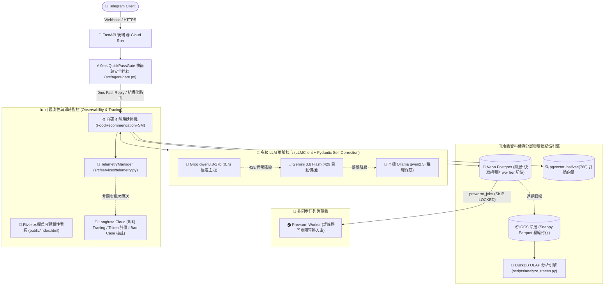
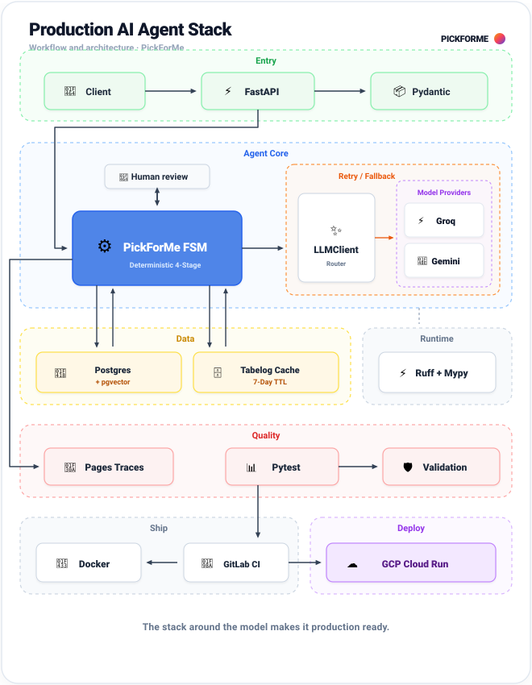
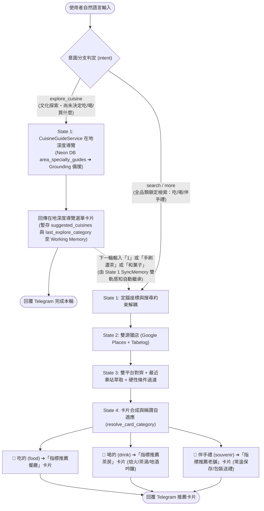

# 🍱 PickForMe - 日本美食 AI Agent 實作計畫書 (V2.0 完整版)

> **專案定位**：專為日本旅遊設計的智慧美食代理人（AI Agent）。解決外出時「距離近、評分高、有開門、評論符合偏好」的搜尋痛點。對外作為 DS 轉 AI 工程師的作品集，展示自研確定性 4 階段有限狀態機 (FoodRecommendationFSM)、Neon + GCS 冷熱資料庫分層、Telegram 互動介面、電話優先實體匹配與四層自動化 Eval 評估框架。

> [!IMPORTANT]
> **系統全局導航與根因排查手冊 (System Blueprint & Debugging SOP)**：
> 凡涉及排查現場推薦異常、實體對齊決策或食評覆蓋時，請唯一參考 **[`docs/SOP_ROOT_CAUSE_DEBUGGING.md`](file:///c:/Users/User/OneDrive/文件/2026/PickForMe/docs/SOP_ROOT_CAUSE_DEBUGGING.md)**，內含 **「高精度多維全景河流圖 (Global Blueprint River)」**、**「6 維個案深入盤點矩陣」** 與 **「5 步根因排查 SOP」**。

---

## 📐 1. 系統整體架構 (System Architecture)

本系統採 **C4 Model** 之 Level 2 (Container) 設計，將使用者介面、確定性業務狀態機、多級 LLM 推論核心與冷熱分層儲存解耦：

### 🌐 全鏈路生產技術棧全景圖 (Production AI Agent Stack)

  

> **生產棧全景解讀**：本圖完整映射自生產級 AI Agent 架構標準（對齊 JamWithAI Production AI Agent Stack），收斂專案從 `Entry (FastAPI + Pydantic)`、`Agent Core (4-Stage FSM Engine + Multi-Provider LLM Router)`、`Data (Neon Postgres + Cache)`、`Quality (Pytest + Observability)`、`Runtime (UV + Ruff + Mypy)` 至 `Ship & Deploy (Docker + Cloud Run + Neon)` 之全鏈路貫通、雙向遙測與狀態反饋動線。亦可直接預覽 [互動式 HTML 版本](assets/production_ai_agent_stack.html) 或檢視 [原始參考規範圖](assets/production_ai_agent_stack_reference.jpg)。

> 註：關於 4 階段 FSM（State 1~4）內部之決策邏輯、階梯擴圈與 Early Stopping 瀑布流，詳見 **[第 3.D 節詳細狀態機流程圖](#d-完整-agent-決策大腦選擇與-4-階段-fsm-流程圖-agent-decision--4-stage-fsm-flowchart)**。

---

## 🗄️ 2. 資料庫 Schema 設計 (Neon Postgres + GCS 冷熱分層)

系統遵循 **SSOT (Single Source of Truth)** 原則，完整 DDL 定義收斂於 [`src/db/schema.sql`](file:///c:/Users/User/OneDrive/文件/2026/PickForMe/src/db/schema.sql)。

### 熱層：Neon Serverless Postgres (容量上限防護)
- **1 GB 免費額度與雙重水位線防護 (`auto_archive_by_watermark`)**：採用 `halfvec` 半精度向量節省 50% 儲存空間；每店最多保留 30 則評論 embedding；每次對話完成後於背景自動巡檢雙重水位線（預設熱層保留最新 `500` 筆 Runs 或 DB 總容量上限 `400 MB`），僅將超出門檻的最舊紀錄壓縮轉檔至 Parquet 歸檔（並在 Cloud Run 無狀態容器內具備 GCS 防刪安全鎖）。

| 資料表 | 用途 | 關鍵欄位 / 設計考量 |
| :--- | :--- | :--- |
| **`restaurants`** | 餐廳實體主檔 | 遵從 Google 條款僅永久儲存 `google_place_id`，其餘名稱座標由 Tabelog 授權資料為主；`phone` 為實體對齊關鍵索引。 |
| **`tabelog_cache`** | 雙平台評分快取 | 記錄 `tabelog_rating`、`match_confidence`、PayPay 支援與信用卡 JSONB。設有 7 天 TTL 過期機制。 |
| **`chat_sessions`** | 對話狀態與雙層記憶 (Two-Tier Memory) | 記錄 `last_location` (地理點位)、`last_recommended_ids` JSONB（內含 `current` 當輪推薦、`accumulated_seen_ids` 累積排除黑名單、`working_memory` (`last_cuisine`, `last_location`) 短期工作記憶與 `long_term_preferences` (`dietary_restrictions`, `payment_preferences`) 長期飲食禁忌/支付偏好）、`conversation_history` (保留 3 輪摘要)。 |
| **`prewarm_jobs`** | 離線預熱任務佇列 | 支援 `SKIP LOCKED` 並行領取，支援 `/prewarm <地名>` 任務狀態與 Telegram 完成推播。 |
| **`agent_runs` / `agent_steps`** | OTel 格式可觀測性 Trace | 記錄每次 Pipeline 總耗時、Token 消耗、狀態機各步驟的 Tool 輸入/輸出 Payload 與例外訊息。 |
| **`area_specialty_guides`** | 在地特色美食・飲品・伴手禮知識庫 | `(area_key, category)` 複合主鍵、`aliases` (JSONB GIN 索引)、`intro`、`specialties` (JSONB)、`source_tier` (`manual`/`grounding`)、`grounding_snippets`、`verified` |
| **`review_embeddings`** | 評論語意向量庫 | 支援 `pgvector` halfvec(768)，供 Phase B 跨語言品項檢索與老饕心得比對。 |

### 冷層：Google Cloud Storage (GCS) + DuckDB
- **資料檔案**：`gs://pickforme-cold-archive/traces/year=2026/month=10/*.parquet` (Snappy 壓縮檔)。
- **用途**：免連線 Live DB 即可使用 DuckDB 進行百萬級離線效能分析、Prompt A/B 評測與回歸實驗。

---

## 🛠️ 3. 核心決策與模組設計

### A. Telegram Bot 介面與同步 Webhook 處理
- **介面選擇**：Telegram Bot。白名單限制僅允許擁有者 User ID。
- **互動流程**：使用者每次發送位置與問句。Telegram 訊息不可編輯的限制由「同步 Webhook 編輯訊息」克服——連線期間即時編輯訊息顯示進度 (`🔍 搜尋 Google Places...` → `📊 抓取 Tabelog 評分...` → 最終推薦卡片)。
- **冪等性**：以 `update_id` 做去重，避免 Telegram 重送時觸發第二次 Agent 執行。超時時間上限設為 45 秒。

### B. Google ↔ Tabelog 雙層漏斗實體匹配器 (`src/services/entity_resolver.py`)
- **設計哲學**：拒絕脆弱的字串打地鼠正則，落實「Level 1 極速放行 + Level 2 智能語意裁決」：
  1. **Level 1: 0ms 規則快篩 (Fast-Path)**：
     - 電話號碼完全吻合 ➔ 直接判定命中 (`phone_exact`, 1.0)。
     - 核心品牌 Token 高度相符 (>= 0.85) ➔ 直接命中 (`rule_high`)。
     - 搜尋引擎首位店家主幹完全吻合 ➔ 信任搜尋結果首選 (`top1_core_match`, 0.92)。
  2. **Level 2: LLM 智能裁決 (Smart Arbiter)**：
     - 灰色地帶 (0.40 ~ 0.85)：異構店名、日英文夾雜、長品類修飾詞，自動由 Groq Qwen 3.8 27B（<300ms）或 Gemini 3.8 Flash 進行語意判定 (`llm_verify`)。
  3. **匹配失敗兜底**：標註「Tabelog 暫無評分，以 Google 為依據」，確保零幻覺。

### C. 全方位預熱 Worker 與官方權威深度爬蟲 (`src/worker/prewarm.py`, `src/services/authority_scraper.py`)
- **All-in-One 雙軌預熱架構 (Places 20 店快取 + 3D 文化導覽)**：
  - **核心架構共用**：`PrewarmWorker` 與即時查詢 FSM 管線底層共用同一套 `TabelogScraper`、`EntityResolver` 與 `LocalSpecialtyGuideService`。
  - **雙軌並行與故障隔離 (Partial Failure Isolation)**：
    1. 透過 `asyncio.gather` 同步並行執行：軌道 A 抓取並快取商圈前 20 家高評價餐廳與 Tabelog 評分；軌道 B 預熱該區域三維度深度文化導覽 (`food` 名物、`drink` 飲品/地酒、`souvenir` 必買伴手禮)。
    2. 內建部分故障隔離防護：當官方文化網站超時或剖析失敗時，餐廳快取照常完成並安全降級推播，任務永不中斷崩潰。
  - **效益雙贏**：
    1. **離峰批量入庫**：以安全間隔自動將熱門商圈（如札幌、函館、箱根）前 20 家名店與三維度在地文化寫入 Neon DB。
    2. **前台 0ms 秒回**：熱門商圈在真實用戶查詢（無論是查餐廳還是問文化特色）時 100% 命中 DB 快取，徹底免除外部爬蟲與 API 延遲。
  - **整合通知卡片**：預熱完成後主動向 Telegram 推播卡片，精選呈現 3 大美食、在地茶酒飲品與必買伴手禮，並附有一鍵複製問句引導。
- **官方權威深度爬蟲與階梯品質降級 (`src/services/authority_scraper.py`, `src/services/cuisine_guide.py`)**：
  - **權威域名過濾器 (Official Authority Filter)**：文化深度導覽透過 Yahoo Japan Grounding 檢索時，強制注入限定 `site:lg.jp OR site:or.jp` 語意約束（嚴格鎖定日本各都道府縣廳、市町村役所 `.lg.jp` 及地方觀光推進機構／公益社團法人 `.or.jp`，例如 `city.hakodate.hokkaido.jp`、`hakodate-kankou.com`），徹底杜絕內容農場與商業廣告軟文。
  - **三階品質備援 (Tiered Fallback)**：
    1. **Tier 1 (`curated`)**：人工專家深度考據之 JSON 種子資料庫（`config/local_specialties.json`）及資料庫高可信主檔。
    2. **Tier 2 (`grounding`)**：透過官方權威站點即時深度擷取並經 Pydantic 語意校驗提煉之結構化導覽，驗證後自動寫入 `area_specialty_guides`。
    3. **Tier 3 (`fallback`)**：長尾生僻地名之啟發式地域知識備援，確保導覽服務 100% 可用。
  - **SQL 優先級排序保證**：查詢資料庫時採用 `ORDER BY CASE source_tier WHEN 'curated' THEN 1 WHEN 'grounding' THEN 2 ELSE 3 END, id ASC`，確保最高可信度來源永遠優先呈現。
- **Telegram 廣域預熱防護 (Wide-Area Disambiguation Guardrail, `src/bot/handlers.py`)**：
  - **廣域主動收斂**：針對未具備具體市/車站之都道府縣級廣域指令（如 `/prewarm 北海道`、`/prewarm 長野`），0ms 攔截 Places 盲搜，主動回傳精選 3 大核心商圈（如札幌、函館、小樽）與「全部 / 取消」互動引導選單。
  - **雙層工作記憶防卡死**：透過 Working Memory 暫存 `pending_prewarm_options`，支援使用者輸入號碼（`1/2/3`）、`全部` 或 `取消`；若輸入越界數字或轉向正常對話/其他指令，系統自動重置並清除待確認狀態，無縫銜接後續處理，杜絕狀態機卡死風險。

### D. 完整 Agent 決策、大腦選擇與 4 階段 FSM 流程圖 (Agent Decision & 4-Stage FSM Flowchart)

```mermaid
flowchart TD
    Start(["1. 觸發來源: Telegram 訊息 / Prewarm Job"]) --> CheckType{"查詢類型判定"}

    %% 1. DevOps 排查路徑
    CheckType -- "@debug / /diagnose" --> DevOpsPath["DevOpsSubagent / agent_bridge_server.py"]
    DevOpsPath --> CheckLocalDB["檢查 Neon DB 狀態 & restaurants 筆數"]
    DevOpsPath --> CheckEnvKeys["檢查 API Keys 狀態"]
    DevOpsPath --> DevOpsReport["輸出 IDE Agent 遠端診斷報告卡片"] --> EndResponse(["完成回應 Telegram"])

    %% 2. 確定性 4 階段 FSM 狀態機流水線
    CheckType -- "美食搜尋 / 推薦 / 追問" --> FSMInit["FoodRecommendationFSM (src/agent/pipeline.py)"]

    subgraph State1 ["State 1: 0ms QuickPassGate 快篩、意圖解析與地理場景判定 (src/agent/stages/intent.py)"]
        FSMInit --> QuickPass["⚡ QuickPassGate 0ms 確定性快篩與安全絆線<br/>(攔截越獄/超長輸入/問候/道謝/店號追問/換一批/座標直搜)"]
        QuickPass -- "命中 Fast-Reply / 安全絆線" --> GateFastReply["0ms 極速秒回 / 安全防護攔截"] --> EndResponse
        QuickPass -- "命中 follow_up_index" --> AnswerDirect["由 chat_sessions 歷史候選資料直接回答<br/>0.5s 秒答，不重複調用 Places"] --> EndResponse
        QuickPass -- "未命中快篩 [Sanitized Context]" --> ParseIntent["Micro-LLM 結構化解析 + Pydantic Self-Correction<br/>(IntentOutput Schema 驗證 + 自動重試自癒)"]
        ParseIntent --> SyncMemory["Two-Tier Memory 雙軌感知與繼承<br/>(1/2/3 優先映射 suggested_locations，次之 suggested_cuisines；或繼承 pending_cuisine)"]
        SyncMemory --> CheckIntent{"意圖分支判定 (intent)"}
        CheckIntent -- "follow_up (店號/屬性追問)" --> AnswerDirect
        
        %% 探索特色美食/茶飲/伴手禮文化導覽 (explore_cuisine)
        CheckIntent -- "explore_cuisine (文化導覽)" --> ResolveExploreCat{"探索品類自適應 (explore_category)<br/>• food (正餐名物料理)<br/>• drink (名茶/地酒/咖啡)<br/>• souvenir (伴手禮/銘菓/老舖)"}
        ResolveExploreCat --> CuisineGuide["CuisineGuideService 知識庫導覽<br/>(Neon DB area_specialty_guides ➔ Grounding 備援)"]
        CuisineGuide --> ReturnGuideCard["回傳在地深度導覽選單卡片<br/>(寫入 suggested_cuisines 與 last_explore_category)"] --> EndResponse
        ReturnGuideCard -.->|"下一輪輸入「1」或「手刷濃茶」或「和菓子」<br/>(由 SyncMemory 雙軌感知自動繼承)"| ParseIntent

        CheckIntent -- "search / more (全品類鎖定檢索：吃/喝/伴手禮)" --> CheckPrefecture{"地理場景 1 判定：是否為廣域或模糊地點?<br/>is_location_ambiguous (靜岡/長野/北海道/靜岡溫泉街)"}
        
        %% 場景 1: 廣域或跨聚落模糊區域
        CheckPrefecture -- "是 (廣域或跨聚落無單一 800m 中心)" --> DisambiguatePref["策略 A: LLM 動態主動反問收斂 (suggested_sub_areas)<br/>1. 微型 LLM 動態產出在地子商圈選單 (如熱海/修善寺或靜岡車站/濱松)<br/>2. 暫存 suggested_locations & pending_cuisine 於 Working Memory<br/>3. 回傳 Telegram 引導，下輪輸入 1/2/3 或城鎮名無縫接軌"] --> EndResponse
        DisambiguatePref -.->|"下一輪輸入「1/2/3」或城鎮名<br/>(由 SyncMemory 雙軌感知自動繼承)"| ParseIntent
        
        %% 場景 2 & 3: 進入座標定錨
        CheckPrefecture -- "否 (具體城鎮/景區/都會)" --> CheckCoord{"有無地理座標?"}
        CheckCoord -- "無座標" --> Geocode["Google Geocoding API<br/>地名轉 (lat, lng)"]
        CheckCoord -- "已有座標" --> S1Done["鎖定座標與搜尋約束解耦<br/>(resolve_search_constraints 分離料理/距離階梯/風格詞)"]
        Geocode --> S1Done
    end

    S1Done -->|"注入 FSMRunContext [Working Memory: accumulated_seen_ids Excluded]"| Progress1["Telegram 狀態推播 1:<br/>🔍 已鎖定 地點，正在搜尋評價優質的 種類 餐廳..."]

    subgraph State2 ["State 2: 雙源獵店與智慧階梯搜尋 (Tabelog-First Dual-Source & Ladder Search, src/agent/stages/places_search.py)"]
        Progress1 --> CheckGeoMode{"地理模式判定<br/>is_wide_area_origin(loc)"}
        
        %% 場景 2: 廣域景區
        CheckGeoMode -- "場景 2: 度假名勝/山區<br/>(箱根/輕井澤/草津溫泉/日光)" --> ScenicLadder["方案 2: 景區最近車站模式<br/>幾何中心距離懲罰歸零 (dist_penalty = 0.0)<br/>避免強羅名店因遠離町役場被無辜降權"]
        
        %% 場景 3: 都會點對點
        CheckGeoMode -- "場景 3: 都會商圈 / 具體車站<br/>(新宿/銀座/箱根湯本站)" --> UrbanLadder["標準點對點模式<br/>依物理半徑階梯梯隊搜尋 (800m ➔ 1200m ➔ 1800m)"]

        ScenicLadder --> DualSource["🌐 源頭 A: Tabelog 主動獵取地區高分/百名店 (discover_area_top_stores)<br/>📍 源頭 B: Google Places 階梯搜尋 (800m ➔ 1200m ➔ 1800m)"]
        UrbanLadder --> DualSource
        DualSource --> S2Select["雙源匯流預篩 Top 種子候選店<br/>(prefilter_potential_foodie_places: Tabelog 種子 100% 優先保送)"]
    end

    S2Select --> Progress2["Telegram 狀態推播 2:<br/>📊 正在彙整 Google 與 Tabelog 雙平台評分卡片..."]

    subgraph State3 ["State 3: Tabelog 交通手段解析、實體對齊與步行指引格式化 (src/agent/stages/enrichment.py)"]
        Progress2 --> ParallelGather["asyncio.gather 平行對齊 3~5 家候選店"]
        
        subgraph PerStore ["每家候選店對齊邏輯"]
            ParallelGather --> CheckCache{"Neon tabelog_cache 快取?"}
            CheckCache -- "🟢 快取命中 (TTL <= 7天)" --> HitCache["直接載入 Tabelog 評分與站點資訊"]
            CheckCache -- "🔴 快取未命中" --> FetchTabelog["TabelogScraper 抓取清單"]
            FetchTabelog --> CheckWaf{"403 WAF 阻擋 / 0筆?"}
            CheckWaf -- "Yes (WAF 觸發)" --> GroundingFallback["啟動 Web Grounding 搜尋備援<br/>(提取官方標準評分、評論數與百名店標章)"]
            CheckWaf -- "No (順利連線)" --> EntityResolver
            GroundingFallback --> EntityResolver["EntityResolver 雙層漏斗對齊<br/>(Tier 1: 0ms 規則快篩 ➔ Tier 2: LLM 模糊裁決)"]
            EntityResolver --> MatchCheck{"比對成功?"}
            MatchCheck -- Yes --> ScrapeDetail["解析評分/百名店/交通手段<br/>(STATION_WALK_PATTERN 萃取最近車站步行)"] --> SaveCache["寫入 Neon DB tabelog_cache 快取<br/>(後續查詢 0ms 永久命中)"]
            MatchCheck -- No --> FallbackGoogle["保底：標註「Tabelog 暫無評分，以 Google 為依據」"]
        end

        HitCache --> ConstraintSensor["🎯 Deterministic Constraint Sensor<br/>(apply_deterministic_constraints 硬性飲食禁忌/支付偏好降權)"]
        SaveCache --> ConstraintSensor
        FallbackGoogle --> ConstraintSensor
        ConstraintSensor --> AlignWalk["🚶 雙階地理步行描述對齊 (_align_walking_and_station / format_walking_description)<br/>• 場景 2 (景區): 從「強羅站」步行約 5 分鐘 (嚴禁拼接中心點 2800m 米數，杜絕 Usain Bolt 錯位)<br/>• 場景 3 (都會): 從「新宿」步行約 4 分鐘 (320m)"]
        AlignWalk --> S3Done["3 家店家雙平台資料彙整完成<br/>寫入 chat_sessions.last_recommended_ids (Two-Tier Memory)"]
    end

    subgraph State4 ["State 4: 推薦卡片合成、品類稱謂自適應與護欄防偽 (src/agent/stages/synthesis.py)"]
        S3Done --> ResolveCardCat{"消費品類自適應<br/>resolve_card_category(cuisine, category)"}
        ResolveCardCat -- "food (正餐美食)" --> CatFood["稱謂:「餐廳」<br/>徽章: 🍱 指標推薦餐廳<br/>標準美食排隊/口感點評風格"]
        ResolveCardCat -- "drink (名茶/地酒/咖啡)" --> CatDrink["稱謂:「茶房／名店」<br/>徽章: 🍵 指標推薦茶房<br/>專屬注入: 焙火、茶湯、咖啡豆香、地酒吟釀點評"]
        ResolveCardCat -- "souvenir (伴手禮/銘菓)" --> CatSouvenir["稱謂:「老舖／名店」<br/>徽章: 🎁 指標伴手禮老舖<br/>專屬注入: 常溫送禮、包裝、保存期限、名產特色點評"]

        CatFood --> LLMSynthesis["LLMClient 單次生成高美感卡片<br/>(注入品類指引 + 景區最近車站保護指引 + 廣域特派員提醒)"]
        CatDrink --> LLMSynthesis
        CatSouvenir --> LLMSynthesis

        LLMSynthesis --> CheckLLMResult{"LLM 生成成功?"}
        CheckLLMResult -- "成功 [Deterministic Gate: Scoped Overwrite & In-place Repair]" --> GuardrailCheck["🛡️ Scoped Anchor 區塊錨點護欄 & 原地修復<br/>(0.1ms 數值覆寫與 Code Block 原地修補)"]
        GuardrailCheck --> FinalCard["輸出零幻覺精選卡片<br/>店名獨立 Code Block + 🚶精準步行/車站指引 + 品類自適應稱謂與徽章"]
        CheckLLMResult -- 失敗 / 空回覆 --> TemplateFallback["純模板引擎自動防護直出 (render_template_fallback_card)<br/>自適應切換 🍱/🍵/🎁 徽章與「餐廳 / 茶房 / 老舖」實體稱謂"]
    end

    FinalCard --> EndResponse
    TemplateFallback --> EndResponse
```

### D.1 三大日本地理檢索場景與狀態流轉 (Three Core Geographic Routing Scenarios)

為了徹底根除「百公里廣域盲搜幾何中心」與「山區景區 5 分鐘走 2.8 公里 (Usain Bolt 錯位)」之長年頑疾，系統在 FSM 狀態機中確立了**三大核心地理場景分流**：

| 場景類型 | 典型輸入範例 | 狀態機判定依據 | 處置策略與流轉邏輯 | 步行指引與輸出效果 |
| :--- | :--- | :--- | :--- | :--- |
| **場景 1：廣域與模糊多聚落區域 (Tier 1 LLM 動態消歧義收斂)** | 「靜岡 鰻魚飯」 「長野 蕎麥麵」 「北海道 拉麵」 「靜岡溫泉街」 「長野滑雪」 | `is_location_ambiguous == True` （微型 LLM 世界知識動態判定，非硬編碼字典） | **策略 A：主動反問收斂 (State 1 攔截)** 1. 0 額外網路延遲（與意圖解析同次單一 Prompt 產出） 2. 微型 LLM 動態產出 2~3 個具代表性具體子商圈選單（如 1. 靜岡車站 / 2. 濱松 / 3. 沼津港；或 1. 熱海溫泉街 / 2. 修善寺溫泉街） 3. Working Memory 暫存 `suggested_locations` 與 `pending_cuisine` 4. 下一輪輸入「1/2/3」或城鎮名自動無縫繼承料理並鎖定檢索 5. 若 LLM 逾時或無子商圈，啟動 Fail-Open 安全直通 | 「🍱 靜岡幅員遼闊，建議先鎖定具體區域...」 （引導遊客精準定錨，杜絕跨 80 公里瞎搜市中心） |
| **場景 2：度假景區/多商圈山區 (Tier 2 景區導航)** | 「箱根 蕎麥麵」 「輕井澤 咖啡」 「草津溫泉 壽喜燒」 「日光 豆皮料理」 | `is_wide_area_origin(loc) == True` （命中景區且尾綴非「站/駅/口」） | **方案 2：景區最近車站提取模式 (State 2/3)** 1. State 2/3 豁免幾何中心距離扣分 (`dist_penalty = 0.0`)，保護偏遠名店 2. State 3 透過 `STATION_WALK_PATTERN` 萃取 Tabelog 交通手段之最近車站 3. `_align_walking_and_station` 格式化步行描述 4. State 4 注入廣域景區特派員提醒 | `🚶 步行距離：從「強羅站」步行約 5 分鐘` **嚴禁拼接廣域中心點大跨度米數** （杜絕「從「箱根」步行約 35 分鐘 (2800m)」） |
| **場景 3：都會商圈 / 具體車站 (標準點對點)** | 「新宿 拉麵」 「銀座 壽司」 「箱根湯本站 懷石」 「強羅車站 豆腐」 | `is_wide_area_origin == False` 且非縣級大區（或具備站點後綴） | **標準階梯半徑搜尋 (State 2/3)** 1. 以精準坐標或站點為起點，實施 800m ➔ 1200m ➔ 1800m 階梯擴圈 2. 嚴格計算距定位點之實際直線距離與物理步程 | `🚶 步行距離：從「新宿」步行約 4 分鐘 (320m)` `🚶 步行距離：從「箱根湯本站」步行約 3 分鐘 (240m)` （標準點對點，精準實用） |

### D.2 三大消費品類自適應：吃的、喝的與伴手禮 (Three Consumption Categories: Food, Drink, Souvenir)

為了避免向尋找百年抹茶或銘菓老舖的遊客推薦時出現「這家餐廳...」或關注「候位用餐桌數」等文案語境錯置，系統在 **State 1 導覽探索** 與 **State 4 卡片生成** 中建立了全管線的**三大消費品類自適應機制**：

| 品類代碼 | 中文意涵 | 關鍵字特徵集與辨識邏輯 | State 1 特色導覽行為 (`explore_cuisine`) | State 4 卡片稱謂與指導語 (`resolve_card_category`) | 保底模板徽章與引導語 |
| :--- | :--- | :--- | :--- | :--- | :--- |
| **`food`** | **吃的 (正餐料理)** | 拉麵、燒肉、壽司、鰻魚飯、居酒屋、天婦羅、懷石料理等正餐美食 | 查詢 Neon DB 在地名物料理（如靜岡鰻魚飯、宇治抹茶蕎麥麵），產出必吃料理選單 | • 實體稱謂：「餐廳」 • 焦點：排隊候位、老饕推薦菜品、Tabelog 評分分析 | 🍱 **已為您精選「熱門料理」指標推薦餐廳如下：** 「若想探索更多餐廳選擇，可隨時告訴我換個商圈！」 |
| **`drink`** | **喝的 (茶飲・酒・咖啡)** | 茶、咖啡、喫茶、カフェ、地酒、日本酒、酒吧、飲品、飲料、ほうじ茶、抹茶、煎茶、玉露、清酒 | 查詢在地茶文化或特色銘酒（如宇治抹茶、靜岡深蒸茶、新潟地酒），推薦知名茶屋與酒造 | • 實體稱謂：「茶房／名店」 • 專屬指導語：點評著重茶湯焙火香氣、咖啡豆烘焙或地酒吟釀風味，嚴禁套用正餐飯桌術語 | 🍵 **已為您精選「特色茶飲／咖啡」指標推薦茶房如下：** 「若想探索更多茶房或飲品選擇，可隨時告訴我換個商圈！」 |
| **`souvenir`** | **伴手禮 (名菓・銘菓・禮品)** | 伴手禮、名產、土產、お土産、みやげ、和菓子、銘菓、點心、蛋糕、落雁、煎餅、最中、羊羹、大福 | 查詢在地代表性土產銘菓（如京都生八橋、宇治抹茶點心、靜岡春華堂鰻魚派），產出必買伴手禮清單 | • 實體稱謂：「老舖／名店」 • 專屬指導語：點評著重包裝設計、常溫保存天數、送禮適宜度與百年老舖歷史，杜絕誤稱餐廳 | 🎁 **已為您精選「熱門伴手禮」指標推薦名店如下：** 「若想探索更多伴手禮與銘菓選擇，可隨時告訴我換個商圈！」 |

### E. Production AI 護欄體系：Agent Harness、確定性數值防偽與防規則漂移 (Agent Harness, Deterministic Guardrails & Contract Testing)
- **0ms 入口快篩與安全絆線 (`src/agent/gate.py` - `QuickPassGate`)**：
  - **前置確定性分流 (0ms Pre-Classifier)**：在進入 Stage 1 LLM 前，以 0ms 正則規則直接處理純問候 (`greeting`)、純道謝 (`thanks`)、Healthcheck 探針 (`__healthcheck__`)、指定店號追問 (`follow_up_index`: 第 1/2/3 家)、純換一批 (`pure_more`) 與日本國境經緯度直搜 (`coords_search`: `20.0<=lat<=46.0, 122.0<=lng<=154.0`)，大幅削減不必要之 LLM 呼叫與延遲。
  - **安全絆線防禦 (Security Tripwire)**：攔截超過 500 字元之異常超長輸入 (`tripwire_length`) 與典型 Prompt Injection 越獄字串 (`tripwire_injection`，如 `ignore previous instructions`、`無視先前的指令`)，0ms 直接回傳安全提示並寫入 `quick_pass_gate` Trace 審計步驟。
- **雙階日本地理智慧導航體系 (Two-Tier Geographic Hierarchy)**：
  - **Tier 1 縣級超大區域主動收斂 (策略 A, `src/agent/stages/intent.py`)**：
    - 識別未具備具體市/車站之都道府縣級廣域（如「靜岡」、「長野」、「北海道」、「沖繩」），0ms 攔截 Places 盲搜，回傳在地特色分區選單（如：1. 靜岡車站 / 2. 濱松 / 3. 沼津港）。
    - 透過 Working Memory 暫存 `suggested_locations` 與 `pending_cuisine`，支援下一輪輸入「1/2/3」或城鎮名（如「濱松」）無縫繼承料理需求並鎖定檢索。
  - **Tier 2 景區最近車站提取與無錯位步行指引 (方案 2, `src/agent/stages/places_search.py`, `src/services/tabelog_scraper.py`)**：
    - 針對度假景區/山區（「箱根」、「輕井澤」、「日光」等），擴充 Tabelog 交通手段爬蟲與 Yahoo Grounding 萃取最近車站步行指引（`STATION_WALK_PATTERN` / `STATION_DIST_PATTERN`）。
    - 在廣域景區模式下，直接輸出店家所屬最近車站步行指引（如「從『強羅站』步行約 5 分鐘」），嚴禁拼接廣域幾何中心點大跨度米數（杜絕 5 分鐘走 2.8 公里的 Usain Bolt 錯位 bug）。
    - 於 `calculate_foodie_score` 豁免廣域景區與持最近車站店家的中心點物理距離懲罰（`dist_penalty = 0.0`），保護偏遠名店不被降權。
    - 都心稠密商圈（新宿、澀谷、池袋、銀座）與具體車站（箱根湯本站）維持標準點對點導航，不誤殺不降級。
- **Pydantic v2 結構化合約與 Self-Correction 自癒迴圈 (`src/agent/schemas.py` & `src/agent/llm_client.py`)**：
  - **嚴格資料邊界校驗**：以 Pydantic v2 `BaseModel` 定義 `IntentOutput`（含 `target_index` 1~3 邊界、`dietary_restrictions`、`payment_preferences`）以及 `GeocodeArgs`、`SearchNearbyArgs`、`TabelogInfoArgs` 工具參數驗證。
  - **ValidationError 自癒重試 (Self-Correction Loop)**：`LLMClient.call_structured_json(messages, schema=IntentOutput, max_retries=1)` 在解析 JSON 後自動執行 Pydantic 驗證；若模型輸出違反 Schema（如欄位型別錯誤或非法枚舉值），自動將 `ValidationError` 詳細錯誤附加回對話訊息要求模型即時修正重試，重試仍失敗時平滑降級至安全預設結構。
- **Stage 3 確定性硬性條件感測器 (`src/agent/stages/enrichment.py` - `apply_deterministic_constraints`)**：
  - **硬性飲食與支付偏好掃描**：透過 `extract_preferences_from_text` 結合當輪 `modifier` 與跨輪 `long_term_preferences`（支援 `credit_card`、`paypay`、`不吃牛`、`不吃豬`、`不吃生食`、`不吃辣`），在 Stage 3 對候選店家的支付屬性與店名特徵進行確定性稽核。
  - **違規降權與自動重排**：一旦偵測到店家違反硬性條件（例如要求刷卡但店家為 `accepts_cash_only=True`，或忌牛卻為牛丼/燒肉名店），自動標記 `constraint_violation = True`，於 `calculate_foodie_score` 施加 `-0.45` 重度懲罰並重新執行 `rank_and_select_top_stores` 排序。
- **痛點與挑戰 (The Problem)**：
  - LLM 在生成高生動度推薦卡片時存在機率性微調數值幻覺（如將 3.78 筆誤寫成 3.70），高敏感美食評分失真將嚴重損害用戶信任。
  - 若使用二次 LLM 審核（LLM-as-a-Judge）會增加 >1s 延遲與 Token 成本；若使用寬鬆正則，極易誤傷內文中的非評分數值（如「排隊 3.5 小時」）。
- **Scoped Anchor 區塊錨點隔離護欄 (`src/agent/pipeline.py`)**：
  - **店家區塊隔離 (Per-Store Scoping)**：以店家序號與日文店名將 Markdown 切割為獨立片段，個別店家的比對校正互不干擾，杜絕跨店串位。
  - **前後雙向語境錨定 (Context Anchoring)**：精準錨定評分關鍵字與數值模式，內文數值 100% 受到上下文隔離保護。
  - **極致效能 (Zero Latency & Cost)**：純 Python 記憶體運算耗時 <0.5ms，0 額外 API 成本；格式異常時自動平滑回退至精準模板引擎。
- **State 4 推薦卡片類別自適應與老舖/茶房稱謂保護 (`src/agent/stages/synthesis.py`)**：
  - **多維度類別自適應 (`resolve_card_category`)**：依據 `explore_category` 或料理關鍵字自動判定 `food`（美食）、`drink`（特色茶飲/地酒/咖啡）與 `souvenir`（伴手禮/名菓/老舖）。
  - **老舖/茶房專屬指導語注入**：當對象為伴手禮或茶飲時，於 System Prompt 與保底模板中動態切換稱謂（以「名店／老舖／茶房」取代「餐廳」），並要求點評聚焦於包裝保存、常溫送禮或茶湯焙火風味，杜絕文案語境錯置。
- **卡片排版防禦與防誤殺體系 (`src/agent/validator.py`)**：
  - **版型合規稽核**：強制要求一鍵複製反引號店名、步行距離、雙平台評分與支付方式，杜絕鬆散未預期之表格語法。
  - **跨語言正規化容錯**：驗證器對店名實施空白與日繁漢字正規化，相容 Google 英文羅馬拼音與 LLM 還原漢字場景，避免誤殺合格卡片。
- **實體對齊漏斗與階梯備援 (`src/services/entity_resolver.py`)**：
  - **商圈錨定檢索**：自動附加搜尋區域以確保在地分店優先進榜；支援日本電話號碼精準檢索與階梯備援，杜絕搜尋雜訊阻斷。
  - **跨語言 Micro-LLM 智慧裁決**：當字面相似度因跨語系落差過大時，自動流向 Level 2 Micro-LLM，結合地址、品類與發音進行語意判定。
- **老饕潛力預篩、自適應查驗與重排演算法 (`src/agent/pipeline.py`)**：
  - **Google 記憶體端老饕潛力預篩 (State 2.5)**：Google Places 單次調用直取 20 筆周邊店家，在記憶體中依評分、評論數與距離綜合預篩出 4 筆主選與 2 筆備選種子。
  - **自適應漸進查驗與提早終止 (State 3.1 & 3.2)**：第一梯隊並行查驗 4 家；若高分名店（Tabelog $\ge 3.45$ 或百名店）$\ge 2$ 家即觸發 Early Stop 提早終止，多數場景 0 額外延遲；品質不足時動態查驗備選店家救援。
  - **$S_i$ 綜合老饕計分重排**：以 Tabelog 評分為核心權重（未命中時 Google 評分安全折算），疊加百名店/Award 加分、距離微幅懲罰與硬性條件違規懲罰 (`-0.45`)，精選 Top 3 店家並注入 `🥇/🥈/🥉` 排名徽章。
- **防腐保證：CI 雙向合約測試防禦 (Contract Testing in CI/CD)**：
  - 於 `tests/test_pipeline.py` 建立自動化合約測試，驗證 System Prompt 定義的排版格式與 Guardrail 錨點 100% 同步；任何提示詞變更若破壞了護欄合約，CI 立即報警阻擋合併。
- **即時監控：DevOps 遠端健康度巡檢 (`src/agent/devops.py`)**：
  - 於系統指標與 Telegram `@debug` 指令中整合「護欄對齊狀態」掃描，隨時可一鍵秒級檢核。
- **安全內部日誌診斷端點 (`/internal/diagnostics/logs`)**：
  - 以 `InMemoryLogBuffer` 環狀佇列攔截最新 WARNING 與 ERROR 日誌，結合 `TELEGRAM_WEBHOOK_SECRET` 密鑰授權，提供免 GCP Key 的即時容器除錯能力 (`scripts/fetch_live_logs.py`)。

### F. 工程維護品質與軟體最佳實踐 (Engineering & Maintainability Practices)
- **品質防線與 CI 守門 (Code Quality Gates)**：
  - **靜態檢查與型別標註**：全面採用 `ruff` (代碼規範/格式化) 與 `mypy` (Python 3.11 嚴格型別校驗)，確保程式碼可讀性與型別安全。
  - **自動化測試與覆蓋率**：建立覆蓋核心邏輯、Agent Harness 與黃金回歸案例之完整自動化測試集 (`tests/test_real_world_regressions.py`)，整合 `pytest-cov` Cobertura XML 報告與 GitLab CI/CD Pipeline (`.gitlab-ci.yml`)，未通過品質關卡禁止合併主線。
  - **全鏈路可觀測性看板 (Observability Pages & Design System)**：由 `src/eval/reporter.py` 載入獨立 HTML 模板 (`src/eval/templates/river_dashboard.html`) 生成現代 3-Pane 滿版全景河流圖看板 (`public/index.html`)，依循 [`docs/OBSERVABILITY_DESIGN_SYSTEM.md`](file:///c:/Users/User/OneDrive/文件/2026/PickForMe/docs/OBSERVABILITY_DESIGN_SYSTEM.md) 之 Draw.io 5 大語意形狀規範，達成 0 原始碼閱讀下的端到端即時架構透視。
- **高內聚低耦合架構解耦 (Modular FSM & Facade Orchestrator)**：
  - **狀態機管線與 Harness 模組化 (`src/agent/stages/`、`src/agent/gate.py`、`src/agent/schemas.py`)**：徹底根除單一巨大檔案 (God File)，`FoodRecommendationFSM` (`src/agent/pipeline.py`) 作為 Facade 調度器，協同 `gate.py` (`QuickPassGate` 0ms 入口快篩)、`schemas.py` (Pydantic v2 結構化合約與偏好抽取器) 與四大階段子模組：`stages/intent.py` (意圖、雙層記憶繼承與多輪追問)、`stages/places_search.py` (階梯擴圈與預篩)、`stages/enrichment.py` (Tabelog 雙平台並行補全、Deterministic Constraint Sensor 與老饕重排)、`stages/synthesis.py` (卡片合成與 Scoped Anchor 護欄)。
  - **前後端表現層分離 (`src/eval/templates/`)**：將 2,200+ 行之互動式 Dashboard HTML/CSS/JS 抽離至獨立模板檔，評估腳本僅專注於資料計算與填充，落實關注點分離 (Separation of Concerns)。
- **資安防護與存取控制 (Security & Access Control)**：
  - **Telegram Webhook Secret Token 驗證**：要求驗證 `X-Telegram-Bot-Api-Secret-Token` 標頭，防止惡意流量觸發 Cloud Run。
  - **白名單過濾**：以 `TELEGRAM_ALLOWED_USER_ID` 限制存取權限。
  - **GitLab Secret Detection**：引入 CI 密鑰洩漏檢測模板，確保 API Keys 不外洩。
- **線上可觀測性與即時監控 (Production Observability & Tracing)**：
  - **Langfuse Cloud 整合 (`src/services/telemetry.py`)**：將每次 Telegram 對話請求包裝為以動詞優先（`handle-user-request`）的頂層 Trace，各階段以標準 Span（`classify-intent`, `search-places`, `enrich-restaurants`, `synthesize-recommendations`, `handle-chitchat`, `explore-culture`）細緻化記錄，底層 LLM 呼叫記錄為 Generation，精準掌握模型降級、Token 消耗、延遲分佈與壞案例標註。
  - **Fail-Open 優雅降級與 0ms 離線 Mock 保證**：未填寫 API Key 或處於 `ENVIRONMENT=test` 時，自動啟用無侵入 NoOp 物件，確保單元測試 0 外部請求、0 延遲與 100% 業務隔離。
- **快取維護與雙層對話記憶 (Cache TTL & Two-Tier Session Memory)**：
  - **7 天 Tabelog 快取 TTL**：Neon DB 快取超過 7 天自動觸發背景爬蟲刷新，平衡評分即時性與抓取頻率。
  - **3 輪對話歷史記憶**：`chat_sessions` 自動保存最近 3 輪對話內容，支援自然語言追問（如「第 2 家有開嗎？」）。
  - **Two-Tier Memory 雙層記憶架構 (`src/db/repositories/session.py`)**：於 `chat_sessions.last_recommended_ids` JSONB 中同時維護短期工作記憶 `working_memory`（記錄 `last_cuisine`、`last_location` 與 `suggested_cuisines`，供 `"more"` 換一批及 `explore_cuisine` 在地特色美食導覽後的 `1`/`2`/`3` 或「直接推薦」點選無縫繼承）與跨輪長期偏好 `long_term_preferences`（持久化累積 `dietary_restrictions` 飲食禁忌與 `payment_preferences` 支付偏好，並向下相容舊版 List/Dict 格式）。
  - **混合雙層在地特色美食與文化導覽 (`src/services/cuisine_guide.py`, `config/local_specialties.json`)**：當使用者提出地區探索意圖 (`explore_cuisine`) 時，優先以 Tier 1 內建考據知識庫 0ms 回應，未命中之長尾日本車站則自動啟動 Tier 2 Yahoo Japan 網頁 Grounding + `AreaSpecialtyGuide` 結構化提煉，兼顧零歷史幻覺與全日本車站覆蓋。
- **OTel 格式 Trace 可觀測性 (Structured Observability & Trace Deep-Dive)**：
  - 每筆 Agent 執行同步記錄至 Neon `agent_runs` 與 `agent_steps`，量化分析 Model 降級率、Tool Latency (ms) 與 Token 成本。
  - **DuckDB 冷熱雙模歷程透視 CLI (`scripts/analyze_traces.py`)**：支援從冷層 Snappy Parquet 或 Neon DB 熱層一鍵提取近期問答清單，選定特定問答後即可輸出完整「端到端歷程透視報告」，包含提問句、最終回答卡片、中間每個 State 流程節點、個別耗時 (ms) 與精確之 Input/Output JSON 結構。
- **生產環境自動化上雲部署 (Cloud Run CI/CD & Auto-Deploy)**：
  - **自動化部署腳本 (`scripts/deploy_cloud_run.sh`)**：支援一鍵讀取環境變數與金鑰，呼叫 Google Cloud Build 構建容器映像檔並推送至 Artifact Registry，更新 Cloud Run 服務資源規格（1Gi 記憶體、1 CPU、0-5 自動水平伸縮），並支援 `--dry-run` 模擬演練與 `--setup-webhook` 自動綁定 Telegram Webhook。
  - **GitLab CI/CD 雲端管線 (`.gitlab-ci.yml`)**：於 `deploy` stage 配置 `deploy-cloud-run` job，整合 Google Cloud SDK，支援手動確認觸發 (`when: manual`) 或 Git Release Tag 自動發布。

