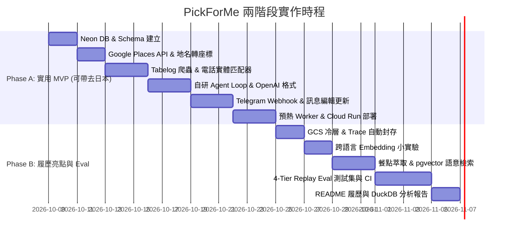

# 🍱 PickForMe - 日本美食 AI Agent 實作計畫書 (V2.0 完整版)

> **專案定位**：專為日本旅遊設計的智慧美食代理人（AI Agent）。解決外出時「距離近、評分高、有開門、評論符合偏好」的搜尋痛點。對外作為 DS 轉 AI 工程師的作品集，展示自研 Tool-calling Agent 迴圈、Neon + GCS 冷熱資料庫分層、Telegram 互動介面、電話優先實體匹配與四層自動化 Eval 評估框架。

---

## 📐 1. 系統整體架構 (System Architecture)

```mermaid
graph TD
    User(["Telegram App / 每次發送位置與問句"]) -->|Webhook| Server["FastAPI 後端 @ Cloud Run"]
    Server --> FSM["自研 4 階段 FSM 狀態機 (FoodRecommendationFSM)"]
    
    subgraph MultiTierLLM ["🧠 多級 LLM 推論核心 (LLMClient)"]
        Groq["🥇 Groq qwen3.8-27b (0.7s 極速主力)"]
        Gemini["🥈 Gemini 3.8 Flash (429 自動備援)"]
        Ollama["🥉 本機 Ollama qwen2.5 (離線保底)"]
        Groq -.->|429/異常降級| Gemini
        Gemini -.->|離線降級| Ollama
    end

    subgraph DeterministicPipeline ["⚡ 確定性 4 階段狀態機流水線"]
        FSM -->|1. 意圖辨識| S1["State 1: 使用者意圖與追問判斷<br/>(繼承歷史/換一批/modifier 抽取)"]
        S1 -->|2. 地圖搜尋| S2["State 2: Google Places 智慧階梯搜尋<br/>(800m~1800m ➔ 2500m 擴圈 + 累積排除已看過)"]
        S2 -->|3. 雙平台對齊| S3["State 3: Tabelog 雙平台實體對齊<br/>(asyncio.gather 平行處理 + 支付標記 + pgvector 重排)"]
        S3 -->|4. 生成卡片| S4["State 4: 最終美食卡片排版合成<br/>(日文店名Code區塊 + 🚶起點步行距離 + 💳支付)"]
        
        %% 明確標註 LLM 在哪裡被調用
        S1 ==>|"【LLM 呼叫 1】0.3s Micro-LLM 結構化意圖抽取"| MultiTierLLM
        S3 -.->|"【LLM 呼叫 2 (可選)】灰區 0.6~0.85 實體比對裁決"| MultiTierLLM
        S4 ==>|"【LLM 呼叫 3】單次 Prompt 高美感推薦卡片生成"| MultiTierLLM
        
        S4 --> Guardrail["🛡️ Scoped Anchor 毫秒級防偽護欄<br/>(0.1ms 數值校驗與自動矯正)"]
        Guardrail --> OutputCard["輸出零幻覺推薦卡片"]
        S4 -.->|LLM全斷線防護| Fallback["純 Python 模板引擎直出保底"]
    end
    
    subgraph StorageTiering ["🗄️ 冷熱資料儲存分層與向量引擎"]
        S3 --> HotDB[("Neon Postgres 熱層: 快取/餐廳/對話歷史")]
        S3 --> VectorDB[("pgvector: halfvec(768) 評論向量重排")]
        FSM -->|OTel 格式 Trace| HotDB
        HotDB -.->|背景歸檔 (Parquet)| ColdStorage[("本機/GCS 冷層: Parquet 壓縮檔")]
        ColdStorage --> DuckDBEngine["🦆 DuckDB OLAP 分析引擎 (analyze_traces.py)"]
    end

    subgraph AsyncWorker ["⚙️ 背景非同步處理"]
        HotDB -->|prewarm_jobs 佇列| LocalWorker["本機 Worker / 家用 IP 批次預熱"]
        DuckDBEngine --> TraceDeepDive["Pipeline 耗時瀑布流與 Deep-Dive"]
    end
```

---

## 🗄️ 2. 資料庫 Schema 設計 (Neon Postgres + GCS 冷熱分層)

### 熱層：Neon Serverless Postgres (上限與容量防護)
- **容量上限與防護**：1 GB 免費額度。採用 `halfvec` 半精度向量、每店最多存 30 則評論 embedding、原始 Trace 只留 14 天、每週自動清理，容量使用率達 70% 時自動發送 Telegram 通知。

```sql
-- 1. 餐廳基礎資料（遵從 Google 條款，只永久存 place_id；其餘店名座標使用 Tabelog）
CREATE TABLE restaurants (
    id UUID PRIMARY KEY DEFAULT gen_random_uuid(),
    google_place_id VARCHAR(255) UNIQUE NOT NULL, -- 唯一合規永久儲存欄位
    tabelog_url VARCHAR(500) UNIQUE,
    name_ja VARCHAR(255) NOT NULL,
    name_en VARCHAR(255),
    phone VARCHAR(50),                       -- 實體匹配關鍵特徵
    lat DOUBLE PRECISION NOT NULL,            -- 來自 Tabelog
    lng DOUBLE PRECISION NOT NULL,            -- 來自 Tabelog
    address TEXT,
    created_at TIMESTAMP WITH TIME ZONE DEFAULT NOW()
);

-- 2. Tabelog 分數與詳細資料快取
CREATE TABLE tabelog_cache (
    restaurant_id UUID PRIMARY KEY REFERENCES restaurants(id) ON DELETE CASCADE,
    tabelog_rating NUMERIC(3,2),
    review_count INT,
    price_lunch VARCHAR(50),
    price_dinner VARCHAR(50),
    match_confidence NUMERIC(3,2),            -- 匹配信心度 (0.00 ~ 1.00)
    match_method VARCHAR(50),                 -- 'phone_exact', 'rule_high', 'llm_verify'
    supports_paypay BOOLEAN DEFAULT FALSE,   -- PayPay 行動支付支援
    credit_cards JSONB DEFAULT '[]'::jsonb,   -- 支援之信用卡清單 (VISA, JCB...)
    updated_at TIMESTAMP WITH TIME ZONE DEFAULT NOW()
);

-- 3. 對話狀態與記憶 (Telegram)
CREATE TABLE chat_sessions (
    chat_id BIGINT PRIMARY KEY,
    last_location POINT,
    last_recommended_ids JSONB,               -- 存上一次推薦的店家編號 [id1, id2, id3]
    conversation_history JSONB,               -- 最近幾輪對話 (僅保留摘要)
    updated_at TIMESTAMP WITH TIME ZONE DEFAULT NOW()
);

-- 4. 預熱工作佇列 (SKIP LOCKED)
CREATE TABLE prewarm_jobs (
    id UUID PRIMARY KEY DEFAULT gen_random_uuid(),
    area_name VARCHAR(100) NOT NULL,
    status VARCHAR(20) DEFAULT 'pending',     -- 'pending', 'processing', 'completed', 'failed'
    target_count INT DEFAULT 20,
    chat_id BIGINT,                           -- 任務完成時主動推播通知的 Telegram Chat ID
    created_at TIMESTAMP WITH TIME ZONE DEFAULT NOW(),
    updated_at TIMESTAMP WITH TIME ZONE DEFAULT NOW()
);

-- 5. 自研 Agent Trace 與 Observability
CREATE TABLE agent_runs (
    run_id UUID PRIMARY KEY DEFAULT gen_random_uuid(),
    chat_id BIGINT,
    user_query TEXT,
    model_used VARCHAR(50),
    total_tokens INT,
    latency_ms INT,
    status VARCHAR(20),
    created_at TIMESTAMP WITH TIME ZONE DEFAULT NOW()
);

CREATE TABLE agent_steps (
    step_id UUID PRIMARY KEY DEFAULT gen_random_uuid(),
    run_id UUID REFERENCES agent_runs(run_id) ON DELETE CASCADE,
    step_number INT,
    action_type VARCHAR(50),                  -- 'llm_call', 'tool_call'
    tool_name VARCHAR(50),
    tool_input JSONB,
    tool_output JSONB,
    latency_ms INT,
    error_message TEXT,
    created_at TIMESTAMP WITH TIME ZONE DEFAULT NOW()
);

-- 6. Phase B: 評論與向量搜尋 (halfvec)
CREATE EXTENSION IF NOT EXISTS vector;

CREATE TABLE review_embeddings (
    id UUID PRIMARY KEY DEFAULT gen_random_uuid(),
    restaurant_id UUID REFERENCES restaurants(id) ON DELETE CASCADE,
    review_text_ja TEXT NOT NULL,
    review_text_zh TEXT,                     -- 可空，由 Phase B 跨語言小實驗決定
    embedding HALFVEC(768),                  -- halfvec 半精度向量省 50% 空間
    created_at TIMESTAMP WITH TIME ZONE DEFAULT NOW()
);

CREATE TABLE restaurant_insights (
    restaurant_id UUID PRIMARY KEY REFERENCES restaurants(id) ON DELETE CASCADE,
    top_dishes JSONB,                        -- [{"name_ja": "特製つけ麺", "name_zh": "特製沾麵", "mentions": 42}]
    pros JSONB,
    cons JSONB,
    summary_zh TEXT,
    updated_at TIMESTAMP WITH TIME ZONE DEFAULT NOW()
);
```

### 冷層：Google Cloud Storage (GCS) + DuckDB
- **資料檔案**：`gs://pickforme-cold-archive/raw_reviews/*.json.gz` (原始抓取內容) 與 `gs://pickforme-cold-archive/traces/year=2026/month=10/*.parquet` (過期轉檔 Trace)。
- **用途**：免重新爬蟲即可重跑評測、修改 Prompt、或用 DuckDB 做離線 DS 分析。

---

## 🛠️ 3. 核心決策與模組設計

### A. Telegram Bot 介面與同步 Webhook 處理
- **介面選擇**：Telegram Bot。白名單限制僅允許擁有者 User ID。
- **互動流程**：使用者每次發送位置與問句。Telegram 訊息不可編輯的限制由「同步 Webhook 編輯訊息」克服——連線期間即時編輯訊息顯示進度 (`🔍 搜尋 Google Places...` → `📊 抓取 Tabelog 評分...` → 最終推薦卡片)。
- **冪等性**：以 `update_id` 做去重，避免 Telegram 重送時觸發第二次 Agent 執行。超時時間上限設為 45 秒。

### B. Google ↔ Tabelog 雙層漏斗實體匹配器 (`src/services/entity_resolver.py`)
- **設計哲學**：拒絕脆弱的字串打地鼠正則，落實「Level 1 極速放行 + Level 2 智能語意裁決」：
  1. **Level 1: 0ms 規則快篩 (Fast-Path)**：
     - 電話號碼完全吻合 ➔ 直接判定命中 (`phone_exact`, 1.0)。
     - 核心品牌 Token 高度相符 (>= 0.85) ➔ 直接命中 (`rule_high`)。
     - 搜尋引擎首位店家主幹完全吻合 ➔ 信任搜尋結果首選 (`top1_core_match`, 0.92)。
  2. **Level 2: LLM 智能裁決 (Smart Arbiter)**：
     - 灰色地帶 (0.40 ~ 0.85)：異構店名、日英文夾雜、長品類修飾詞，自動由 Groq Llama 3.3 70B（<300ms）或 Gemini 3.8 Flash 進行語意判定 (`llm_verify`)。
  3. **匹配失敗兜底**：標註「Tabelog 暫無評分，以 Google 為依據」，確保零幻覺。

### C. 預熱與防封鎖機制 (`src/worker/prewarm.py`)
- **核心架構共用**：`PrewarmWorker` 與即時查詢 FSM 管線**底層共用同一套 `TabelogScraper` 與 `EntityResolver`**。
- **效益雙贏**：
  1. **離峰批量入庫**：以每 2 秒安全間隔自動將熱門商圈（如新宿、澀谷）前 20~50 家名店與 Tabelog 分數、老饕評論寫入 Neon DB。
  2. **前台 0ms 秒回**：熱門商圈店家在真實用戶查詢時 100% 命中 DB 快取，徹底免除外部爬蟲與 API 延遲。
- **觸發與推播**：使用者可透過 Telegram 傳送 `/prewarm <地名> [分類]` 直接發起預熱，完成後主動推播 Telegram 通知。

### D. 完整 Agent 決策、大腦選擇與 4 階段 FSM 流程圖 (Agent Decision & 4-Stage FSM Flowchart)


### E. Production AI 護欄體系：確定性數值防偽與防規則漂移 (Deterministic Guardrail & Contract Testing)
- **痛點與挑戰 (The Problem)**：
  - LLM 在生成高生動度富文本時存在機率性微調幻覺（例如將 DB 中的 3.78 評分筆誤寫成 3.70），高敏感美食評分失真將嚴重損害用戶信任。
  - 若使用二次 LLM 審核（LLM-as-a-Judge），會增加 1 秒以上的延遲與額外 Token 成本；若使用單純正則，又極易誤傷評論中的非評分數值（如「排隊 3.5 小時」、「3.5 天熬煮」）。
  - 正則規則容易隨著 Prompt 範本的迭代演進而產生靜默失效（Rule / Schema Drift）。
- **核心架構：Scoped Anchor 區塊錨點隔離護欄 (`src/agent/pipeline.py`)**：
  - **區塊隔離 (Per-Store Scoping)**：以店家序號與日文店名為界將 Markdown 切割為獨立片段，店家 1 的比對絕不影響店家 2，徹底排除跨店串位。
  - **前後雙向強關鍵字錨點 (Context Anchoring)**：只匹配 `(?:Tabelog|食べログ)[^\d\n]{0,25}?(\d\.\d{1,2})`，精準校正數值，內文的「排隊 3.5 小時」100% 受到語境保護不受影響。
  - **極致效能 (Zero Latency & Cost)**：純 Python 運算耗時 <0.5ms，0 額外 API 調用成本。
  - **Fail-Safe 兜底機制**：未匹配到錨點時維持原文，絕不盲目置換；若結構嚴重毀損自動降級為模板直出。
- **卡片排版防禦體系：嚴格版型驗證器 (`src/agent/validator.py`)**：
  - **拒絕未預期表格**：嚴格偵測並拒絕 Markdown 表格語法（`|---|`），確保不會退化成生硬表格。
  - **必備維度稽核**：強制要求一鍵複製反引號店名（`` `店名` ``）、步行距離（`🚶 **步行距離**`）、雙平台評分與支付方式（`💳 **支付方式**`）。
  - **State 4 自動回退**：若 LLM 產生的卡片未能通過驗證，自動降級為確定性精準模板卡片，保證送到使用者的排版永遠 100% 規範統一。
- **實體對齊強化：商圈錨定搜尋與跨語言 LLM 智慧裁決 (`src/services/entity_resolver.py`)**：
  - **商圈/地名搜尋錨定**：若 Google 店名未包含地名，Tabelog 搜尋自動附加使用者搜尋區域（如 `Mawashizushi KATSU 横浜`），確保在地分店 100% 擠入搜尋前席。
  - **拒絕脆弱大樓白名單 (Zero Hardcoded Whitelists)**：不維護易腐化的大樓名稱白名單，徹底避免同商場美食街張冠李戴之風險。
  - **羅馬拼音跨語言語意裁決**：針對英數 ASCII 店名與日文漢字候選者，自然流向 Level 2 Micro-LLM，由 Prompt 指引其結合地址、品類與發音綜合裁決，防止將「KATSU (活)」望文生義猜成炸豬排。
- **對話歷史淨化與反向問候意圖保底機制 (State 1 Sanitization & Inverse Greeting Guard)**：
  - 意圖解析時，將上一輪長篇推薦卡片（>100 字或含卡片格式）淨化為簡要摘要，杜絕微型 LLM 產生 Few-shot 模仿偏見導致輸出非 JSON。
  - **反向問候保底 (Inverse Greeting Fallback)**：不窮舉拉麵、壽司等特定菜品白名單，改為反向排除純打招呼問候語（`你好|早安|謝謝`），其餘任何實質提問一律安全保底為 `search`，確保天婦羅、鰻魚飯等百種料理 100% 進入檢索流程。
- **全日本 47 都道府縣行政區劃泛用正則**：
  - 採用 `(?:[^\d\s,，]{2,3}[都道府縣])?\s*([^\d\s,，]{2,6}?[市區町村島])`，完美覆蓋神戶（兵庫）、沖繩那霸、廣島、仙台（宮城）等全日本 47 個縣市，不再寫死任何地名。
- **維護保證：CI 雙向合約測試防禦 (Contract Testing in CI/CD)**：
  - 於 `tests/test_pipeline.py` 建立自動化合約測試，每次執行 `pytest` 或 `git push`（Pre-push Hook）時，自動驗證 `config/prompts/agent_system.md` 定義的關鍵字與 Guardrail 正則錨點是否 100% 同步。
  - 任何提示詞變更若破壞了護欄錨點，CI 立即報警阻擋合併，徹底根除規則隨時間腐化的維護盲點。
- **即時監控：DevOps 遠端健康度巡檢 (`src/agent/devops.py`)**：
  - 於系統指標與 Telegram `@debug` 指令中整合「護欄對齊狀態」掃描，隨時可一鍵秒級檢核。

### F. 工程維護品質與軟體最佳實踐 (Engineering & Maintainability Practices)
- **品質防線與 CI 守門 (Code Quality Gates)**：
  - **靜態檢查與型別標註**：全面採用 `ruff` (代碼規範/格式化) 與 `mypy` (Python 3.11 嚴格型別校驗)，確保程式碼可讀性與型別安全。
  - **自動化測試與覆蓋率**：建立 85 項覆蓋核心邏輯之單元與合約測試，整合 `pytest-cov` Cobertura XML 報告與 GitLab CI/CD Pipeline (`.gitlab-ci.yml`)，未通過品質關卡禁止合併主線。
- **資安防護與存取控制 (Security & Access Control)**：
  - **Telegram Webhook Secret Token 驗證**：要求驗證 `X-Telegram-Bot-Api-Secret-Token` 標頭，防止惡意流量觸發 Cloud Run。
  - **白名單過濾**：以 `TELEGRAM_ALLOWED_USER_ID` 限制存取權限。
  - **GitLab Secret Detection**：引入 CI 密鑰洩漏檢測模板，確保 API Keys 不外洩。
- **快取維護與對話記憶 (Cache TTL & Session Context)**：
  - **7 天 Tabelog 快取 TTL**：Neon DB 快取超過 7 天自動觸發背景爬蟲刷新，平衡評分即時性與抓取頻率。
  - **3 輪對話歷史記憶**：`chat_sessions` 自動保存最近 3 輪對話內容，支援自然語言追問（如「第 2 家有開嗎？」）。
- **OTel 格式 Trace 可觀測性 (Structured Observability & Trace Deep-Dive)**：
  - 每筆 Agent 執行同步記錄至 Neon `agent_runs` 與 `agent_steps`，量化分析 Model 降級率、Tool Latency (ms) 與 Token 成本。
  - **DuckDB 冷熱雙模歷程透視 CLI (`scripts/analyze_traces.py`)**：支援從冷層 Snappy Parquet 或 Neon DB 熱層一鍵提取近期問答清單，選定特定問答後即可輸出完整「端到端歷程透視報告」，包含提問句、最終回答卡片、中間每個 State 流程節點、個別耗時 (ms) 與精確之 Input/Output JSON 結構。

---

## 📅 4. 兩階段開發里程碑 (Phased Roadmap)



---

## 🎯 5. 履歷亮點展現 (README Preview)

```markdown
### 🌟 Tech Highlights
1. **Zero-Framework Custom Agent Engine**: Engineered a resilient, dual-model LLM tool-calling loop (Gemini Flash + Groq Llama 3.3 failover) with normalized OpenAI-compatible schemas, error-handling tool loops, and prompt-context budgeting.
2. **Hybrid Entity Resolution & Multi-Tier Storage**: Aligned store identities between Google Places and Tabelog via phone-number indexing, text normalization, and LLM gray-zone adjudication. Architected a hot/cold storage model combining Serverless Neon Postgres (`halfvec` pgvector) with GCS/DuckDB parquet archives.
3. **Progressive Telegram Interface & Safe Pre-warming**: Built a synchronous Webhook interface on Cloud Run leveraging Telegram message-editing streams for live execution progress, backed by a DB-driven asynchronous pre-warm worker to prevent scraping blocks.
4. **Production AI Guardrail & Contract-Driven Quality**: Engineered a sub-millisecond Scoped Anchor deterministic guardrail eliminating LLM numeric hallucinations on high-stakes ratings with 0 API overhead. Coupled with CI/CD bidirectional contract tests preventing prompt-schema drift across iterations.
5. **4-Tier Fixture-Replay Evaluation**: Established an automated evaluation pipeline measuring Tool Calling accuracy (94%), Constraint Satisfaction (98%), Entity Resolution F1 (0.93), and latency/cost metrics using recorded API fixtures.
```
