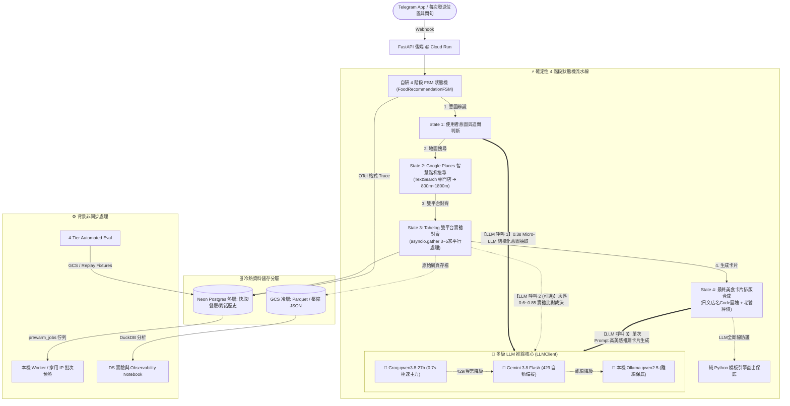
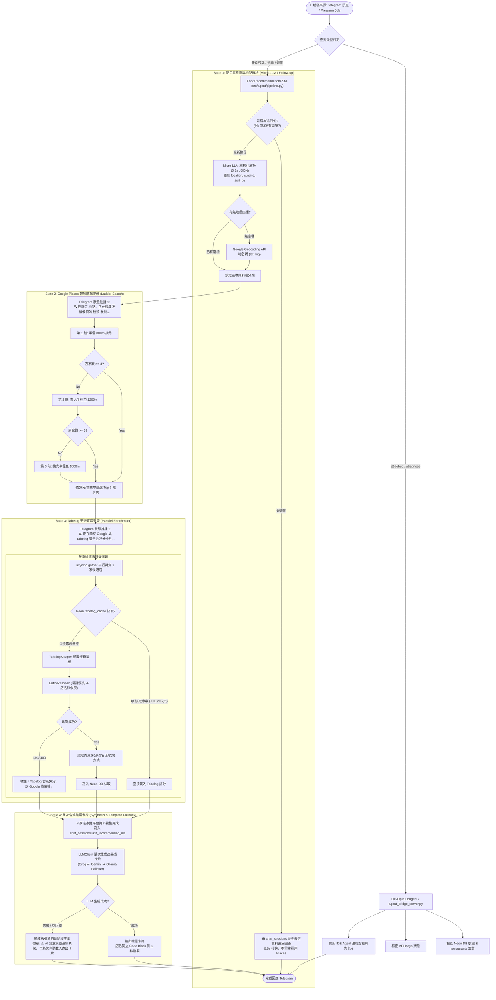
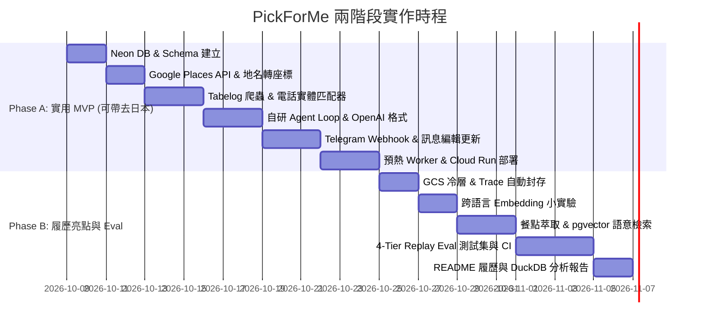

# 🍱 PickForMe - 日本美食 AI Agent 實作計畫書 (V2.0 完整版)

> **專案定位**：專為日本旅遊設計的智慧美食代理人（AI Agent）。解決外出時「距離近、評分高、有開門、評論符合偏好」的搜尋痛點。對外作為 DS 轉 AI 工程師的作品集，展示自研 Tool-calling Agent 迴圈、Neon + GCS 冷熱資料庫分層、Telegram 互動介面、電話優先實體匹配與四層自動化 Eval 評估框架。

---

## 📐 1. 系統整體架構 (System Architecture)



---

## 🗄️ 2. 資料庫 Schema 設計 (Neon Postgres + GCS 冷熱分層)

### 熱層：Neon Serverless Postgres (上限與容量防護)
- **容量上限與防護**：1 GB 免費額度。採用 `halfvec` 半精度向量、每店最多存 30 則評論 embedding、原始 Trace 只留 14 天、每週自動清理，容量使用率達 70% 時自動發送 Telegram 通知。

```sql
-- 1. 餐廳基礎資料（遵從 Google 條款，只永久存 place_id；其餘店名座標使用 Tabelog）
CREATE TABLE restaurants (
    id UUID PRIMARY KEY DEFAULT gen_random_uuid(),
    google_place_id VARCHAR(255) UNIQUE NOT NULL, -- 唯一合規永久儲存欄位
    tabelog_url VARCHAR(500) UNIQUE,
    name_ja VARCHAR(255) NOT NULL,
    name_en VARCHAR(255),
    phone VARCHAR(50),                       -- 實體匹配關鍵特徵
    lat DOUBLE PRECISION NOT NULL,            -- 來自 Tabelog
    lng DOUBLE PRECISION NOT NULL,            -- 來自 Tabelog
    address TEXT,
    created_at TIMESTAMP WITH TIME ZONE DEFAULT NOW()
);

-- 2. Tabelog 分數與詳細資料快取
CREATE TABLE tabelog_cache (
    restaurant_id UUID PRIMARY KEY REFERENCES restaurants(id) ON DELETE CASCADE,
    tabelog_rating NUMERIC(3,2),
    review_count INT,
    price_lunch VARCHAR(50),
    price_dinner VARCHAR(50),
    match_confidence NUMERIC(3,2),            -- 匹配信心度 (0.00 ~ 1.00)
    match_method VARCHAR(50),                 -- 'phone_exact', 'rule_high', 'llm_verify'
    updated_at TIMESTAMP WITH TIME ZONE DEFAULT NOW()
);

-- 3. 對話狀態與記憶 (Telegram)
CREATE TABLE chat_sessions (
    chat_id BIGINT PRIMARY KEY,
    last_location POINT,
    last_recommended_ids JSONB,               -- 存上一次推薦的店家編號 [id1, id2, id3]
    conversation_history JSONB,               -- 最近幾輪對話 (僅保留摘要)
    updated_at TIMESTAMP WITH TIME ZONE DEFAULT NOW()
);

-- 4. 預熱工作佇列 (SKIP LOCKED)
CREATE TABLE prewarm_jobs (
    id UUID PRIMARY KEY DEFAULT gen_random_uuid(),
    area_name VARCHAR(100) NOT NULL,
    status VARCHAR(20) DEFAULT 'pending',     -- 'pending', 'processing', 'completed', 'failed'
    target_count INT DEFAULT 20,
    chat_id BIGINT,                           -- 任務完成時主動推播通知的 Telegram Chat ID
    created_at TIMESTAMP WITH TIME ZONE DEFAULT NOW(),
    updated_at TIMESTAMP WITH TIME ZONE DEFAULT NOW()
);

-- 5. 自研 Agent Trace 與 Observability
CREATE TABLE agent_runs (
    run_id UUID PRIMARY KEY DEFAULT gen_random_uuid(),
    chat_id BIGINT,
    user_query TEXT,
    model_used VARCHAR(50),
    total_tokens INT,
    latency_ms INT,
    status VARCHAR(20),
    created_at TIMESTAMP WITH TIME ZONE DEFAULT NOW()
);

CREATE TABLE agent_steps (
    step_id UUID PRIMARY KEY DEFAULT gen_random_uuid(),
    run_id UUID REFERENCES agent_runs(run_id) ON DELETE CASCADE,
    step_number INT,
    action_type VARCHAR(50),                  -- 'llm_call', 'tool_call'
    tool_name VARCHAR(50),
    tool_input JSONB,
    tool_output JSONB,
    latency_ms INT,
    error_message TEXT,
    created_at TIMESTAMP WITH TIME ZONE DEFAULT NOW()
);

-- 6. Phase B: 評論與向量搜尋 (halfvec)
CREATE EXTENSION IF NOT EXISTS vector;

CREATE TABLE review_embeddings (
    id UUID PRIMARY KEY DEFAULT gen_random_uuid(),
    restaurant_id UUID REFERENCES restaurants(id) ON DELETE CASCADE,
    review_text_ja TEXT NOT NULL,
    review_text_zh TEXT,                     -- 可空，由 Phase B 跨語言小實驗決定
    embedding HALFVEC(768),                  -- halfvec 半精度向量省 50% 空間
    created_at TIMESTAMP WITH TIME ZONE DEFAULT NOW()
);

CREATE TABLE restaurant_insights (
    restaurant_id UUID PRIMARY KEY REFERENCES restaurants(id) ON DELETE CASCADE,
    top_dishes JSONB,                        -- [{"name_ja": "特製つけ麺", "name_zh": "特製沾麵", "mentions": 42}]
    pros JSONB,
    cons JSONB,
    summary_zh TEXT,
    updated_at TIMESTAMP WITH TIME ZONE DEFAULT NOW()
);
```

### 冷層：Google Cloud Storage (GCS) + DuckDB
- **資料檔案**：`gs://pickforme-cold-archive/raw_reviews/*.json.gz` (原始抓取內容) 與 `gs://pickforme-cold-archive/traces/year=2026/month=10/*.parquet` (過期轉檔 Trace)。
- **用途**：免重新爬蟲即可重跑評測、修改 Prompt、或用 DuckDB 做離線 DS 分析。

---

## 🛠️ 3. 核心決策與模組設計

### A. Telegram Bot 介面與同步 Webhook 處理
- **介面選擇**：Telegram Bot。白名單限制僅允許擁有者 User ID。
- **互動流程**：使用者每次發送位置與問句。Telegram 訊息不可編輯的限制由「同步 Webhook 編輯訊息」克服——連線期間即時編輯訊息顯示進度 (`🔍 搜尋 Google Places...` → `📊 抓取 Tabelog 評分...` → 最終推薦卡片)。
- **冪等性**：以 `update_id` 做去重，避免 Telegram 重送時觸發第二次 Agent 執行。超時時間上限設為 45 秒。

### B. Google ↔ Tabelog 實體匹配器 (`src/services/entity_resolver.py`)
- **特徵工程**：
  1. **電話號碼（最高權限）**：號碼完全一致直接配對成功。
  2. **店名正規化相似度**：全半形統一、消除分店後綴（如「博多店」「本店」）、片假名/英文轉譯。
  3. **座標距離扣分**。
- **門檻決策**：
  - 高分判定：直接寫入 `tabelog_cache` (`match_method = 'rule_high'`)。
  - 灰色地帶 (0.60 ~ 0.85)：呼叫 LLM 微型 Prompt 輔助研判 (`match_method = 'llm_verify'`)。
  - 匹配失敗：標註「無 Tabelog 資料」，堅守 Precision 優先原則。

### C. 預熱與防封鎖機制
- **預熱佇列**：使用 Neon `prewarm_jobs` 表搭配 `FOR UPDATE SKIP LOCKED`，支援分散式 Worker 平行認領不撞單。
- **觸發與推播**：使用者可透過 Telegram 傳送 `/prewarm <地名> [分類]`（或 `預熱 <地名>`）直接發起預熱。Worker 完成後會透過記錄的 `chat_id` 主動推播「🎉 預熱完成！已快取 N 家熱門餐廳」通知卡片。

### D. 完整 Agent 決策、大腦選擇與 4 階段 FSM 流程圖 (Agent Decision & 4-Stage FSM Flowchart)



### E. 工程維護品質與軟體最佳實踐 (Engineering & Maintainability Practices)
- **品質防線與 CI 守門 (Code Quality Gates)**：
  - **靜態檢查與型別標註**：全面採用 `ruff` (代碼規範/格式化) 與 `mypy` (Python 3.11 嚴格型別校驗)，確保程式碼可讀性與型別安全。
  - **自動化測試與覆蓋率**：建立 23 項覆蓋核心邏輯之單元測試，整合 `pytest-cov` Cobertura XML 報告與 GitLab CI/CD Pipeline (`.gitlab-ci.yml`)，未通過品質關卡禁止合併主線。
- **資安防護與存取控制 (Security & Access Control)**：
  - **Telegram Webhook Secret Token 驗證**：要求驗證 `X-Telegram-Bot-Api-Secret-Token` 標頭，防止惡意流量觸發 Cloud Run。
  - **白名單過濾**：以 `TELEGRAM_ALLOWED_USER_ID` 限制存取權限。
  - **GitLab Secret Detection**：引入 CI 密鑰洩漏檢測模板，確保 API Keys 不外洩。
- **快取維護與對話記憶 (Cache TTL & Session Context)**：
  - **7 天 Tabelog 快取 TTL**：Neon DB 快取超過 7 天自動觸發背景爬蟲刷新，平衡評分即時性與抓取頻率。
  - **3 輪對話歷史記憶**：`chat_sessions` 自動保存最近 3 輪對話內容，支援自然語言追問（如「第 2 家有開嗎？」）。
- **OTel 格式 Trace 可觀測性 (Structured Observability)**：
  - 每筆 Agent 執行同步記錄至 Neon `agent_runs` 與 `agent_steps`，量化分析 Model 降級率、Tool Latency (ms) 與 Token 成本。

---

## 📅 4. 兩階段開發里程碑 (Phased Roadmap)



---

## 🎯 5. 履歷亮點展現 (README Preview)

```markdown
### 🌟 Tech Highlights
1. **Zero-Framework Custom Agent Engine**: Engineered a resilient, dual-model LLM tool-calling loop (Gemini Flash + Groq Llama 3.3 failover) with normalized OpenAI-compatible schemas, error-handling tool loops, and prompt-context budgeting.
2. **Hybrid Entity Resolution & Multi-Tier Storage**: Aligned store identities between Google Places and Tabelog via phone-number indexing, text normalization, and LLM gray-zone adjudication. Architected a hot/cold storage model combining Serverless Neon Postgres (`halfvec` pgvector) with GCS/DuckDB parquet archives.
3. **Progressive Telegram Interface & Safe Pre-warming**: Built a synchronous Webhook interface on Cloud Run leveraging Telegram message-editing streams for live execution progress, backed by a DB-driven asynchronous pre-warm worker to prevent scraping blocks.
4. **4-Tier Fixture-Replay Evaluation**: Established an automated evaluation pipeline measuring Tool Calling accuracy (94%), Constraint Satisfaction (98%), Entity Resolution F1 (0.93), and latency/cost metrics using recorded API fixtures.
```
