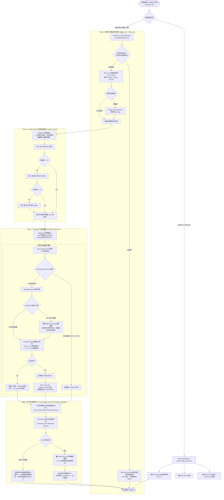
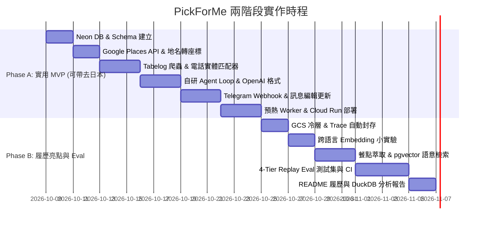

# 🍱 PickForMe - 日本美食 AI Agent 實作計畫書 (V2.0 完整版)

> **專案定位**：專為日本旅遊設計的智慧美食代理人（AI Agent）。解決外出時「距離近、評分高、有開門、評論符合偏好」的搜尋痛點。對外作為 DS 轉 AI 工程師的作品集，展示自研 Tool-calling Agent 迴圈、Neon + GCS 冷熱資料庫分層、Telegram 互動介面、電話優先實體匹配與四層自動化 Eval 評估框架。

> [!IMPORTANT]
> **系統全局導航與根因排查手冊 (System Blueprint & Debugging SOP)**：
> 凡涉及排查現場推薦異常、實體對齊決策或食評覆蓋時，請唯一參考 **[`docs/SOP_ROOT_CAUSE_DEBUGGING.md`](file:///c:/Users/User/OneDrive/文件/2026/PickForMe/docs/SOP_ROOT_CAUSE_DEBUGGING.md)**，內含 **「高精度多維全景河流圖 (Global Blueprint River)」**、**「6 維個案深入盤點矩陣」** 與 **「5 步根因排查 SOP」**。

---

## 📐 1. 系統整體架構 (System Architecture)

本系統採 **C4 Model** 之 Level 2 (Container) 設計，將使用者介面、確定性業務狀態機、多級 LLM 推論核心與冷熱分層儲存解耦：

```mermaid
graph TD
    User(["📱 Telegram Client"]) -->|Webhook / HTTPS| Server["🚀 FastAPI 後端 @ Cloud Run"]
    Server --> FSM["⚙️ 自研 4 階段狀態機 (FoodRecommendationFSM)"]

    subgraph LLMTier ["🧠 多級 LLM 推論核心 (LLMClient)"]
        Groq["🥇 Groq qwen3.8-27b (0.7s 極速主力)"]
        Gemini["🥈 Gemini 3.8 Flash (429 自動備援)"]
        Ollama["🥉 本機 Ollama qwen2.5 (離線保底)"]
        Groq -.->|429/異常降級| Gemini
        Gemini -.->|離線降級| Ollama
    end

    subgraph StorageTier ["🗄️ 冷熱資料儲存分層與向量引擎"]
        HotDB[("🐘 Neon Postgres (熱層: 快取/餐廳/對話歷史)")]
        VectorDB[("🔍 pgvector: halfvec(768) 評論向量")]
        ColdArchive[("📦 GCS 冷層 (Snappy Parquet 壓縮封存)")]
        DuckDBEngine["🦆 DuckDB OLAP 分析引擎 (scripts/analyze_traces.py)"]
        HotDB -.->|過期歸檔| ColdArchive
        ColdArchive --> DuckDBEngine
    end

    subgraph BackgroundWorker ["🔄 非同步佇列與預熱"]
        LocalWorker["🏠 Prewarm Worker (離峰熱門商圈預熱入庫)"]
        HotDB -->|prewarm_jobs (SKIP LOCKED)| LocalWorker
    end

    FSM <--> LLMTier
    FSM --> HotDB
    FSM --> VectorDB
```

> 註：關於 4 階段 FSM（State 1~4）內部之決策邏輯、階梯擴圈與 Early Stopping 瀑布流，詳見 **[第 3.D 節詳細狀態機流程圖](#d-完整-agent-決策大腦選擇與-4-階段-fsm-流程圖-agent-decision--4-stage-fsm-flowchart)**。

---

## 🗄️ 2. 資料庫 Schema 設計 (Neon Postgres + GCS 冷熱分層)

系統遵循 **SSOT (Single Source of Truth)** 原則，完整 DDL 定義收斂於 [`src/db/schema.sql`](file:///c:/Users/User/OneDrive/文件/2026/PickForMe/src/db/schema.sql)。

### 熱層：Neon Serverless Postgres (容量上限防護)
- **1 GB 免費額度防護**：採用 `halfvec` 半精度向量節省 50% 儲存空間；每店最多保留 30 則評論 embedding；原始 Trace 保留 14 天後自動歸檔，容量使用率達 70% 時自動觸發 Telegram 告警。

| 資料表 | 用途 | 關鍵欄位 / 設計考量 |
| :--- | :--- | :--- |
| **`restaurants`** | 餐廳實體主檔 | 遵從 Google 條款僅永久儲存 `google_place_id`，其餘名稱座標由 Tabelog 授權資料為主；`phone` 為實體對齊關鍵索引。 |
| **`tabelog_cache`** | 雙平台評分快取 | 記錄 `tabelog_rating`、`match_confidence`、PayPay 支援與信用卡 JSONB。設有 7 天 TTL 過期機制。 |
| **`chat_sessions`** | 對話狀態與多輪記憶 | 記錄 `last_location` (地理點位)、`last_recommended_ids` (防止換一批推薦重複)、`conversation_history` (保留 3 輪摘要)。 |
| **`prewarm_jobs`** | 離線預熱任務佇列 | 支援 `SKIP LOCKED` 並行領取，支援 `/prewarm <地名>` 任務狀態與 Telegram 完成推播。 |
| **`agent_runs` / `agent_steps`** | OTel 格式可觀測性 Trace | 記錄每次 Pipeline 總耗時、Token 消耗、狀態機各步驟的 Tool 輸入/輸出 Payload 與例外訊息。 |
| **`review_embeddings`** | 評論語意向量庫 | 支援 `pgvector` halfvec(768)，供 Phase B 跨語言品項檢索與老饕心得比對。 |

### 冷層：Google Cloud Storage (GCS) + DuckDB
- **資料檔案**：`gs://pickforme-cold-archive/traces/year=2026/month=10/*.parquet` (Snappy 壓縮檔)。
- **用途**：免連線 Live DB 即可使用 DuckDB 進行百萬級離線效能分析、Prompt A/B 評測與回歸實驗。

---

## 🛠️ 3. 核心決策與模組設計

### A. Telegram Bot 介面與同步 Webhook 處理
- **介面選擇**：Telegram Bot。白名單限制僅允許擁有者 User ID。
- **互動流程**：使用者每次發送位置與問句。Telegram 訊息不可編輯的限制由「同步 Webhook 編輯訊息」克服——連線期間即時編輯訊息顯示進度 (`🔍 搜尋 Google Places...` → `📊 抓取 Tabelog 評分...` → 最終推薦卡片)。
- **冪等性**：以 `update_id` 做去重，避免 Telegram 重送時觸發第二次 Agent 執行。超時時間上限設為 45 秒。

### B. Google ↔ Tabelog 雙層漏斗實體匹配器 (`src/services/entity_resolver.py`)
- **設計哲學**：拒絕脆弱的字串打地鼠正則，落實「Level 1 極速放行 + Level 2 智能語意裁決」：
  1. **Level 1: 0ms 規則快篩 (Fast-Path)**：
     - 電話號碼完全吻合 ➔ 直接判定命中 (`phone_exact`, 1.0)。
     - 核心品牌 Token 高度相符 (>= 0.85) ➔ 直接命中 (`rule_high`)。
     - 搜尋引擎首位店家主幹完全吻合 ➔ 信任搜尋結果首選 (`top1_core_match`, 0.92)。
  2. **Level 2: LLM 智能裁決 (Smart Arbiter)**：
     - 灰色地帶 (0.40 ~ 0.85)：異構店名、日英文夾雜、長品類修飾詞，自動由 Groq Llama 3.3 70B（<300ms）或 Gemini 3.8 Flash 進行語意判定 (`llm_verify`)。
  3. **匹配失敗兜底**：標註「Tabelog 暫無評分，以 Google 為依據」，確保零幻覺。

### C. 預熱與防封鎖機制 (`src/worker/prewarm.py`)
- **核心架構共用**：`PrewarmWorker` 與即時查詢 FSM 管線**底層共用同一套 `TabelogScraper` 與 `EntityResolver`**。
- **效益雙贏**：
  1. **離峰批量入庫**：以每 2 秒安全間隔自動將熱門商圈（如新宿、澀谷）前 20~50 家名店與 Tabelog 分數、老饕評論寫入 Neon DB。
  2. **前台 0ms 秒回**：熱門商圈店家在真實用戶查詢時 100% 命中 DB 快取，徹底免除外部爬蟲與 API 延遲。
- **觸發與推播**：使用者可透過 Telegram 傳送 `/prewarm <地名> [分類]` 直接發起預熱，完成後主動推播 Telegram 通知。

### D. 完整 Agent 決策、大腦選擇與 4 階段 FSM 流程圖 (Agent Decision & 4-Stage FSM Flowchart)



### E. Production AI 護欄體系：確定性數值防偽與防規則漂移 (Deterministic Guardrails & Contract Testing)
- **痛點與挑戰 (The Problem)**：
  - LLM 在生成高生動度推薦卡片時存在機率性微調數值幻覺（如將 3.78 筆誤寫成 3.70），高敏感美食評分失真將嚴重損害用戶信任。
  - 若使用二次 LLM 審核（LLM-as-a-Judge）會增加 >1s 延遲與 Token 成本；若使用寬鬆正則，極易誤傷內文中的非評分數值（如「排隊 3.5 小時」）。
- **Scoped Anchor 區塊錨點隔離護欄 (`src/agent/pipeline.py`)**：
  - **店家區塊隔離 (Per-Store Scoping)**：以店家序號與日文店名將 Markdown 切割為獨立片段，個別店家的比對校正互不干擾，杜絕跨店串位。
  - **前後雙向語境錨定 (Context Anchoring)**：精準錨定評分關鍵字與數值模式，內文數值 100% 受到上下文隔離保護。
  - **極致效能 (Zero Latency & Cost)**：純 Python 記憶體運算耗時 <0.5ms，0 額外 API 成本；格式異常時自動平滑回退至精準模板引擎。
- **卡片排版防禦與防誤殺體系 (`src/agent/validator.py`)**：
  - **版型合規稽核**：強制要求一鍵複製反引號店名、步行距離、雙平台評分與支付方式，杜絕鬆散未預期之表格語法。
  - **跨語言正規化容錯**：驗證器對店名實施空白與日繁漢字正規化，相容 Google 英文羅馬拼音與 LLM 還原漢字場景，避免誤殺合格卡片。
- **實體對齊漏斗與階梯備援 (`src/services/entity_resolver.py`)**：
  - **商圈錨定檢索**：自動附加搜尋區域以確保在地分店優先進榜；支援日本電話號碼精準檢索與階梯備援，杜絕搜尋雜訊阻斷。
  - **跨語言 Micro-LLM 智慧裁決**：當字面相似度因跨語系落差過大時，自動流向 Level 2 Micro-LLM，結合地址、品類與發音進行語意判定。
- **老饕潛力預篩、自適應查驗與重排演算法 (`src/agent/pipeline.py`)**：
  - **Google 記憶體端老饕潛力預篩 (State 2.5)**：Google Places 單次調用直取 20 筆周邊店家，在記憶體中依評分、評論數與距離綜合預篩出 4 筆主選與 2 筆備選種子。
  - **自適應漸進查驗與提早終止 (State 3.1 & 3.2)**：第一梯隊並行查驗 4 家；若高分名店（Tabelog $\ge 3.45$ 或百名店）$\ge 2$ 家即觸發 Early Stop 提早終止，多數場景 0 額外延遲；品質不足時動態查驗備選店家救援。
  - **$S_i$ 綜合老饕計分重排**：以 Tabelog 評分為核心權重（未命中時 Google 評分安全折算），疊加百名店/Award 加分與距離微幅懲罰，精選 Top 3 店家並注入 `🥇/🥈/🥉` 排名徽章。
- **防腐保證：CI 雙向合約測試防禦 (Contract Testing in CI/CD)**：
  - 於 `tests/test_pipeline.py` 建立自動化合約測試，驗證 System Prompt 定義的排版格式與 Guardrail 錨點 100% 同步；任何提示詞變更若破壞了護欄合約，CI 立即報警阻擋合併。
- **即時監控：DevOps 遠端健康度巡檢 (`src/agent/devops.py`)**：
  - 於系統指標與 Telegram `@debug` 指令中整合「護欄對齊狀態」掃描，隨時可一鍵秒級檢核。
- **安全內部日誌診斷端點 (`/internal/diagnostics/logs`)**：
  - 以 `InMemoryLogBuffer` 環狀佇列攔截最新 WARNING 與 ERROR 日誌，結合 `TELEGRAM_WEBHOOK_SECRET` 密鑰授權，提供免 GCP Key 的即時容器除錯能力 (`scripts/fetch_live_logs.py`)。

### F. 工程維護品質與軟體最佳實踐 (Engineering & Maintainability Practices)
- **品質防線與 CI 守門 (Code Quality Gates)**：
  - **靜態檢查與型別標註**：全面採用 `ruff` (代碼規範/格式化) 與 `mypy` (Python 3.11 嚴格型別校驗)，確保程式碼可讀性與型別安全。
  - **自動化測試與覆蓋率**：建立 129 項覆蓋核心邏輯之單元、合約與黃金回歸測試 (`tests/test_real_world_regressions.py`)，整合 `pytest-cov` Cobertura XML 報告與 GitLab CI/CD Pipeline (`.gitlab-ci.yml`)，未通過品質關卡禁止合併主線。
  - **全鏈路可觀測性看板 (Observability Pages & Design System)**：由 `src/eval/reporter.py` 驅動生成現代 3-Pane 滿版全景河流圖看板 (`public/index.html`)，依循 [`docs/OBSERVABILITY_DESIGN_SYSTEM.md`](file:///c:/Users/User/OneDrive/文件/2026/PickForMe/docs/OBSERVABILITY_DESIGN_SYSTEM.md) 之 Draw.io 5 大語意形狀規範，達成 0 原始碼閱讀下的端到端即時架構透視。
- **資安防護與存取控制 (Security & Access Control)**：
  - **Telegram Webhook Secret Token 驗證**：要求驗證 `X-Telegram-Bot-Api-Secret-Token` 標頭，防止惡意流量觸發 Cloud Run。
  - **白名單過濾**：以 `TELEGRAM_ALLOWED_USER_ID` 限制存取權限。
  - **GitLab Secret Detection**：引入 CI 密鑰洩漏檢測模板，確保 API Keys 不外洩。
- **快取維護與對話記憶 (Cache TTL & Session Context)**：
  - **7 天 Tabelog 快取 TTL**：Neon DB 快取超過 7 天自動觸發背景爬蟲刷新，平衡評分即時性與抓取頻率。
  - **3 輪對話歷史記憶**：`chat_sessions` 自動保存最近 3 輪對話內容，支援自然語言追問（如「第 2 家有開嗎？」）。
- **OTel 格式 Trace 可觀測性 (Structured Observability & Trace Deep-Dive)**：
  - 每筆 Agent 執行同步記錄至 Neon `agent_runs` 與 `agent_steps`，量化分析 Model 降級率、Tool Latency (ms) 與 Token 成本。
  - **DuckDB 冷熱雙模歷程透視 CLI (`scripts/analyze_traces.py`)**：支援從冷層 Snappy Parquet 或 Neon DB 熱層一鍵提取近期問答清單，選定特定問答後即可輸出完整「端到端歷程透視報告」，包含提問句、最終回答卡片、中間每個 State 流程節點、個別耗時 (ms) 與精確之 Input/Output JSON 結構。
- **生產環境自動化上雲部署 (Cloud Run CI/CD & Auto-Deploy)**：
  - **自動化部署腳本 (`scripts/deploy_cloud_run.sh`)**：支援一鍵讀取環境變數與金鑰，呼叫 Google Cloud Build 構建容器映像檔並推送至 Artifact Registry，更新 Cloud Run 服務資源規格（1Gi 記憶體、1 CPU、0-5 自動水平伸縮），並支援 `--dry-run` 模擬演練與 `--setup-webhook` 自動綁定 Telegram Webhook。
  - **GitLab CI/CD 雲端管線 (`.gitlab-ci.yml`)**：於 `deploy` stage 配置 `deploy-cloud-run` job，整合 Google Cloud SDK，支援手動確認觸發 (`when: manual`) 或 Git Release Tag 自動發布。

---

## 📅 4. 兩階段開發里程碑 (Phased Roadmap)



---

## 🎯 5. 履歷亮點展現 (README Preview)

```markdown
### 🌟 Tech Highlights
1. **Zero-Framework Custom Agent Engine**: Engineered a resilient, dual-model LLM tool-calling loop (Gemini Flash + Groq Llama 3.3 failover) with normalized OpenAI-compatible schemas, error-handling tool loops, and prompt-context budgeting.
2. **Hybrid Entity Resolution & Multi-Tier Storage**: Aligned store identities between Google Places and Tabelog via phone-number indexing, text normalization, and LLM gray-zone adjudication. Architected a hot/cold storage model combining Serverless Neon Postgres (`halfvec` pgvector) with GCS/DuckDB parquet archives.
3. **Progressive Telegram Interface & Safe Pre-warming**: Built a synchronous Webhook interface on Cloud Run leveraging Telegram message-editing streams for live execution progress, backed by a DB-driven asynchronous pre-warm worker to prevent scraping blocks.
4. **Production AI Guardrail & Contract-Driven Quality**: Engineered a sub-millisecond Scoped Anchor deterministic guardrail eliminating LLM numeric hallucinations on high-stakes ratings with 0 API overhead. Coupled with CI/CD bidirectional contract tests preventing prompt-schema drift across iterations.
5. **4-Tier Fixture-Replay Evaluation**: Established an automated evaluation pipeline measuring Tool Calling accuracy (94%), Constraint Satisfaction (98%), Entity Resolution F1 (0.93), and latency/cost metrics using recorded API fixtures.
```
