# 🍱 PickForMe 系統全景圖與端到端根因排查 SOP (Root-Cause Debugging SOP)

本文檔定義了 PickForMe 的全局數據流轉全景、個案穿透盤點維度、以及排查與解決問題的標準作業程序（SOP），旨在徹底杜絕「修一個 Bug 冒出一個新 Bug」的短期打補丁行為。

---

## 🗺️ 第一部分：高精度多維全景河流圖 (Global System Blueprint River)

任何使用者請求，皆穿梭於外部 API、本地快取、實體對齊漏斗、食評覆蓋引擎、向量檢索與安全護欄之間：

```mermaid
flowchart TD
    subgraph Layer1 ["1. 意圖與結構化約束解析層"]
        UserMsg["Telegram 使用者輸入"] --> State1["State 1: Intent 解析"]
        State1 --> History["歷史對話摘要防偏見"]
        State1 --> Coords["Google Geocoding 取得座標"]
        State1 --> Constraint["resolve_search_constraints<br/>解耦料理名、半徑階梯與風格標籤"]
    end

    subgraph Layer2 ["2. 候選檢索與潛力預篩層"]
        Constraint --> Exclude["從 Session 載入已推薦黑名單"]
        Exclude --> State2["State 2: Google Places 智慧階梯搜尋<br/>(強制 languageCode: ja)"]
        State2 --> RawPlaces["取得原始 Places 資料<br/>含 Google 評分/5則評論/原生支付選項"]
        RawPlaces --> Prefilter["0ms 老饕潛力預篩<br/>挑選 Top 4 種子 + 2 備選"]
    end

    subgraph Layer3 ["3. 雙層漏斗實體對齊與快取層"]
        Prefilter --> CacheCheck{"Neon DB 7天快取命中?"}
        CacheCheck -- "是 (且行政區一致)" --> FastCache["0ms 快取直出"]
        CacheCheck -- "否" --> GroundingFirst["⚡ Grounding-First 檢索<br/>(避開純 HTTP 直爬 100% 403 撞牆，直達 Yahoo Grounding)"]
        GroundingFirst --> Funnel["Entity Resolver 雙層漏斗"]
        Funnel --> GeoVeto{"都道府縣一致?<br/>(郵區/市區補全/正則)"}
        GeoVeto -- "否 (跨縣市)" --> VetoDrop["🚫 一票否決 (Geo-Vetoed)"]
        GeoVeto -- "是" --> PhoneRule{"本地市話完全吻合?<br/>(排除0120/0800專線)"}
        PhoneRule -- "是" --> FastPass["0ms Level 1 完全通過"]
        PhoneRule -- "否" --> MicroLLM["Level 2 Micro-LLM 智慧裁決"]
        FastPass --> EnrichedStore["完成基礎評分與支付融合"]
        MicroLLM --> EnrichedStore
        VetoDrop --> FallbackGoogle["安全降級為 Google 評分"]
        EnrichedStore --> EarlyStop{"Tier 1 已有 >=2 家高分名店?"}
        EarlyStop -- "是" --> RankTop3["老饕綜合加權重排，挑選 Top 3"]
        EarlyStop -- "否" --> Tier2Rescue["啟動 Tier 2 備選店家查驗"]
        Tier2Rescue --> RankTop3
    end

    subgraph Layer4 ["4. 食評絕對優先覆蓋與 RAG 層"]
        RankTop3 --> TabelogURLCheck{"Top 3 店家是否有 Tabelog URL?"}
        TabelogURLCheck -- "是" --> FetchReviews["無條件平行呼叫 fetch_tabelog_reviews<br/>定向檢索 site:tabelog.com 口コミ"]
        TabelogURLCheck -- "否" --> KeepGoogle["保留 Google 評論 source=google"]
        FetchReviews --> FoundTabelog{"抓到 >=1 則老饕短評?"}
        FoundTabelog -- "是" --> Overrule["🔥 100% 覆蓋並取代 Google 評論<br/>標記 source=tabelog"]
        FoundTabelog -- "否" --> KeepGoogle
        Overrule --> EmbedRAG["Gemini Embedding 768維向量化"]
        KeepGoogle --> EmbedRAG
        EmbedRAG --> VectorSearch["pgvector Cosine 相似度語意重排"]
        VectorSearch --> BestHighlight["萃取最契合之食評亮點與血統標籤"]
    end

    subgraph Layer5 ["5. 卡片合成與執行期熔斷護欄層"]
        BestHighlight --> PromptBuild["Stage 4 Prompt 組合<br/>嚴格依據血統綁定標籤"]
        PromptBuild --> AntiPrompt["注入 No-Rating-As-Reason 禁令"]
        AntiPrompt --> CallLLM["LLM 文字生成卡片"]
        CallLLM --> ScopedAnchor["Scoped Anchor 評分雙向防偽校對"]
        ScopedAnchor --> Validator["validator.py 執行期排版與真實性掃描"]
        Validator --> VetoCheck{"違規評分套話 / 假店名 / 假連結?"}
        VetoCheck -- "是 (違規)" --> FailsafeTemplate["⚠️ 立即一票否決熔斷<br/>自動降級為確定性安全模板"]
        VetoCheck -- "否 (合格)" --> SafeCard["合格卡片"]
        FailsafeTemplate --> SendTelegram["推播至 Telegram 使用者"]
        SafeCard --> SendTelegram
    end
```

---

## 🔍 第二部分：6 維個案深入盤點矩陣 (6-Dimensional Case Audit Matrix)

當發生特定店家推薦異常時，必須依據全景圖填寫以下 6 大維度穿透分析：

| 維度 | 盤點核心檢視項 | 檢視與驗證標準 |
| :--- | :--- | :--- |
| **維度 1：原始資料源起點 (Google Places Payload)** | API 回傳了哪些原始欄位？有沒有預帶 reviews？支付欄位是什麼？是否強制 `languageCode="ja"`？ | 檢查 `address`、`phone`、`paymentOptions` 是否完整且無拼音混亂。 |
| **維度 2：快取與存活狀態 (Cache Lifecycle)** | 是 DB 快取命中還是 live 檢索？快取資料是否有過期、污染或跨區？ | 檢查 Neon DB `tabelog_cache` 的 `updated_at` 與行政區一致性。 |
| **維度 3：實體對齊決策 (Resolution Decision)** | 走的是電話快篩、規則比對、還是 Micro-LLM？有無行政區漂移？ | 檢查是否觸發 Geo-Veto、是否有郵遞區號/政令市補全、是否誤信 0120 虛擬專線。 |
| **維度 4：食評覆蓋合約 (Review Precedence)** | 該店家是否有觸發 `fetch_tabelog_reviews`？有沒有被假陰性短路？覆蓋了誰？ | 嚴格遵守「Tabelog 口コミ無條件覆蓋 Google 評論」，檢查 `source` 標籤是否精準。 |
| **維度 5：向量檢索與血統 (pgvector Lineage)** | 寫入向量庫的是哪種評論？檢索命中 highlight 的來源血統是否有完整保留？ | 確保 `ReviewItem.source` 血統貫穿到 Stage 4，杜絕中途遺失。 |
| **維度 6：卡片合成與護欄 (Synthesis & Guardrail)** | Prompt 標籤是否對齊？理由是否包含評分套話？有無觸發執行期熔斷？ | 檢查 `No-Rating-As-Reason` 禁令執行狀態與 `validator.py` 熔斷退回防線。 |

---

## 🔄 第三部分：端到端根因排查 5 步 SOP (The 5-Step Root-Cause SOP)

1. **步驟 1：依據全景圖，填寫【6 維個案深入盤點矩陣】**：
   - 逐一標註出該店家在「原始資料 ➡️ 快取 ➡️ 對齊 ➡️ 食評覆蓋 ➡️ 向量 ➡️ 護欄」的流轉狀態，找出最初發源點。
2. **步驟 2：執行 5-Whys 深度溯源**：
   - 追問 5 次為什麼，直到定位出是哪一項「資料合約」、「邊界假設」或「弱型別遺失」缺失。
3. **步驟 3：副作用矩陣評估 (Blast Radius Assessment)**：
   - 檢查改動會不會影響下游 State 4、快取相容性、或現有 121 題黃金回歸測試。
4. **步驟 4：合約與型別不變量先行 (Contract & Invariants First)**：
   - 先在 `src/models/` 建立強型別模型，定義不可打破的 System Invariants。
5. **步驟 5：Red-Green 測試固化與全域驗證**：
   - 先在測試集還原失敗（Red），實裝轉綠（Green），並執行全量測試確認無歷史倒退。

---

## 🏛️ 第四部分：機器 100% 物理守門四大硬約束 (Hard Pillars)

1. **型別物理封殺**：Mypy 嚴格型別檢查，以強型別 Pydantic/dataclass 取代易遺失欄位的弱型別 dict。
2. **架構合約測試**：專屬 `tests/test_invariants.py`，任何違背全鏈路覆蓋優先級的代碼一律紅燈中斷。
3. **執行期熔斷護欄**：`validator.py` 即時攔截評分套話、虛假連結與造假店名，自動退回安全確定性模板。
4. **本機物理阻斷**：Git Pre-Push Hook (`.git/hooks/pre-push`)，未全過者本機直接拒絕 push。
