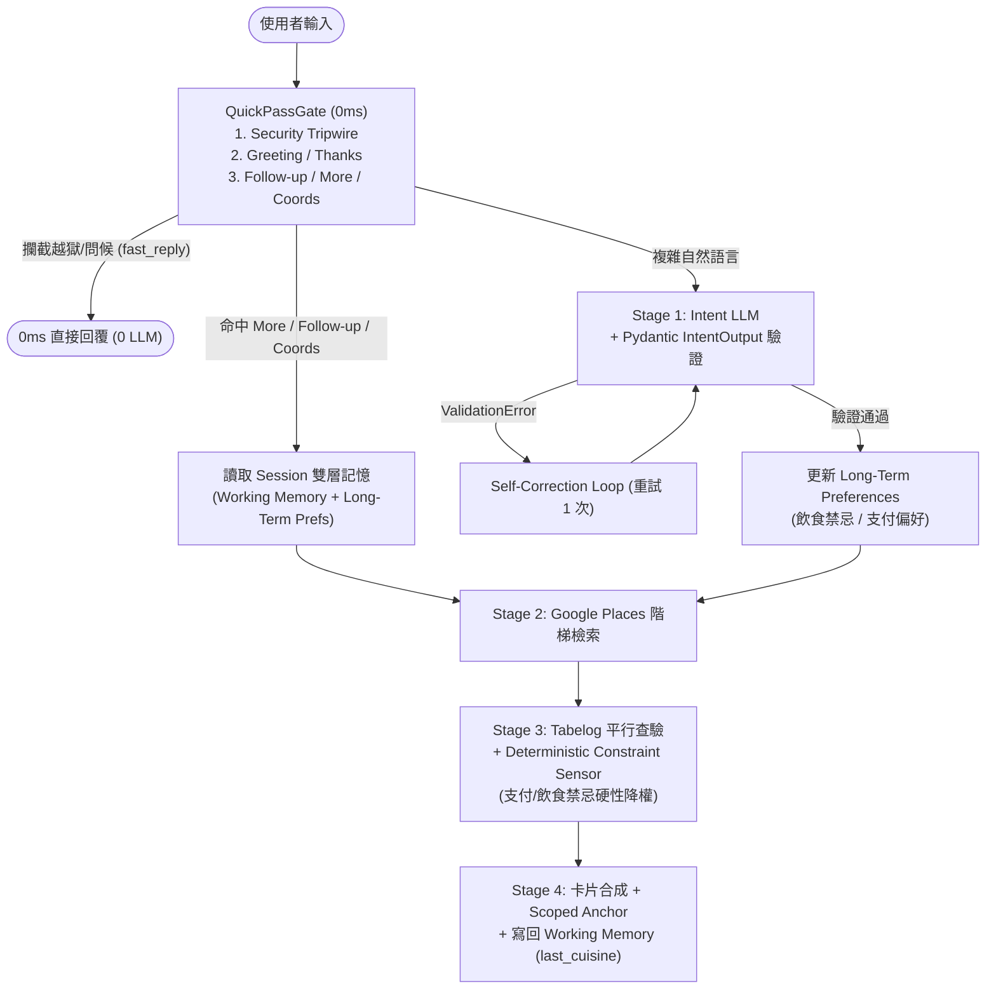

# PickForMe Agent Harness 三維度強化架構設計 (Design Document)

**日期**：2026-11-10  
**狀態**：已完成 (Completed)  
**作者**：Antigravity & User  
**主題**：Pre-Classifier `QuickPassGate`、Pydantic Schema 自癒與硬性條件防呆校驗、雙層記憶架構 (Working + Long-Term Memory)

---

## 1. 背景與意圖 (Intent & The Why)

借鏡生產級客服專案 `rem` 的架構設計與現代 **Agent Harness Engineering** 的核心標準，目前 PickForMe 雖已具備 Stage 4 自然語言卡片正則護欄 (`validator.py`) 與歷史卡片遮罩 (`sanitize_history_for_intent`)，但在以下三個生產級 Harness 維度仍有明顯升級空間：

1. **入口缺少 0ms 確定性快篩與安全絆線 (`QuickPassGate` & Input Tripwire)**：所有簡單指令（如「換一批」、「第2家有開嗎」、「你好/謝謝」）與潛在的越獄/超長惡意輸入皆無差別送入 Stage 1 LLM，造成不必要的延遲與 Token 消耗（例如一句「你好」會觸發 Stage 1 + Chitchat 共 2 次 LLM 呼叫）。
2. **防呆校驗缺乏結構化型別合約與硬性條件過濾 (Typed Validation & Deterministic Constraint Sensor)**：
   - Stage 1 意圖輸出與 `tools.py` 工具參數僅靠 `json.loads()` 與 `float()` 處理，缺乏 **Pydantic Schema 驗證** 與 **Self-Correction 自癒重試迴圈**。
   - Stage 3 重排僅看 Tabelog 評分與距離，若使用者要求「可刷卡 / PayPay」或「不吃牛」，缺乏 **Deterministic Constraint Sensor** 對違反硬性條件（如 `accepts_cash_only=True`）的店家進行降權或過濾。
3. **記憶層缺乏跨輪/跨 Session 的雙層持久化 (Two-Tier Memory Architecture)**：
   - `chat_sessions` 的 `conversation_history` 僅保留最近 3 輪，未結構化保存 **Working Memory**（上一輪 `last_cuisine`、`last_location`），也未持久化 **Long-Term Preferences**（跨 Session 的飲食禁忌如「不吃牛」、支付偏好如「要能刷卡/PayPay」）。

本設計將此三大模組整合為一體化的 **Agent Harness Upgrade**，在不破壞既有資料庫 DDL Schema 與測試集的前提下，實現毫秒級入口快篩、結構化自癒驗證與跨輪偏好記憶。

---

## 2. 目標、非目標與反目標 (Goals, Non-Goals, Anti-Goals)

### 目標 (Goals)
1. **實作 `QuickPassGate` 入口快篩與安全絆線 (`src/agent/gate.py`)**：
   - **Security Tripwire**：0ms 攔截超長輸入（`> 500` 字元）與典型 Prompt Injection 越獄字串，直接回傳安全提示，0 LLM 消耗。
   - **0-LLM 問候/感謝/探針秒回**：攔截 `__healthcheck__`、純問候（`你好`、`哈囉`、`hi` 等）與純道謝（`謝謝`、`感謝`），0ms 直接回傳親切引導模板，一次省下 Stage 1 與 Chitchat 兩次 LLM 呼叫。
   - **指定店號追問快篩 (`follow_up`)**：正則匹配 `^第?\s*([123一二三])\s*(?:家|間|號店?)`，0ms 直接鎖定 `intent="follow_up"` 與 `target_index=1|2|3`，跳過 Stage 1 LLM。
   - **純「換一批」快篩 (`more`)**：正則匹配純換批指令（`換一批`、`還有嗎`、`還有別家嗎`、`下一批`），0ms 直接結合 Working Memory 中的 `last_cuisine` 與 `last_location` 進入 Stage 2。
   - **經緯度座標快篩 (`search`)**：正則匹配 `lat, lng [cuisine]`，0ms 提取座標與料理詞，同時跳過 Stage 1 LLM 與 Google Geocoding API。
2. **實作 Pydantic Schema 驗證、Self-Correction 自癒迴圈與硬性條件檢驗**：
   - 新增 `src/agent/schemas.py`，定義 `IntentOutput`、`GeocodeArgs`、`SearchNearbyArgs`、`TabelogInfoArgs` 等 Pydantic v2 模型（含日本國境經緯度邊界與欄位校驗）。
   - 升級 `LLMClient.call_structured_json`：支援傳入 Pydantic `schema`；若解析或驗證失敗，自動將 `ValidationError` 組裝為錯誤反饋進行 1 次 **Self-Correction Retry**，失敗才退回安全保底。
   - 在 Stage 3 (`enrichment.py`) 新增 `apply_deterministic_constraints`：根據當輪 `modifier` 與跨輪 `long_term_preferences`（如要求信用卡/PayPay、飲食禁忌），對明確違反硬性條件（如 `accepts_cash_only=True`）的店家進行確定性降權或過濾。
3. **實作雙層記憶架構 (Working Memory + Long-Term Profile)**：
   - 擴充 `SessionRepository` (`src/db/repositories/session.py`) 的 `last_recommended_ids` JSONB 結構，向下相容既有格式，同時儲存：
     - `working_memory`: `{"last_cuisine": str, "last_location": str}`
     - `long_term_preferences`: `{"dietary_restrictions": list[str], "payment_preferences": list[str]}`
   - 使用者在對話中提及的偏好（如「我不吃牛」、「我要刷卡/PayPay」）會由確定性規則與 Stage 1 自動提取並寫入 `long_term_preferences`，跨輪、跨日持續生效。
4. **可觀測性與文件同步**：
   - 更新 `src/eval/reporter.py`、`public/index.html` 與 `docs/ARCHITECTURE.md`，反映 `QuickPassGate`、Pydantic 自癒與雙層記憶架構。

### 非目標 (Non-Goals)
- 不修改 PostgreSQL `schema.sql` 的資料表欄位結構（直接複用 `chat_sessions.last_recommended_ids` JSONB 欄位，達成零停機遷移）。
- 不將整個 4-Stage FSM 改寫為開放式無限迴圈 ReAct Agent（保留 FSM 的延遲可控性，但在各階段注入強型別與自癒 Harness）。

### 反目標 (Anti-Goals)
- `QuickPassGate` 嚴禁誤攔截帶有複雜新條件的句子（例如「換一批更平價的拉麵」含有新修飾語，必須放行給 Stage 1 LLM 解析，不可誤判為純 `more`）。
- 硬性條件過濾嚴禁在「所有候選店皆無支付資料」時把名單清空為 0 家（若全數未知或全數受罰，應透過降權排序而非硬性清空，保證推薦不中斷）。

---

## 3. 系統架構與方案決策 (Approaches & Architecture)

### 方案比較
| 方案 | 做法 | 取捨與結論 |
|---|---|---|
| **方案 A（採用）：FSM 內聚式 Harness 升級** | 新增 `src/agent/gate.py` 與 `src/agent/schemas.py`，整合進 `intent.py`、`llm_client.py`、`enrichment.py` 與 `session.py`。 | **優點**：Telegram 與未來的 LINE Bot 雙平台共享同一套 Gate、Schema 自癒與雙層記憶，且完整記入 `AgentTraceLogger`。 |
| **方案 B：Webhook 外掛式攔截 + 新增 DB 資料表** | 在 `handlers.py` 攔截正則，並另建 `user_preferences` SQL 表。 | **缺點**：雙平台邏輯重複，且需要執行雲端 DB Migration。 |

### 核心資料流 (Mermaid)

---

## 4. 詳細模組規格 (Module Specifications)

### 4.1 `src/agent/gate.py` (`QuickPassGate`)
- **資料結構 `GateResult`**：
  - `matched: bool`
  - `rule_name: Optional[str]` (`"tripwire_length"`, `"tripwire_injection"`, `"healthcheck"`, `"greeting"`, `"thanks"`, `"follow_up_index"`, `"pure_more"`, `"coords_search"`)
  - `parsed_intent: Optional[dict[str, Any]]`
  - `fast_reply: Optional[str]`
- **規則判定細節**：
  1. `len(text) > 500` 或匹配越獄正則 `(?i)(ignore\s+(all\s+)?previous\s+instructions|system\s+prompt|無視先前的指令|忽略上述指令)` ➡️ `matched=True, rule_name="tripwire_*", fast_reply="⚠️ 系統僅提供日本美食與餐廳推薦服務，請輸入您想尋找的日本城市或料理名稱。"`
  2. `text == "__healthcheck__"` ➡️ `fast_reply="PONG"`
  3. 純問候（`^(你好|您好|哈囉|嗨|早安|午安|晚安|hi|hello|hey)[！!~～嗎呢\s]*$`）或純道謝（`^(謝謝|感謝|多謝|謝謝你|太感謝了|thanks|thank you)[！!~～\s]*$`）➡️ `fast_reply` 對應親切引導語。
  4. 指定店號追問：匹配 `^第?\s*([123一二三])\s*(?:家|間|號店?)(.+)$` ➡️ `parsed_intent={"intent": "follow_up", "target_index": idx, "question": text}`。
  5. 純換一批：完全匹配 `^(換一批|還有嗎|還有別家嗎|再推薦幾家|下一批|換別家)[？?!！\s]*$` ➡️ `parsed_intent={"intent": "more", "location": None, "cuisine": None, "modifier": None}`（後續由 `execute_state_1_intent` 從 `working_memory` 自動補齊 `last_cuisine` 與 `last_location`）。
  6. 座標直搜：匹配 `^\s*(-?\d{1,2}\.\d+)\s*,\s*(-?\d{1,3}\.\d+)\s*(.*)$` ➡️ 檢查是否在日本合理座標範圍，直接回傳 `coords=(lat, lng)` 與 `cuisine`。

### 4.2 `src/agent/schemas.py` & `src/agent/llm_client.py` (Pydantic Schema & Self-Correction)
- **`IntentOutput(BaseModel)`**：
  - `intent: Literal["search", "more", "follow_up", "chitchat", "need_location"]`
  - `location: Optional[str] = None`
  - `cuisine: Optional[str] = None`
  - `modifier: Optional[str] = None`
  - `target_index: Optional[int] = Field(default=None, ge=1, le=3)`
  - `question: Optional[str] = None`
  - `dietary_restrictions: list[str] = Field(default_factory=list)`
  - `payment_preferences: list[str] = Field(default_factory=list)`
- **`GeocodeArgs` / `SearchNearbyArgs` / `TabelogInfoArgs`**：
  - 在 `SearchNearbyArgs` 驗證日本緯度 `20.0 <= lat <= 46.0`、經度 `122.0 <= lng <= 154.0`、半徑 `100 <= radius <= 5000`。
- **`extract_preferences_from_text(text: str) -> dict[str, list[str]]`**：
  - 確定性正則抽取飲食禁忌（`不吃牛`、`不吃豬`、`不吃生食`、`不吃辣`）與支付偏好（`credit_card`、`paypay`），與 LLM 輸出互補。
- **`LLMClient.call_structured_json(messages, schema=None, max_retries=1)`**：
  - 當傳入 `schema` 時，對解析出的 `dict` 執行 `schema.model_validate(data)`。
  - 若 `json.loads` 失敗或拋出 `ValidationError`，且尚有重試次數，自動將錯誤訊息附加至對話中進行 1 次自癒重試 (`Self-Correction`)。

### 4.3 `src/db/repositories/session.py` (雙層記憶 Working + Long-Term Memory)
- 在 `update_recommended_ids` 擴充選填參數 `last_cuisine: Optional[str] = None, last_location: Optional[str] = None`，將其存入 JSONB 的 `"working_memory"` 欄位，並保留既有的 `"long_term_preferences"` 不被覆蓋。
- 新增 `get_working_memory(chat_id) -> dict[str, Any]`：回傳 `{"last_cuisine": ..., "last_location": ...}`。
- 新增 `get_long_term_preferences(chat_id) -> dict[str, list[str]]` 與 `update_long_term_preferences(chat_id, dietary_restrictions, payment_preferences)`：自動合併去重並持久化使用者的長期飲食與支付偏好。

### 4.4 `src/agent/stages/enrichment.py` (Deterministic Constraint Sensor)
- 新增 `apply_deterministic_constraints(stores: list[dict[str, Any]], modifier: Optional[str] = None, preferences: Optional[dict[str, Any]] = None) -> list[dict[str, Any]]`：
  - 若使用者要求 `credit_card` 或 `paypay`（來自當輪 `modifier` 或長期 `preferences`）：
    - 檢查每家店的 `accepts_cash_only`、`credit_cards`、`supports_paypay`。
    - 若明確為「僅收現金 (`accepts_cash_only is True`)」或明確不支援指定支付方式，寫入 `store["constraint_violation"] = True` 並在 `calculate_foodie_score` 中扣除 `0.45` 分（確保符合支付條件的店家優先排在前面，同時避免全數未知時清空名單）。
  - 若使用者有飲食禁忌（如 `不吃牛`）：檢查店名與評論摘要是否為純牛肉專門店（如牛かつ、和牛燒肉），若是則標記 `constraint_violation = True` 並扣分降權。

