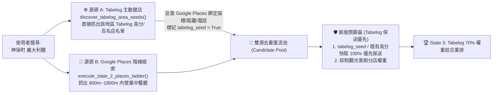

# Tabelog 雙源獵店與反向種子保送架構計畫 (Tabelog-First Dual-Source Discovery Plan)

> **建立日期**：2026-11-11  
> **狀態**：🟢 已完成 (Completed & Verified)  
> **核心痛點**：現行 State 2 (`src/agent/stages/places_search.py`) 完全依賴 Google Places API 回傳的 20 家清單，且 `prefilter_potential_foodie_places()` 以 `google_rating * 0.6` 進行預篩。在日本，許多 **Tabelog 3.65+ 或百名店** 的在地職人老店於 Google Maps 評分僅 `3.7 ~ 3.9` 星，導致它們在 State 2 就被 Google 4.6+ 星的觀光客網紅店擠出前 6 名種子，連進入 State 3 查驗 Tabelog 的機會都沒有。

---

## 🎯 架構目標：從「Google 篩選後查 Tabelog」升級為「Tabelog 主動提名 + Google 地理驗證雙源匯流」

---

## 🛠️ 分步實作規格 (Implementation Steps)

### Task 1: 新增 Tabelog 地區主動獵店方法 (`discover_area_top_stores`)
**目標檔案**：[`src/services/tabelog_scraper.py`](file:///c:/Users/User/OneDrive/文件/2026/PickForMe/src/services/tabelog_scraper.py)

1. 新增非同步方法 `discover_area_top_stores(area_name: str, cuisine: str, max_seeds: int = 3) -> list[dict[str, Any]]`：
   - 組合查詢詞：`site:tabelog.com {area_name} {cuisine}`，直接呼叫 `search_via_grounding()`。
   - 過濾並優先排序帶有 **百名店 (`hyakumeiten`)** 或 **`tabelog_rating >= 3.45`** 的單一店家專頁結果，回傳前 `max_seeds` 家 Tabelog 原生高分名店（含 `name_ja`, `tabelog_url`, `tabelog_rating`, `review_count`, `awards`）。

---

### Task 2: State 2 雙源平行檢索與 Google 地理座標錨定 (`_hydrate_tabelog_seeds_with_places`)
**目標檔案**：[`src/agent/stages/places_search.py`](file:///c:/Users/User/OneDrive/文件/2026/PickForMe/src/agent/stages/places_search.py)

1. 新增輔助函式 `_hydrate_tabelog_seeds_with_places(fsm, lat, lng, origin_name, keyword, max_radius, exclude_set)`：
   - 當有明確 `origin_name`（如 `"神保町車站"`、`"新宿"`）時，呼叫 `fsm.tabelog_scraper.discover_area_top_stores(origin_name, keyword, max_seeds=3)`。
   - 對抓出的每家 Tabelog 名店，平行呼叫 `fsm.places_client.search_by_text(query=f"{seed['name_ja']} {origin_name}", lat=lat, lng=lng, radius=max_radius, max_results=1)` 取得對應的 Google Place 資訊（`google_place_id`、精準經緯度、步行距離、電話與營業狀態）。
   - 使用 Haversine 球面距離驗證該店確實位於合理步行半徑（`<= max_radius`）且不在 `exclude_set` 黑名單內。
   - 將預先取得的 `tabelog_url`、`tabelog_rating`、`awards` 直接附掛於該候選店字典上，並標記 `"tabelog_seed": True`。
2. 在 [`execute_state_2_places_ladder()`](file:///c:/Users/User/OneDrive/文件/2026/PickForMe/src/agent/stages/places_search.py#L109) 中：
   - 以 `asyncio.gather` **平行啟動**「源頭 A（Tabelog 主動獵店）」與「源頭 B（Google 800m 階梯檢索）」，以 `google_place_id` 去重合併。

---

### Task 3: 改造 `prefilter_potential_foodie_places()` — 廢除 Google 觀光客高分綁架
**目標檔案**：[`src/agent/stages/places_search.py`](file:///c:/Users/User/OneDrive/文件/2026/PickForMe/src/agent/stages/places_search.py#L80-L106)

1. 重構 [`prefilter_potential_foodie_places()`](file:///c:/Users/User/OneDrive/文件/2026/PickForMe/src/agent/stages/places_search.py#L80) 評分公式：
   - **Tabelog 種子保送權重 (`+10.0`)**：凡具備 `p.get("tabelog_seed") is True` 或已知 `tabelog_rating >= 3.45` / `awards` 的店家，直接排在最前順位，保證 100% 進入 Top 6 種子名單，不受 Google 低分影響。
   - **日本在地老店保護曲線**：對於其餘 Google 候選店，將 Google 評分 `3.7 ~ 4.4` 視為日本常態優質區間（不再讓 `4.8` 星觀光客店以線性高權重輾壓 `3.8` 星日本老店），並結合距離權重選出剩餘種子。

---

### Task 4: State 3 快取直通優化與回歸測試
**目標檔案**：[`src/agent/stages/enrichment.py`](file:///c:/Users/User/OneDrive/文件/2026/PickForMe/src/agent/stages/enrichment.py) 與 [`tests/test_real_world_regressions.py`](file:///c:/Users/User/OneDrive/文件/2026/PickForMe/tests/test_real_world_regressions.py)

1. 在 [`enrich_single_place()`](file:///c:/Users/User/OneDrive/文件/2026/PickForMe/src/agent/stages/enrichment.py#L213) 中，若傳入的 `place` 已帶有 State 2 雙源檢索取得的 `tabelog_seed=True` 與有效 `tabelog_rating`，可直接免除重複的 Tabelog 清單搜尋，直接寫入快取並進入排名。
2. 新增回歸測試：模擬一家 **Google 僅 `3.8` 星（排在 Google 第 10 名）但 Tabelog 高達 `3.78` 分的百名店**，驗證在雙源獵店與新版預篩器下，該店能擊敗 Google `4.7` 星但 Tabelog 僅 `3.15` 分的觀光客店，穩居最終推薦第 1 名（🥇）！

