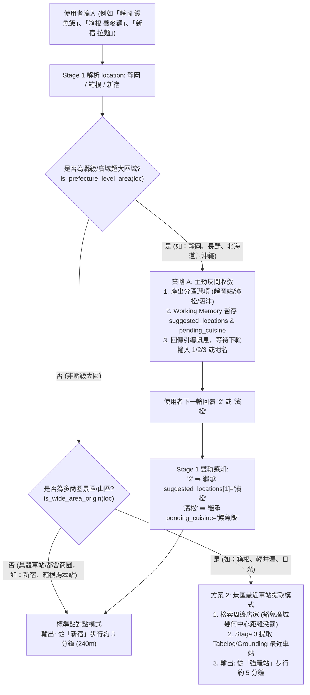

# 雙階日本地理智慧導航計畫：縣級超大區域主動收斂 (策略 A) + 景區最近車站導航 (方案 2)

> **目標**：
> 1. **Tier 1 (超大區域 - 縣級/廣域，如「靜岡」、「長野」、「北海道」、「沖繩」)**：徹底終結在 150 公里廣闊縣域隨機幾何中心盲搜的弊端，透過 **策略 A（主動反問收斂）** 引導使用者點選具體核心城市/車站（例如：靜岡 ➡️ 1. 靜岡車站 / 2. 濱松 / 3. 沼津），並將提問之料理與候選城鎮暫存於 Working Memory，支援下一輪輸入「1/2/3」或城鎮名無縫鎖定檢索。
> 2. **Tier 2 (中型景區 - 名勝山區，如「箱根」、「輕井澤」、「日光」)**：在已選定特定度假景區時，徹底根除「從『箱根』步行約 15 分鐘」之抽象中心點問題，透過 **方案 2（店家最近車站提取）**，從 Tabelog 交通手段 (Access) 與 Web Grounding 精準輸出「從『強羅站』步行約 5 分鐘」或「從『箱根湯本站』步行約 3 分鐘」，並在特派員提醒中提供分區引導。

---

## 🎯 痛點分析與使用者現況 (The Problem)

### 1. 縣級廣域盲搜問題（以「靜岡」為例）
- **現象**：使用者問「我想吃靜岡的鰻魚飯」，靜岡名物鰻魚飯最負盛名的是**濱松**或**三島**，但系統目前將「靜岡」Geocoding 到靜岡市公所，在周邊 1~2 公里盲搜，導致完全搜不到濱松名店；且若使用者人就在濱松，推薦靜岡市區的店（相距 80 公里）對遊客毫無價值。
- **解法 (策略 A)**：偵測到都道府縣級且未具備具體市/車站時，不進入 Places 搜尋，而是回傳專業且親切的分區選單（如：1. 靜岡車站、2. 濱松、3. 沼津/熱海），讓遊客秒級精準定錨。

### 2. 景區幾何中心步行錯位問題（以「箱根」為例）
- **現象**：使用者輸入「箱根 蕎麥麵」，系統計算店家距離箱根町公所中心點的距離，硬套模板輸出「從『箱根』步行約 15 分鐘 (1200m)」。但箱根山區各站（箱根湯本、強羅、仙石原、蘆之湖）相距甚遠，遊客想知道的是「離哪座車站走路幾分鐘」。
- **解法 (方案 2)**：從 Tabelog 店家交通手段或 Yahoo 摘要中提取最近車站（如「強羅站 徒歩5分」），在卡片中直接輸出「從『強羅站』步行約 5 分鐘」，並杜絕將中心點的大跨度米數（如 2800m）拼接到車站步行後面。

---

## 🏗️ 核心架構階層 (Two-Tier Geographic Hierarchy)



---

## 📋 模組分工與具體任務拆解 (Work Breakdown Structure)

### Task 1: 實作縣級超大區域主動收斂機制 (策略 A: Prefecture Disambiguation)

**檔案：**
- 修改：`src/agent/stages/intent.py`
- 修改：`src/agent/pipeline.py`
- 修改：`src/db/repositories/session.py`
- 修改：`tests/test_pipeline.py`

- [x] **Step 1: 定義縣級分區對照庫與判定函式 (`src/agent/stages/intent.py`)**
  - 新增 `PREFECTURE_DISAMBIGUATION_MAP`:
    - `靜岡/静岡`: `[{"name": "靜岡車站周邊", "desc": "駿府城、靜岡黑關東煮、在地海鮮", "search_loc": "靜岡車站"}, {"name": "濱松 / 濱名湖", "desc": "日本鰻魚名產地、濱松煎餃", "search_loc": "濱松車站"}, {"name": "沼津港 / 三島 / 熱海", "desc": "沼津直送海鮮丼、三島鰻魚、溫泉街", "search_loc": "沼津港"}]`
    - `長野`: `[{"name": "長野車站 / 善光寺", "desc": "信州手打蕎麥麵、辛口七味", "search_loc": "長野車站"}, {"name": "松本 / 安曇野", "desc": "松本山賊燒、信州和牛、馬肉料理", "search_loc": "松本車站"}, {"name": "輕井澤", "desc": "高原文藝喫茶、歐風烘焙、名物釜飯", "search_loc": "輕井澤車站"}]`
    - `北海道`: `[{"name": "札幌 / 薄野", "desc": "札幌味噌拉麵、成吉思汗烤羊肉、湯咖哩", "search_loc": "札幌車站"}, {"name": "函館", "desc": "函館鹽味拉麵、朝市活烏賊海鮮丼", "search_loc": "函館車站"}, {"name": "小樽 / 旭川", "desc": "小樽壽司街、旭川醬油拉麵", "search_loc": "小樽車站"}]`
    - `沖繩/沖縄`: `[{"name": "那霸市區 / 國際通", "desc": "沖繩麵、石垣牛牛排、島料理居酒屋", "search_loc": "國際通"}, {"name": "美國村 / 北谷 / 恩納村", "desc": "美式漢堡、阿古豬涮涮鍋、海景海鮮", "search_loc": "美國村"}, {"name": "名護 / 本部", "desc": "本部牛、百年古家岸本食堂", "search_loc": "名護"}]`
  - 實作 `is_prefecture_level_area(location: Optional[str]) -> tuple[bool, Optional[str]]`：
    - 若輸入僅為純縣名（無「站/駅/市/區」等具體後綴，例如「靜岡」或「靜岡縣」），判定為需要收斂 (`True, canonical_pref`)。
    - 若輸入為「靜岡車站」或「靜岡市葵區」，則為具體區域 (`False, None`)。
- [x] **Step 2: 產生反問導引與 Working Memory 儲存**
  - 當 `is_prefecture_level_area` 命中且非 `explore_cuisine` 意圖時：
    - 將 `intent` 標記為 `need_location`，並附帶 `need_location_prompt`。
    - 將各選項之 `search_loc` 存入 `working_memory.suggested_locations`，並保存 `working_memory.pending_cuisine = parsed["cuisine"]`。
- [x] **Step 3: 升級 `pipeline.py` 與 `SessionRepository` 支援動態反問與生命週期清除**
  - 在 `pipeline.py` 的 `if intent == "need_location":`：
    - 若 `parsed.get("need_location_prompt")` 存在，調用 `session_repo.update_working_memory(chat_id, suggested_locations=..., pending_cuisine=...)` 並回傳客製化引導訊息。
  - 在 `SessionRepository.update_working_memory`：
    - 擴充支援 `suggested_locations` 與 `pending_cuisine` 參數。
  - 在 `SessionRepository.update_recommended_ids`：
    - 當搜尋成功落庫時，同步清理 `suggested_locations` 與 `pending_cuisine`，杜絕過期選單殘留。
- [x] **Step 4: 修復 QuickPassGate「1/2/3」雙軌感知與城鎮名回覆接軌**
  - 在 `intent.py` 處理 `specialty_index` 時：
    - **優先感知 `suggested_locations`**：若命中，取出對應 `search_loc`，並將 `parsed["cuisine"]` 設為 `wm.get("pending_cuisine") or "熱門人氣美食"`，切換為 `intent = "search"`（絕不誤殺為 `follow_up`）。
    - 次之感知 `suggested_cuisines`。
  - 在 Stage 1 解析地名（如使用者直接回覆「濱松」）後：
    - 若 Working Memory 有 `pending_cuisine` 且當前輪次 `parsed["cuisine"]` 為預設值，強制繼承 `pending_cuisine`。

---

### Task 2: 建立景區最近車站辨識、無錯位步行描述與距離懲罰豁免 (方案 2: Nearest Station Guide)

**檔案：**
- 修改：`src/agent/stages/places_search.py`
- 修改：`src/agent/stages/enrichment.py`
- 修改：`tests/test_pipeline.py`

- [x] **Step 1: 實作 `is_wide_area_origin(origin_name: Optional[str]) -> bool`**
  - 定義 `WIDE_AREA_SCENIC_REGIONS = {"箱根", "伊豆", "輕井澤", "軽井沢", "日光", "草津", "有馬", "白濱", "白浜", "河口湖", "富士五湖", "由布院", "湯布院", "登別", "定山溪", "黑川", "黒川", "白馬", "富良野", "美瑛"}`。
  - 若結尾具備「站、駅、Station、口」等站點後綴，立即回傳 `False`（如「箱根湯本站」、「強羅車站」）。
  - 都會核心商圈（如 `新宿`、`澀谷`、`銀座`、`池袋`）絕不誤殺，維持標準點對點。
- [x] **Step 2: 實作 `format_walking_description(...)`（修正米數錯位盲點）**
  - 簽名：
    ```python
    def format_walking_description(
        origin_name: Optional[str],
        dist_m: int,
        walk_mins: int,
        nearest_station_desc: Optional[str] = None,
        address: Optional[str] = None,
    ) -> str:
    ```
  - 規則：
    1. 若非廣域景區：輸出 `從「{origin_name or '您目前位置'}」步行約 {walk_mins} 分鐘 ({dist_m}m)`。
    2. 若為廣域景區且有 `nearest_station_desc`（如 `從「強羅站」步行約 5 分鐘`）：
       **直接輸出 `{nearest_station_desc}`，嚴禁拼接廣域中心點之 `{dist_m}m`（杜絕 5 分鐘走 2.8km 的荒謬錯位）**。
    3. 若無車站但地址有子商圈（如 `箱根町強羅` ➡️ `強羅`）：
       輸出 `位於{origin_name}「{sub_area}」商圈 (距定位點約 {dist_m}m)`。
    4. 若皆無：輸出 `位於「{origin_name}」區域 (距定位點約 {dist_m}m)`。
- [x] **Step 3: 豁免廣域景區幾何中心距離扣分 (`src/agent/stages/enrichment.py`)**
  - 在 `calculate_foodie_score` 中：
    - 若 `is_wide_area_origin` 或店家已持有 `nearest_station_desc`，將中心點物理距離懲罰 `dist_penalty` 歸零，防止優質名店因遠離町役場被無辜降權。

---

### Task 3: 擴充 Tabelog 交通手段爬蟲與 Grounding 最近車站提取（含出口詞支援）(`src/services/tabelog_scraper.py`)

**檔案：**
- 修改：`src/services/tabelog_scraper.py`
- 修改：`tests/test_tabelog_scraper.py`

- [x] **Step 1: 在 `_parse_store_details` 擷取 Tabelog 交通手段 (`th: 交通手段 / アクセス`)**
  - 採用出口容忍度高、無鐵道公司依賴之泛用正則（支援 `正面口`、`北口`、`徒歩約`、`徒歩 Python`、`駅から Xm`）：
    ```python
    STATION_WALK_PATTERN = re.compile(
        r"([^\s\(\)（）「」]{2,10}?駅(?:[東西南北中央正面地下]*[口出口]*|\s*[A-Za-z0-9]+出口)?)(?:[^\d\n]{0,15}?)?(?:より|から)?\s*(?:徒歩|歩き)?\s*(?:で)?\s*(?:約)?\s*(\d{1,2})\s*分"
    )
    STATION_DIST_PATTERN = re.compile(
        r"([^\s\(\)（）「」]{2,10}?駅(?:[東西南北中央正面地下]*[口出口]*|\s*[A-Za-z0-9]+出口)?)(?:[^\d\n]{0,15}?)?(?:約)?\s*(\d{1,4})\s*m"
    )
    ```
  - 若命中則格式化為 `從「{station_name}」步行約 {mins} 分鐘`，存入 `nearest_station_desc`。
- [x] **Step 2: 在 `search_via_grounding` 支援從 Yahoo 摘要直接萃取車站步行**
  - 當從 Yahoo Grounding 獲得文字摘要時，套用上述 `STATION_WALK_PATTERN` 提取最近車站。

---

### Task 4: Stage 2/3 資料流貫通與 State 4 卡片生成對齊 (`src/agent/stages/`)

**檔案：**
- 修改：`src/agent/stages/places_search.py`
- 修改：`src/agent/stages/enrichment.py`
- 修改：`src/agent/stages/synthesis.py`

- [x] **Step 1: 貫通 Tabelog Seed 直通車資料流 (`_hydrate_tabelog_seeds_with_places`)**
  - 將 seed 的 `nearest_station_desc` 完整複製至 `place` 物件。
- [x] **Step 2: 在 `enrich_single_place` 整合 `nearest_station_desc` 並更新 `walking_desc`**
  - 若 `is_wide_area_origin(origin_name)`，呼叫 `format_walking_description` 更新 `place["walking_desc"]`。
- [x] **Step 3: State 4 推薦卡片提示詞與特派員提醒升級**
  - 提示詞指引：`「若店家資料中已標註所屬之最近車站或子商圈，請如實呈現該站點之步行指引，切勿將其竄改回廣域搜尋地標！」`
  - 廣域提醒：`（💡 特派員提醒：{location_name} 幅員廣闊、景點分散；若您人在特定車站或區域，亦可隨時告訴我指定區域以精準搜尋）`。

---

### Task 5: 完整回歸測試與 GitLab CI 守門驗證

**檔案：**
- 修改：`tests/test_real_world_regressions.py`
- 修改：`docs/ARCHITECTURE.md`
- 修改：`CHANGELOG.md`

- [x] **Step 1: 新增專屬回歸測試案例**
  - Case 1 (策略 A - 縣級大區反問)：輸入 `靜岡 鰻魚飯` ➡️ 驗證回傳包含「靜岡車站」、「濱松」、「沼津/三島」之分區引導，且 Working Memory 正確記錄 `suggested_locations` 與 `pending_cuisine`。
  - Case 2 (策略 A - 下一輪點選 2)：下一輪輸入 `2` ➡️ 驗證自動轉為搜尋 `濱松` 之 `鰻魚飯`，絕不誤殺為 `follow_up`。
  - Case 3 (策略 A - 下一輪輸入城鎮名)：下一輪輸入 `濱松` ➡️ 驗證自動繼承 `pending_cuisine="鰻魚飯"`。
  - Case 4 (方案 2 - 景區最近車站)：輸入 `箱根 蕎麥麵`，店家具備 `強羅駅 徒歩5分` ➡️ 驗證 `walking_desc` 輸出為 `從「強羅站」步行約 5 分鐘`，**絕無「從「箱根」步行」**且**絕無「(2800m)」等不合理中心點米數**。
  - Case 5 (具體站點不降級)：輸入 `箱根湯本站` ➡️ 驗證維持點對點 `從「箱根湯本站」步行約 X 分鐘`。
  - Case 6 (都心商圈不誤殺)：輸入 `新宿` ➡️ 驗證維持正常都心點對點步行描述。
- [x] **Step 2: 執行 100% CI 守門驗證**
  - `python -m ruff format src/ tests/`
  - `python -m ruff check src/ tests/`
  - `python -m mypy src/`
  - `pytest`
  - `python scripts/run_eval.py`
  - 同步更新架構圖與版本日誌，確保零文件滯後。
