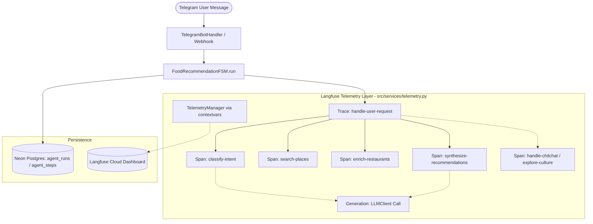

# 📋 Langfuse Online Observability Integration Plan (Approved with Subagent Review Adjustments)

## 🎯 Objective
Integrate **Langfuse Python SDK** into PickForMe for production-grade real-time tracing, LLM cost/token monitoring, and bad-case collection, strictly adhering to:
1. **Langfuse Official Best Practices** (`github.com/langfuse/skills`):
   - Trace per chatbot turn, bound by `session_id` and `user_id`.
   - Verb-first static span names (`classify-intent`, `search-places`, `enrich-restaurants`, `synthesize-recommendations`, `handle-chitchat`, `explore-culture`).
   - LLM calls recorded as proper `Generation` observations with tokens, model parameters, latency, and multi-provider fallback tracking.
2. **PickForMe Core Architecture & Guardrails**:
   - **Zero External Network Dependency in Tests (0ms Mock Principle)**: Test suite MUST never make live requests to Langfuse (`ENVIRONMENT == "test"` disables SDK entirely).
   - **ContextVars Non-Invasive Propagation**: Use `contextvars.ContextVar` for current Trace/Span so stage & service function signatures remain 100% untouched.
   - **Graceful Degradation / No-Op Safety**: If keys are missing, SDK disabled, or network fails, execution continues with zero exceptions and zero delay.
   - **Background Prewarm Safety**: Independent handling for non-turn background LLM calls.

---

## 🏗️ Architecture Design

---

## 🛠️ Step-by-Step Implementation Tasks

### Task 1: Dependencies & Configuration
- Add `langfuse` to `requirements.txt`.
- Update `src/config.py` with:
  - `LANGFUSE_PUBLIC_KEY: Optional[str] = None`
  - `LANGFUSE_SECRET_KEY: Optional[str] = None`
  - `LANGFUSE_HOST: str = "https://cloud.langfuse.com"`
  - `is_langfuse_enabled() -> bool`: checks keys are set AND `ENVIRONMENT != "test"`.

### Task 2: Build `TelemetryManager` Facade (`src/services/telemetry.py`)
- Implement `NoOpTrace`, `NoOpSpan`, `NoOpGeneration` with sync & async context manager support (`__enter__`, `__exit__`, `__aenter__`, `__aexit__`) and chainable methods (`end()`, `update()`).
- Implement `TelemetryManager` using `contextvars.ContextVar` for thread-safe/task-safe active trace and span management.
- Provide `start_trace()`, `start_span()`, `record_generation()`, and `flush()`.
- Wrap all Langfuse SDK interactions in `try...except Exception: logger.warning(...)` for fail-open resilience.

### Task 3: Instrument `FoodRecommendationFSM` & Non-Search Branches (`src/agent/pipeline.py`)
- Inside `FoodRecommendationFSM.run()`:
  - Create trace for `turn_id` with `user_id` and `session_id` (`chat_id`).
  - Open spans for all branches:
    - `classify-intent`
    - `search-places`
    - `enrich-restaurants`
    - `synthesize-recommendations`
    - `handle-chitchat` / `explore-culture` / `fast-reply`
  - Ensure all exit branches properly conclude the trace.

### Task 4: Instrument `LLMClient` & Provider Fallback (`src/agent/llm_client.py`)
- In `LLMClient._call_openai_compatible_api()`:
  - Extract `prompt_tokens`, `completion_tokens`, and `total_tokens`.
  - In catch blocks (e.g. 429 rate limit or connection error), record an errored Generation (`level="ERROR"`).
  - In success, record generation linked to active span via `TelemetryManager`.
  - If no active span (e.g. Prewarm background worker), handle safely without error.

### Task 5: Lifespan Shutdown & Documentation Sync
- In `src/main.py`: Call `telemetry.flush()` during FastAPI `lifespan` shutdown.
- Update `docs/ARCHITECTURE.md` to document Langfuse config and observability topology.

### Task 6: Unit & Regression Verification (0ms Mock Discipline)
- Add comprehensive mock-backed unit tests in `tests/test_langfuse_telemetry.py`.
- Run full pre-push test suite: `python -m ruff format src/ tests/ && python -m ruff check src/ tests/ && python -m mypy src/ && pytest`.
