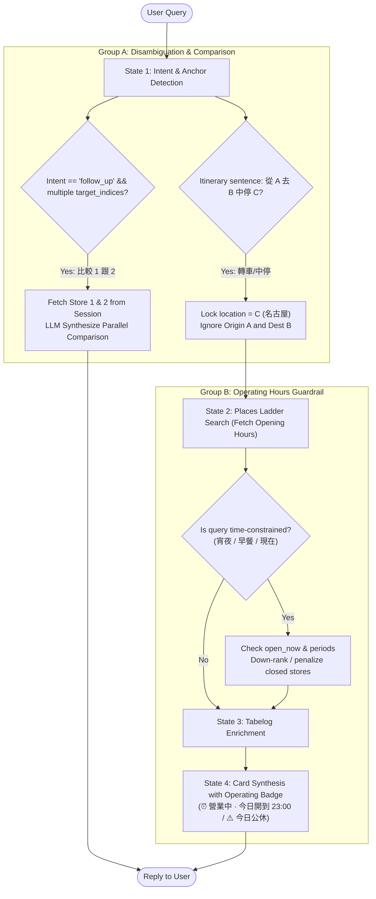

# 📋 Multi-Store Comparison, Itinerary Anchor & Operating Hours Guardrail Implementation Plan

> **For agentic workers:** REQUIRED SUB-SKILL: Use superpowers:subagent-driven-development (recommended) or superpowers:executing-plans to implement this plan task-by-task. Steps use checkbox (`- [ ]`) syntax for tracking.

## 🎯 Executive Overview
Combine Group A and Group B enhancements into a cohesive, production-grade upgrade:
1. **Group A: Comparative Follow-Up & Itinerary Routing**:
   - **Multi-Store Comparison**: Enable cross-store comparisons (e.g. "比較 1 跟 2", "1 跟 3 哪家比較不油/適合長輩") by expanding `target_indices: list[int]` and fetching multiple candidates from session working memory.
   - **Itinerary Stopover Anchoring**: Disambiguate route sentences like "從東京搭新幹線去京都，在名古屋轉車吃鰻魚", ensuring the true dining stop (`名古屋`) is targeted rather than origin or destination.
2. **Group B: Real-Time Operating Hours & Rest-Day Guardrail**:
   - **Operating Hours Sensor**: Ingest `regularOpeningHours` / `currentOpeningHours` from Google Places API.
   - **Scenario Hours Constraint**: When query mentions late night ("宵夜/深夜"), breakfast ("早餐"), or "現在", flag and down-rank closed stores in Stage 2/3, displaying clear status warnings on Stage 4 synthesis cards.
3. **Core Mandates & Quality Guardrails**:
   - **0ms Mock Discipline**: All new tests in `tests/test_real_world_regressions.py` must be 100% offline Mock-backed.
   - **AGENTS.md Anti-bloat Compliance**: Total physical lines of `AGENTS.md` MUST remain $\le 106$ lines.
   - **Zero Doc Drift**: Keep `docs/ARCHITECTURE.md` and `CHANGELOG.md` synchronized.

---

## 🏗️ Architecture Flow

---

## 📂 File Structure Map

| File Path | Action | Description |
| :--- | :---: | :--- |
| `src/agent/schemas.py` | Modify | Add `target_indices: list[int]` to `IntentOutput`; add `time_constraint: Optional[Literal["late_night", "breakfast", "now"]]`. |
| `src/agent/stages/intent.py` | Modify | Update `INTENT_PARSER_SYSTEM_PROMPT` for multi-store indices, itinerary stopover extraction, and time constraints. |
| `src/services/google_places.py` | Modify | Ensure `currentOpeningHours` / `regularOpeningHours` are requested in FieldMask and formatted in place dictionary. |
| `src/agent/stages/places_search.py` | Modify | Implement time-based constraint filtering and down-ranking in `apply_deterministic_constraints` or prefilter. |
| `src/agent/stages/synthesis.py` | Modify | Inject operating hours badge (`⏰ 營業狀態`) into card layout and template fallback. |
| `src/agent/pipeline.py` | Modify | Wire up multi-store comparison in `execute_follow_up`. |
| `tests/test_real_world_regressions.py` | Modify | Add Case 30 (multi-store comparison), Case 31 (itinerary stopover), and Case 32 (operating hours guardrail). |
| `docs/ARCHITECTURE.md` | Modify | Update architecture docs and flowchart. |
| `CHANGELOG.md` | Modify | Record new features in `[Unreleased]`. |

---

## 🛠️ Step-by-Step Tasks

### Task 1: Schema Extension & Intent Prompt Upgrade
- [ ] In `src/agent/schemas.py`:
  - In `IntentOutput`, deprecate single `target_index` in favor of `target_indices: list[int] = Field(default_factory=list)`. Add backwards-compatibility validator so single int `target_index` normalizes to `[target_index]`.
  - Add `time_constraint: Optional[Literal["late_night", "breakfast", "now"]] = None`.
- [ ] In `src/agent/stages/intent.py`:
  - Enhance `INTENT_PARSER_SYSTEM_PROMPT`:
    - Teach multi-target follow-up: e.g. "比較 1 跟 2" -> `target_indices=[1, 2]`.
    - Teach itinerary stopover: e.g. "從東京去京都，中間在名古屋轉車吃鰻魚" -> `location="名古屋"`, `cuisine="鰻魚"`.
    - Teach time constraint: "宵夜" -> `time_constraint="late_night"`, "早餐" -> `time_constraint="breakfast"`.

### Task 2: Multi-Store Comparison in FSM (`execute_follow_up`)
- [ ] In `src/agent/stages/intent.py` (`execute_follow_up`):
  - Check `len(target_indices) >= 2`.
  - Fetch corresponding stores from `session.last_recommended_ids`.
  - If multiple stores found, invoke LLM with comparison prompt:
    - Structured comparison: Flavor profile, wait times, price tier, pros & cons, best choice for whom.
  - If single store, retain existing single-store Q&A flow.

### Task 3: Places Client Operating Hours & Filter
- [ ] In `src/services/google_places.py`:
  - Add `places.currentOpeningHours`, `places.regularOpeningHours` to FieldMask.
  - Parse `openNow: bool` and `weekdayDescriptions: list[str]` into candidate place dictionary.
- [ ] In `src/agent/stages/enrichment.py` or `places_search.py`:
  - In `apply_deterministic_constraints`:
    - If `time_constraint == "late_night"`, check if store is open past 22:00.
    - If `time_constraint == "breakfast"`, check if store is open before 10:30.
    - If `time_constraint == "now"` and `open_now is False`, apply constraint penalty (`-0.45`).

### Task 4: Card Synthesis with Operating Badge
- [ ] In `src/agent/stages/synthesis.py`:
  - Include operating status in `AGENT_SYSTEM_PROMPT`:
    - `⏰ 營業狀態：營業中（今日開到 23:30）` or `⏰ 營業時間：詳見店家公告 / 今日公休`.
  - In `render_template_fallback_card`, include operating hours line.

### Task 5: Battle-Tested Regression Tests (Cases 30, 31, 32)
- [ ] In `tests/test_real_world_regressions.py`:
  - Case 30: Multi-store comparison ("比較 1 跟 2") outputs side-by-side comparison from session memory.
  - Case 31: Itinerary stopover extraction targets stopover city correctly without wide-area ambiguity misfire.
  - Case 32: Querying "宵夜" or "現在有開" penalizes closed stores and includes operating badge on card.

### Task 6: Documentation, Pre-push Checks & Push
- [ ] Update `docs/ARCHITECTURE.md` and `CHANGELOG.md`.
- [ ] Verify `AGENTS.md` length $\le 106$ lines.
- [ ] Run 7/7 pre-push checks (`ruff format`, `ruff check`, `mypy`, `pytest`, `observability sync`).
- [ ] Push to `origin/main`.

