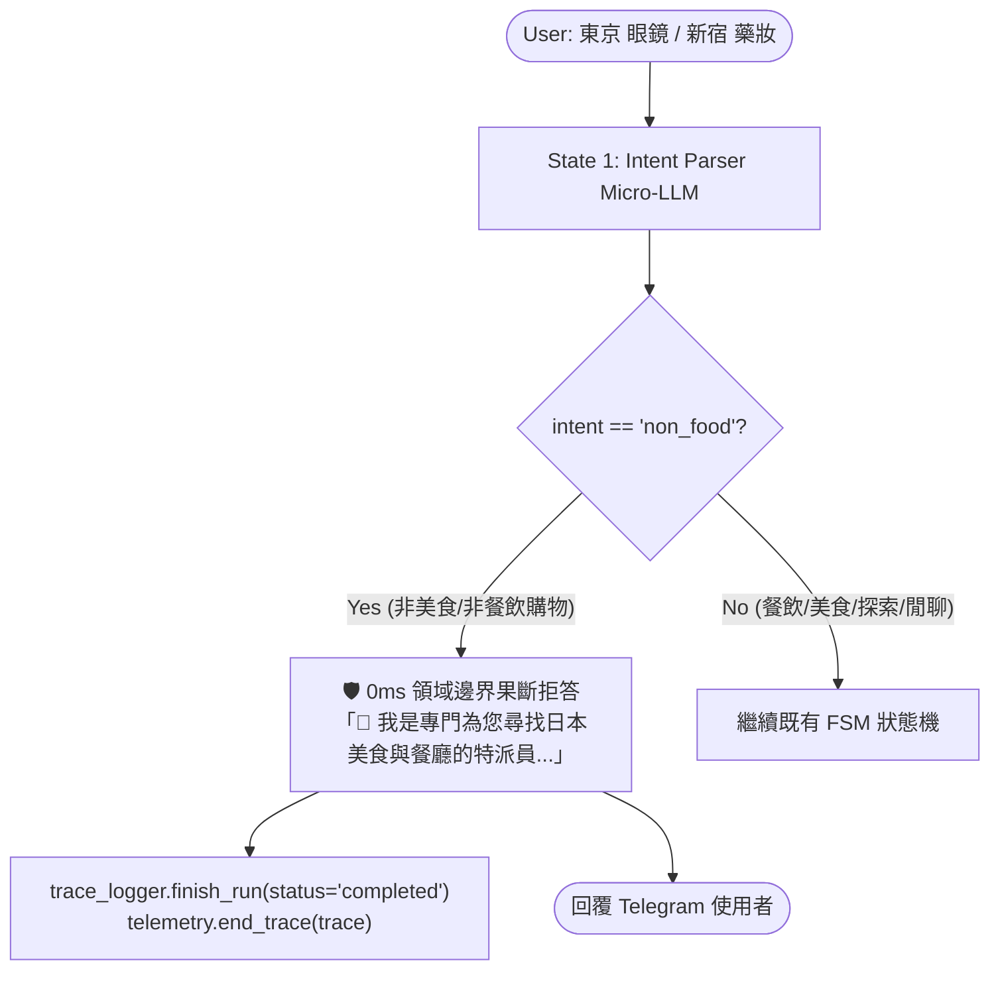

# 📋 Non-Food Domain Guardrail & Early Rejection Plan

## 🎯 Objective
Add dedicated `non_food` intent handling to State 1 (Intent Parsing) and FSM Pipeline (`FoodRecommendationFSM`):
When a user asks for non-food items/services (e.g., eyeglasses, sneakers, cosmetics/drugs, electronics, haircuts, hotel/flight tickets), immediately intercept at State 1 with `intent="non_food"` and provide a friendly, domain-focused boundary message, with **ZERO** downstream API calls (no Places API, no Tabelog Scraper, no second LLM chitchat).

---

## 🏗️ Architecture Design

---

## 🛠️ Step-by-Step Implementation Tasks

### Task 1: Update Schema Contract (`src/agent/schemas.py`)
- In `IntentOutput.intent`:
  - Extend Literal enum: `Literal["search", "more", "chitchat", "need_location", "follow_up", "fast_reply", "explore_cuisine", "non_food"]`.
  - Add optional `non_food_item: Optional[str] = None` to capture what non-food item was asked (e.g. "眼鏡", "藥妝", "球鞋").

### Task 2: Update System Prompt & Parsing (`src/agent/stages/intent.py`)
- In `INTENT_PARSER_SYSTEM_PROMPT`:
  - Clearly instruct Micro-LLM: If user is searching for non-food items (clothing, glasses/optometry, cosmetics, electronics, sneakers, hotels, attractions/tickets, salon), set `intent="non_food"` and populate `non_food_item`.
  - Do NOT confuse non-food with `search` or `chitchat`.
- In `execute_state_1_intent`:
  - If `intent == "non_food"`, construct domain refusal prompt (mentioning the detected non-food item and guiding back to Japanese cuisine).

### Task 3: Instrument FSM Pipeline (`src/agent/pipeline.py`)
- In `FoodRecommendationFSM.run_pipeline()`:
  - Add branch for `if intent == "non_food":`:
    - Conclude trace and span cleanly.
    - Return non-food guidance message immediately (0 Places calls, 0 Tabelog calls, 0 second LLM calls).

### Task 4: Regression Test Mandate (AGENTS.md)
- In `tests/test_real_world_regressions.py`:
  - Add Case 29: Test `東京 眼鏡`, `新宿 藥妝店`, `原宿 球鞋` correctly trigger `intent="non_food"` and early rejection without downstream API calls.
- Run full pre-push verification.

