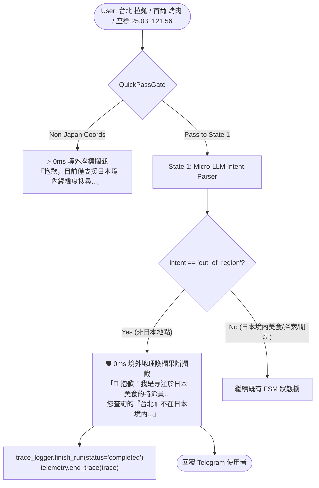

# 📋 Non-Japan Geographic Scope Guardrail Plan (`out_of_region`)

## 🎯 Objective
As a dedicated "Japan Food AI Agent" (日本美食特派員), PickForMe specializes exclusively in Japan's culinary landscape, leveraging Google Places Japan and Tabelog.
When a user asks for dining recommendations in locations outside Japan (e.g., `台北 拉麵`, `首爾 烤肉`, `香港 點心`, `紐約 牛排`, `台南 溫體牛`):
1. State 1 Micro-LLM accurately detects that the requested location is outside Japan and outputs `intent="out_of_region"` with `location`.
2. FSM Pipeline immediately intercepts this intent at State 1 and returns a warm, clear domain boundary message guiding the user back to Japanese locations.
3. **ZERO downstream API calls**: 0 calls to Google Places API (preventing quota consumption and foreign-entity pollution), 0 calls to Tabelog Scraper (preventing cross-border entity resolver hallucinations like matching a Taipei ramen store to a closed Tokyo store), and 0 calls to Stage 4 LLM synthesis.
4. QuickPassGate & Telegram Native GPS Guardrail:
   - If a user submits raw GPS coordinates (via text or Telegram attachment 📎) outside Japan's boundary, intercept with 0ms fast reply and do NOT write non-Japan coordinates to session memory.
   - Refined `is_in_japan_bounds(lat, lng)`: Bounding box `20.0 <= lat <= 46.0` and `122.0 <= lng <= 154.0` with explicit Korean Peninsula exclusion (`34.5 <= lat <= 43.0 and 124.0 <= lng <= 129.5`).

---

## 🏗️ Architecture Flow



---

## 🛠️ Step-by-Step Implementation Tasks

### Task 1: Update Schema Contract (`src/agent/schemas.py`)
- Extend `IntentOutput.intent`:
  ```python
  Literal[
      "search",
      "more",
      "follow_up",
      "chitchat",
      "need_location",
      "explore_cuisine",
      "non_food",
      "out_of_region",
  ]
  ```
- Ensure JSON Schema generation automatically reflects the new intent.

### Task 2: Update System Prompt & Early Exit in Intent Handler (`src/agent/stages/intent.py`)
- In `INTENT_PARSER_SYSTEM_PROMPT`:
  - Add explicit rule for `"out_of_region"`:
    - Triggered when the queried city, region, or country is outside Japan (e.g. Taipei, Tainan, Seoul, Hong Kong, New York, Paris, Bangkok, London, Shanghai, Singapore, etc.).
    - Extract `location` (e.g. "台北").
    - **Contrastive Prompting (異國料理在日搜尋防誤殺)**:
      If cuisine mentions a foreign food (e.g., "新宿 台灣料理", "東京 韓式烤肉", "大阪 美式漢堡"), but the target location is in Japan or unspecified, it MUST be classified as `"search"` (cuisine="台灣料理", location="新宿"), NEVER `"out_of_region"`.
    - **Homonymous Places (同名漢字地名消歧義)**:
      For names shared across regions (e.g., 松山, 板橋, 三重, 中山), default to Japan unless accompanied by foreign contextual cues (e.g., "台北松山", "捷運中山站", "新北板橋", "夜市").
- In `stage_execute_state_1_intent`:
  - Early-exit immediately when `intent == "out_of_region"`, populating `fsm.early_response` and returning without calling `geocode_location`.

### Task 3: Common Japan Bounding Box & QuickPassGate (`src/agent/gate.py`)
- Implement `is_in_japan_bounds(lat: float, lng: float) -> bool`:
  - Main box: `20.0 <= lat <= 46.0 and 122.0 <= lng <= 154.0`
  - Korean Peninsula cut-out: `not (34.5 <= lat <= 43.0 and 124.0 <= lng <= 129.5)`
- In `QuickPassGate.evaluate()`:
  - For `_COORDS_RE`:
    - If `is_in_japan_bounds(lat, lng)` is True $\rightarrow$ `coords_search`
    - Else $\rightarrow$ return `out_of_region_coords` with 0ms fast reply.

### Task 4: Telegram Native GPS Location Guard (`src/bot/handlers.py`)
- When handling `message.get("location")`:
  - Check `is_in_japan_bounds(lat, lng)`.
  - If False, do NOT save to `session_repo.update_location()`, reply with friendly out-of-region notice.

### Task 5: Instrument FSM Pipeline (`src/agent/pipeline.py`)
- In `FoodRecommendationFSM.run_pipeline()`:
  - Add branch `if intent == "out_of_region":`:
    - Retrieve `out_of_region_prompt` or generate fallback.
    - Conclude trace and span with status `completed`, model `out_of_region_guardrail`, total_tokens=0.
    - Return message immediately (0 Places calls, 0 Tabelog calls, 0 Stage 4 synthesis calls).

### Task 6: Battle-Tested Regression Test (`tests/test_real_world_regressions.py`)
- Add **Case 33**:
  1. `台北 拉麵` -> triggers `intent="out_of_region"`, 0 places API calls, response mentions "台北" and guides to Japan.
  2. `首爾 烤肉` / `紐約 牛排` -> triggers `intent="out_of_region"`.
  3. `新宿 台灣牛肉麵` -> stays `intent="search"` (location="新宿", cuisine="台灣牛肉麵").
  4. `松山 鯛魚飯` -> stays `intent="search"` (location="松山", Japan default).
  5. Raw non-Japan coordinates (`25.033, 121.565` for Taipei, or `37.56, 126.97` for Seoul) -> caught by `is_in_japan_bounds` and intercepted with 0ms fast reply.

### Task 7: Documentation & Observability Co-Evolution
- Update `docs/ARCHITECTURE.md`.
- Update `CHANGELOG.md` (`[Unreleased]`).
- Verify `AGENTS.md` length $\le 106$ lines.
- Run full pre-push check suite: `ruff format`, `ruff check`, `mypy src/`, `pytest`.
