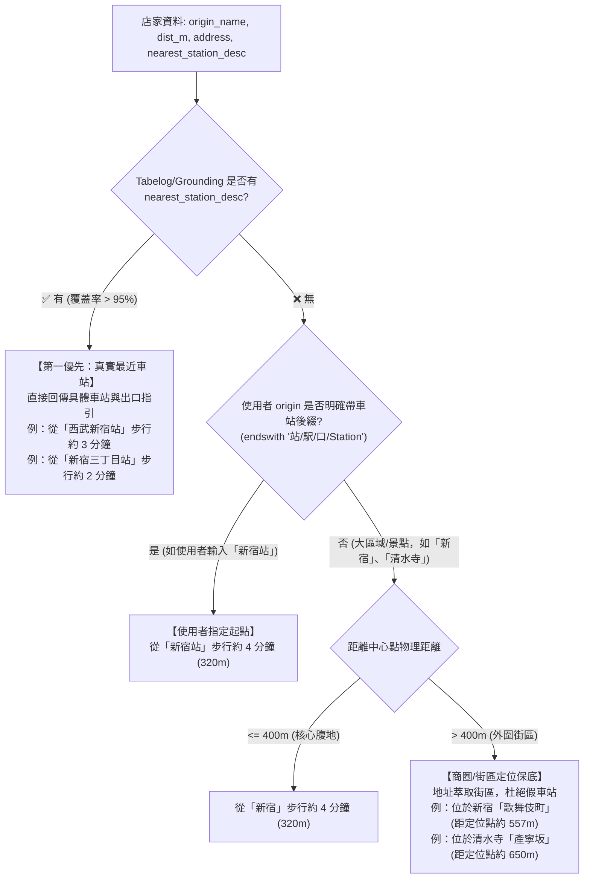

# 📋 Universal Nearest-Station & Honest Neighborhood Navigation Plan

## 🎯 Objective
Resolve the vague origin departure issue (`從「新宿」步行約 7 分鐘`):
1. **Station-First Principle (Universal Across Scenic & Urban)**:
   - Eliminate the restriction `if is_wide_area_origin(origin)` in `_align_walking_and_station`.
   - Whenever Tabelog / Grounding extracts a concrete nearest station and exit (e.g., `從「西武新宿站」步行約 3 分鐘`, `從「新宿三丁目站」步行約 2 分鐘`, `從「新宿站東口」步行約 5 分鐘`), **prioritize it 100% for both urban districts (新宿/澀谷/銀座) and scenic regions (箱根/輕井澤)**.
2. **Honest Neighborhood Context (Anti-Ghost-Station Trap)**:
   - If no nearest station is available, **NEVER** blindly append "站" to arbitrary locations (preventing ghost stations like "清水寺站", "道頓堀站", "東京鐵塔站").
   - If the user explicitly searched with a station suffix (`站`, `駅`, `Station`, `口`), retain `從「{origin_name}」步行約 {walk_mins} 分鐘 ({dist_m}m)`.
   - If the user searched a general neighborhood/landmark (e.g., `新宿`, `清水寺`, `道頓堀`):
     - If `dist_m <= 400m`: retain close proximity `從「{origin_name}」步行約 {walk_mins} 分鐘 ({dist_m}m)` for backward compatibility.
     - If `dist_m > 400m`: extract neighborhood from address (e.g., `位於新宿「歌舞伎町」 (距定位點約 557m)`), preventing misleading claims like walking 12 minutes across Shinjuku.

---

## 🏗️ Architecture Design

---

## 🛠️ Step-by-Step Implementation Tasks

### Task 1: Update `format_walking_description` in `src/agent/stages/places_search.py`
- Re-architect `format_walking_description` according to the 3-tiered principle:
  1. Priority 1: `nearest_station_desc` (regardless of `is_wide_area_origin`).
  2. Priority 2: User station suffix (`站`, `駅`, `口`, `Station`).
  3. Priority 3: Proximity / Neighborhood sub-area extracted from address (never fabricating "站").

### Task 2: Unify `_align_walking_and_station` in `src/agent/stages/enrichment.py`
- Remove `if is_wide_area_origin(origin):` gating in `_align_walking_and_station`.
- Ensure all candidate stores (urban & scenic) update `walking_desc` with `format_walking_description`.

### Task 3: Regression Test Mandate (Case 34 in `tests/test_real_world_regressions.py`)
- Add Case 34:
  - 34.1: Urban store with nearest station (`西武新宿站` 3 mins) overrides vague `從「新宿」步行`.
  - 34.2: Urban store without nearest station at close range (<400m) maintains backward compatibility.
  - 34.3: Landmark without train station (e.g. `清水寺`, `道頓堀`) at >400m outputs `位於清水寺「產寧坂」` without hallucinating ghost station.
  - 34.4: User query ending in `新宿站` retains `從「新宿站」`.

### Task 4: Documentation & Observability Co-Evolution
- Update `docs/ARCHITECTURE.md` Section D diagram & table.
- Update `CHANGELOG.md` (`[Unreleased]`).
- Pre-push 7-gate verification.

