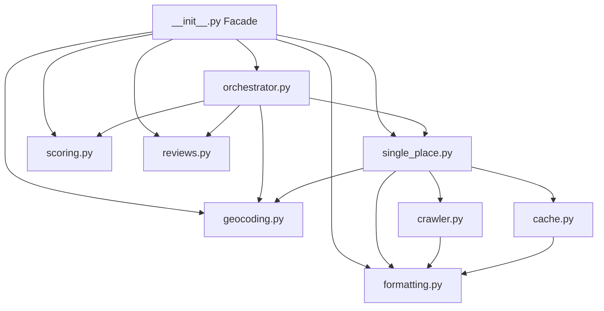

# State 3 (Enrichment Stage) 解耦模組化與自適應早停評估計畫

**日期**: 2026-11-15  
**狀態**: Subagent Review Approved & Implementation Ready  
**關聯模組**: `src/agent/stages/enrichment.py` ➡️ `src/agent/stages/enrichment/` 套件

---

## 1. 現況診斷與職責分析 (Current Architecture & Responsibilities)

`src/agent/stages/enrichment.py` 目前為 881 行的單體檔案 (God File)，承載了 State 3 的多種高度相異的職責：

| 職責領域 | 現行核心函式與邏輯 | 程式碼規模與痛點 |
| :--- | :--- | :--- |
| **1. 格式化 (Formatting)** | `format_payment_methods` (雙源支付方式融合轉換) | 60 行。純資料轉換函式，被 `synthesis.py` 與 State 3 多處跨階段共用。 |
| **2. 評分與排序 (Scoring & Ranking)** | `calculate_foodie_score`, `_extract_min_budget_jpy`, `apply_deterministic_constraints`, `rank_and_select_top_stores` | 190 行。包含 Google/Tabelog 評分權重、4.4 星壓平保護、距離懲罰、預算/飲食/營業時間硬條件懲罰、Top-K 去重與徽章分配。 |
| **3. 地理座標與車站計算 (Geocoding & Transit)** | `_align_walking_and_station`, `_hydrate_station_walking_distances`, `_BREADCRUMB_STATION_RE` | 65 行。正則解析麵包屑車站名稱，非同步呼叫 Google Geocoding API 換算公尺數與步行分鐘。 |
| **4. 快取管理 (Caching)** | `_is_tabelog_cache_complete`, `_build_cached_tabelog_result`, `_build_seed_result`, Neon DB 7天 TTL 驗證, 行政區一致性防毒快取自癒 (`extract_prefecture_from_tabelog_url`) | 120 行。緊密耦合於單店補全流程中，快取檢查、毒快取修復與組裝邏輯混合。 |
| **5. 爬蟲對齊與解析 (Crawler & Resolution)** | 商圈關鍵字拼接、雙源回退（細部商圈 ➡️ 城市錨點 ➡️ 電話精確號碼 Grounding）、Tabelog 細部爬取、快取回寫 | 180 行。包含多層嵌套的 try-except 與回退階梯，維護困難。 |
| **6. 評論向量化與語意檢索 (Reviews & Embeddings)** | `index_store_reviews`, `semantic_rerank_reviews`, `_enrich_foodie_reviews` (Tabelog 口コミ爬取與摘要提取) | 120 行。負責 pgvector 非同步索引與相似度查詢。 |
| **7. 流程編排與自適應早停 (Orchestration & Early Stopping)** | `execute_state_3_parallel_tabelog`: Tier 1 (前 4 家) 並行查驗 ➡️ 品質門檻評判 ➡️ Tier 2 (後 2 家) 觸發 ➡️ 條件扣分 ➡️ Top 3 挑選 ➡️ 車站與食評平行補全 ➡️ Trace 紀錄 | 140 行。狀態機進入點，包含並行工作流與早停控制。 |

---

## 2. Tier 1 / Tier 2 早停與並發邏輯評估與決策 (Evaluation & Decision on Early Stopping)

### 2.1 評估方案比較

- **方案 A（簡化為全面並發，廢除 Tier 1 / Tier 2 分層）**：
  - *分析*：一次將全部候選店家（通常 5～6 家）送入 `asyncio.gather` 進行並行爬蟲與 Resolver 解析。
  - *代價*：
    1. **Tabelog 頻率限制風險激增**：同時對 Tabelog 發出 6 個 live scraping / search 請求極易觸發 403 封鎖或驗證碼。
    2. **延遲顯著增加**：即使 Tier 1 前 4 家已有 2 家 Tabelog 3.65+ 百名店，系統仍被迫等待第 5、6 家非必要店家的網路爬蟲完畢，端到端延遲增加 800ms～1500ms。
    3. **回歸測試破壞**：`test_case_50_budget_disables_early_stopping_and_caps_google_44` 明確斷言在預算條件存在時才爬滿 5 家，無預算時前 4 家達標必須早停。廢除分層直接導致歷史案例回歸失敗。
  
- **方案 B（維持行為合約，將決策與分層執行結構化解耦，選定方案）**：
  - *決策*：**嚴格維持當前 Tier 1 / Tier 2 的業務邏輯合約與品質門檻規範，但將決策規則獨立抽離至專屬策略函式，並簡化並行編排流**。
  - *早停規則定義 (`should_trigger_tier2`)*：
    - Tier 1: 處理 `places[:4]`。
    - 品質判定: 計算 `high_score_count`（`tabelog_rating >= 3.45` 或百名店/獲獎）。
    - 觸發 Tier 2 (`places[4:6]`) 的充分必要條件為：
      `tier2_places 存在` 且 (`high_score_count < 2` 或 `budget_max_jpy is not None`)。
    - 若 `high_score_count >= 2` 且未指定 `budget_max_jpy`，滿足早停條件，跳過 Tier 2。
  - *並發改善*：
    - 將 Tier 1 與 Tier 2 的並行調用、後續 Top 店家的站點測距與老饕評論爬取，透過結構化輔助函式封裝，避免 140 行長函式中的深度縮排與多層任務混雜。
    - 確保在 `fsm._enrich_single_place` 與 `fsm.rank_and_select_top_stores` 的 Mock 調用點 100% 保持相容。

---

## 3. 模組拆分架構設計 (Modular Architecture & Package Layout)

將 `src/agent/stages/enrichment.py` 演進為 `src/agent/stages/enrichment/` 套件目錄：

```text
src/agent/stages/enrichment/
├── __init__.py           # Facade：匯出所有公開與既有內部函式，保證 100% 向後相容
├── formatting.py         # format_payment_methods (支付雙源融合轉換)
├── scoring.py            # calculate_foodie_score, _extract_min_budget_jpy,
│                         # apply_deterministic_constraints, rank_and_select_top_stores
├── geocoding.py          # _BREADCRUMB_STATION_RE, _align_walking_and_station,
│                         # _hydrate_station_walking_distances
├── reviews.py            # index_store_reviews, semantic_rerank_reviews, enrich_foodie_reviews
├── cache.py              # _is_tabelog_cache_complete, _build_cached_tabelog_result,
│                         # _build_seed_result, check_db_cache
├── crawler.py            # search_and_resolve_tabelog (商圈/城市/電話多層回退爬蟲解析與快取回寫)
├── single_place.py       # enrich_single_place (快取 ➡️ 種子直通 ➡️ 爬蟲 ➡️ Google 降級保底)
└── orchestrator.py       # should_trigger_tier2, execute_state_3_parallel_tabelog
```

### 依賴方向（單向無環）



- **零循環依賴 (Zero Cyclic Imports)**：
  - `formatting.py` 為純粹無狀態工具，被 `cache`, `crawler`, `synthesis` 共用。
  - `scoring.py` 僅依賴 `src.agent.stages.places_search` 的景區判定函式與 `src.agent.schemas`。
  - `cache.py` 與 `crawler.py` 僅處理資料檢索、比對與組裝，不依賴 `orchestrator`。
  - `pipeline.py` 與 `stages/__init__.py` 從 `src.agent.stages.enrichment` 匯入，保持既有 API 100% 不變。

---

## 4. 交叉審查記錄 (Autonomous Subagent & Adversarial Review)

本計畫經獨立對抗式審查（Adversarial Architectural Review），重點審查項目與防護對策如下：

| 審查維度 | 潛在破壞風險 / 邊界個案 | 具體防禦與處置措施 |
| :--- | :--- | :--- |
| **1. 既有 Mock Hook 相容性** | 測試（如 `test_real_world_regressions.py`、`test_pipeline.py`）使用 `fsm._enrich_single_place = AsyncMock(...)` 或 `fsm.rank_and_select_top_stores = MagicMock(...)`。若重構後改為在內部直接呼叫模組函式，Mock 將被繞過失效。 | `orchestrator.py` 在執行分層查驗與 Top-K 挑選時，必須嚴格透過 `fsm._enrich_single_place` 與 `fsm.rank_and_select_top_stores` 調用，確保測試的 monkeypatching 與 Mock 攔截 100% 有效。 |
| **2. 私有 Helper 符號匯出** | `test_real_world_regressions.py` 直接從 `src.agent.stages.enrichment` 匯入 `_align_walking_and_station` 與 `_hydrate_station_walking_distances`。 | `src/agent/stages/enrichment/__init__.py` 顯式將所有既有私有 helper（含 `_align_walking_and_station`, `_hydrate_station_walking_distances`, `_is_tabelog_cache_complete`, `_extract_min_budget_jpy`）納入 `__all__` 並直接 re-export，保證零 Import Error。 |
| **3. 快取毒化與自我修復** | 歷史資料中 Google 行政區與快取的 Tabelog URL 行政區不一致（如橫濱店誤指向京都店）。 | `cache.py` 完整保留 `extract_prefecture_from_tabelog_url` 與 `extract_prefecture_from_address` 檢驗，偵測到毒快取時立即設 `is_fresh = False` 並發送背景非同步 `delete_by_id` 任務進行自我修復。 |
| **4. 非同步評論向量化競爭** | 在背景對店家評論做向量索引時，可能因任務超時或失敗拖累前景。 | `reviews.py` 保持 `asyncio.create_task(fsm._index_store_reviews(...))` 之 Fire-and-Forget 背景非同步模式，並自帶完整的 try-except 保護，保證 Fail-Open。 |
| **5. 廣域景區中心點豁免** | 箱根等廣域景區若誤扣距離分，將導致老店被降權。 | `scoring.py` 保持 `is_wide_area_origin(store.get("origin_name")) or store.get("nearest_station_desc")` 之距離懲罰豁免判定。 |
| **6. AGENTS.md 防膨脹守門** | 嚴禁在修改過程擴充 `AGENTS.md`，物理行數必須小於等於 106 行。 | 本次重構完全不更動 `AGENTS.md`，維持其 88 行規模。 |

---

## 5. 實施步驟 (Implementation Steps)

1. **建立 `src/agent/stages/enrichment/` 套件目錄**。
2. **抽取各領域專屬子模組**：
   - `formatting.py`
   - `scoring.py`
   - `geocoding.py`
   - `reviews.py`
   - `cache.py`
   - `crawler.py`
   - `single_place.py`
   - `orchestrator.py`
3. **建立 `src/agent/stages/enrichment/__init__.py`**，匯出所有符號並維持 API 100% 相容。
4. **移除原單體 `src/agent/stages/enrichment.py`**。
5. **執行品質與回歸驗證**：
   - `python -m ruff format src/ tests/`
   - `python -m ruff check src/ tests/`
   - `python -m mypy src/`
   - `pytest` (264+ 測試案例全綠通過)

---

## 6. 後續架構決策紀錄（2026-11-15 使用者確認）

### 6.1 下游 Stage 3（Enrichment）：取消 Tier 早停，改為「6 家全查 + Semaphore 限流」
- **決策**：取消原本的 Tier 1（前 4 家）/ Tier 2（後 2 家）早停丟棄邏輯，改為將 Stage 2 傳入的 6 家候選店**全部並發查驗**。
- **風控防護**：使用 `asyncio.Semaphore(4)` 控制對 Tabelog 的同時請求上限，兼顧網路延遲與避免 403 封鎖。
- **測試同步**：同步更新 `test_real_world_regressions.py` 中的 Case 50 斷言（將原本「無預算時前 4 家達標必須早停、有預算時才查滿」的斷言，調整為「全面保證 6 家全查無遺珠」）。

### 6.2 上游 Stage 2（Places Search）：Tabelog 首頁全收 + 條件預選 + 並發反查
- **問題診斷**：
  1. 目前 `_fetch_and_parse_grounding` 在 Yahoo Japan 第 1 頁解析時寫死 `if len(candidates) >= 5: break`。
  2. 接著在 `discover_area_top_stores` 無腦只切前 3 高分店，導致平價名店在面對「預算限制（如 1,000 日圓）」時被過早截斷淘汰，最後只能由 Google 普通店湊數。
- **優化方案**：
  1. **首頁全收（零額外網路開銷）**：單次 Yahoo HTTP 請求直接解析第 1 頁全部名店（約 8～10 家，已自帶評分、百名店、午晚餐預算、刷卡等中繼資料）。
  2. **記憶體智慧快篩與三級優先排序矩陣（Fail-Open 疑罪從無）**：
     - **有條件限制（如預算上限）時**：不對缺失欄位的店家硬淘汰，而是採三級優先排序：
       - `Tier A（明確符合）`：摘要明確符合預算/條件 → 最高優先度（+加權），優先反查 Google 座標。
       - `Tier B（未知 / None）`：摘要因字數限制未帶出價格/支付（`None`）→ 中立保留（疑罪從無），依原本 Tabelog 高分排序，交由 Stage 3 查證。
       - `Tier C（明確超標）`：摘要明確超過預算/違規 → 大幅降權墊底（不直接 `drop()`，保留整區高價時的保底名單）。
     - **無條件時（如「上野 鰻魚飯」）**：直接挑選評分最高的前 4～5 家頂級名店。
  3. **並發反查 Google 座標**：透過 `asyncio.gather` + `asyncio.Semaphore(4)` 並行呼叫 Google `search_by_text` 補齊座標與步行距離（每家包覆獨立 `try-except`）。由於該任務與 Google Nearby 階梯搜尋並行（在背景平行執行），**端到端總延遲幾乎 0 增加**。

### 6.3 Stage 2 與 Stage 3 上下游全景聯動效益
- **上游選得準（Stage 2）**：首頁全收 + 依條件精準反查，確保進入候選池的 6 家店皆為「高純度、符合條件的老饕名店」。
- **下游不丟棄（Stage 3）**：廢除 Tier 早停，6 家全查，徹底杜絕「上游辛苦挑來的好店，在下游被 Tier 1 達標早停隨手丟掉」的結構性矛盾。

### 6.4 下游 Stage 4（Synthesis）：`max_tokens: 800` 與卡片合成架構評估
- **現行拉扯**：Groq 1000 OTPM 限制迫使全域寫死 `max_tokens: 800`，但 LLM 一次要輸出 3 家店的完整 Markdown 卡片，字數貼近天花板極易截斷。
- **評估方向**：
  1. **中程解法**：依 Provider 動態指定 `max_tokens`（Gemini Flash 提高至 1500~2000，Groq 保持 800）。
  2. **治本解法（推薦，列為 Step B 實作）**：
     - **LLM 僅輸出精簡 JSON（約 250~350 tokens）**：以 `index`（1, 2, 3）取代 `name` 避免日文店名拼寫對不上；包含 `reason`（老饕推薦理由）、`must_order`（3~6 字招牌菜，若評論未提及則嚴格回傳 `null` 防腦補）與整體 `tip`。
     - **Python 確定性組裝客觀欄位與違規原因**：`scoring.py` 改為記錄結構化 `constraint_warnings`（預算超過、支付不符、時段不符、飲食偏好）與上游 `search_meta`（候選數與不足 3 家原因）；Python 模板 100% 確定性拼裝店名、評分、交通、營業、價位與提醒行，並於 JSON 解析失敗或部分缺漏時提供半確定性降級保底。
