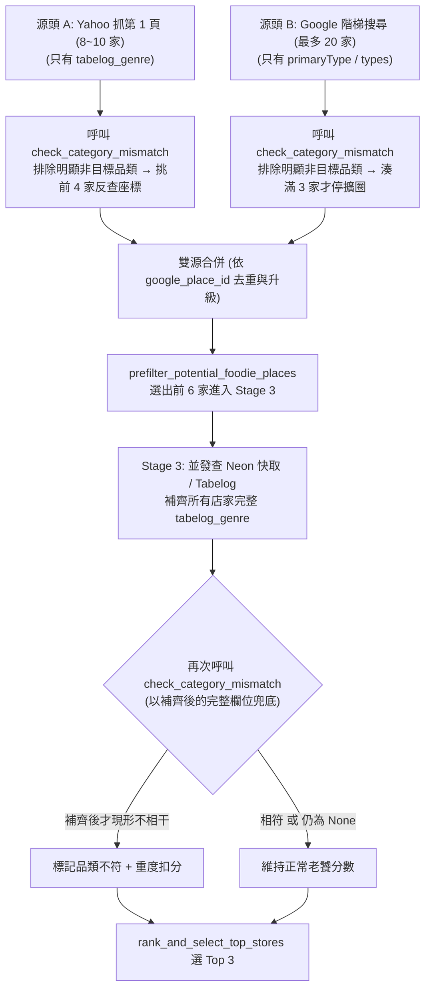

# 品類一致性防線計畫：Stage 2 雙源預濾 ＆ Stage 3 兜底降權

**日期**: 2026-11-16  
**狀態**: Subagent Review Approved（已納入 5 項審查修正：`category_guard.py` 獨立模組、Stage 3 Skip Guard 補齊、`tabelog_genre` 全鏈路保留、防雙重扣分、複合品類容錯）  
**觸發案例**: 線上 Trace `0c672e01-265f-403c-93a8-228cc93623cb`（「新宿御苑附近的咖啡廳推薦」）

---

## 1. 問題現場與根因診斷

在線上 Trace `0c672e01` 中，使用者查詢「新宿御苑附近的咖啡廳推薦（走路10分鐘內）」，State 1 正確解析出 `cuisine="咖啡"`、`search_keyword_ja="カフェ"`，但最終推薦卡片卻讓烤魚定食店 `しんぱち食堂 新宿御苑店` 登上 **🥈 第 2 名**，候選池亦混入水煙吧 `C.Stand Shinjuku 3-chome`。

三個結構性漏洞如下：
1. **Google `search_by_text` 未取得也未檢查店家類型 (`src/services/google_places.py`)**：
   - `X-Goog-FieldMask` 缺少 `places.primaryType,places.types`。
   - 請求端若硬傳單數 `includedType="cafe"` 會誤殺 `coffee_shop` / `tea_house` / `bakery`；但完全不檢查回傳類型，Google Text Search 會將評論出現過「カフェ」的定食食堂與水煙吧一併回傳。
2. **Stage 2 源頭 B 擴圈提早停止與名額被佔 (`src/agent/stages/places_search.py`)**：
   - `execute_state_2_places_ladder` 在 `len(candidates) >= 3` 即停止擴圈；若前 3 家混入非咖啡店，會阻斷向外圈（如 `1200m`）尋找真咖啡廳。
   - `discover_area_top_stores` 雖已解析 `tabelog_genre`，但選前 4 名時未使用。
3. **Stage 3 缺乏品類一致性檢驗 (`src/agent/stages/enrichment/scoring.py`)**：
   - `tabelog_genre` 未從 `tabelog_scraper.py` 傳遞至 `places_search.py`、`crawler.py`、`single_place.py` 與 `scoring.py`。
   - `しんぱち食堂` 在 Stage 3 匹配到 Tabelog `3.1` 分（分類為 `食堂`），因無品類扣分而擊敗僅有 Google 折算分（`2.86`）的真咖啡廳。

---

## 2. 整體架構設計（單一共用函式三段復用）

---

## 3. 具體模組調整規劃

### 3.1 保留並補齊品類訊號
1. **`src/services/google_places.py`**：
   - `search_by_text` 與 `search_nearby` 之 `X-Goog-FieldMask` 新增 `places.primaryType,places.types`（不增加 API 次數，亦不於請求端硬鎖單數 `includedType`）。
   - `_format_place_item` 輸出 `primary_type: item.get("primaryType")` 與 `types: item.get("types") or []`。
2. **保留 `tabelog_genre` 與目標品類傳遞鏈**：
   - `src/agent/stages/places_search.py`（`_hydrate_tabelog_seeds_with_places` 與雙源合併升級處）補複製 `"tabelog_genre"`，並支援可選 `explore_category: Optional[str] = None`。
   - `src/agent/stages/enrichment/crawler.py` 與 `single_place.py` 於查驗或命中種子/快取時保留 `"tabelog_genre"`。
   - `src/agent/pipeline.py` → `execute_state_3_parallel_tabelog` → `apply_deterministic_constraints` 新增可選參數 `cuisine: Optional[str] = None` 與 `explore_category: Optional[str] = None`（預設 `None` 以維持既有測試 100% 向後相容）。

### 3.2 共用品類一致性判定 (`check_category_mismatch`)
- 建立單一共用純函式（放置於無循環依賴之服務層或共用 helper，供 `tabelog_scraper.py`、`places_search.py` 與 `scoring.py` 同時呼叫，嚴禁複製多份規則）：
  - **遵守 `AGENTS.md` Anti-Hardcoded Mapping 原則**：不寫死大型跨語言同義字字典，聚焦高互斥大類與 Google 標準 `primaryType` / `types`（例如當目標為飲品/咖啡 `explore_category == "drink"` 或 `search_keyword_ja` / `cuisine` 屬咖啡喫茶時）：
    - **Google 端**：若 `types` 存在且**完全不含** `{"cafe", "coffee_shop", "tea_house", "bakery"}`，且 `primary_type` 明確屬於高互斥正餐/夜生活類型（如 `japanese_restaurant`, `restaurant`, `ramen_restaurant`, `izakaya`, `bar`, `hookah_bar`, `night_club`, `steak_house`, `sushi_restaurant`），判定為品類不符。
    - **Tabelog 端**：若 `tabelog_genre` 明確存在且為高互斥類型（如 `食堂`, `定食`, `居酒屋`, `ラーメン`, `焼肉`, `寿司`, `バー` 等，且不含咖啡/喫茶/甜點相關詞），判定為品類不符。
  - **Fail-Open 疑罪從無**：若 `types` 與 `tabelog_genre` 皆缺失或為 `None`，回傳「無衝突」，絕不誤殺資料不完整的老店。

### 3.3 三關卡套用策略（含抗零結果保底）
1. **Stage 2 源頭 A（`tabelog_scraper.py` `discover_area_top_stores`）**：
   - 呼叫 `check_category_mismatch`；優先保留非衝突候選挑前 `max_seeds` 家（僅當整頁皆為衝突店家時才保底回傳）。
2. **Stage 2 源頭 B（`places_search.py` `execute_state_2_places_ladder`）**：
   - 迴圈內依 `check_category_mismatch` 過濾明顯非目標品類，只將通過檢查的店家計入 `candidates`（確保 `len(candidates) >= 3` 是基於真咖啡廳，避免提早停止擴圈）；被過濾掉的衝突店家暫存至 `demoted_fallback`。
   - 僅當**所有半徑（含 2500m 保底圈）都跑完**且 `candidates` 與 `tabelog_hydrated_seeds` 合計仍不足（例如 0 家）時，才從 `demoted_fallback` 補回保底，避免全部變 0 家。
3. **Stage 3 兜底降權（`scoring.py` `apply_deterministic_constraints` & `calculate_foodie_score`）**：
   - 對 Stage 3 補齊 `tabelog_genre` 後仍觸發 `check_category_mismatch` 的店家，標記 `store["category_mismatch"] = True`（可同步寫入 `constraint_warnings` 提醒）。
   - 於 `calculate_foodie_score` 施加顯著重度扣分（例如 `-1.5`，大於硬性條件扣分 `-0.45`），確保即使其擁有 Tabelog `3.1` 分，仍穩居所有正常咖啡廳（Google 折算分 `2.86`）之後，同時不將候選列表歸零。

---

## 4. 風險評估與測試計畫

- **Blast-Radius 檢查**：
  - 既有測試中若 Google Places mock 未提供 `primary_type` / `types` 或 `tabelog_genre`，因 Fail-Open 疑罪從無原則，**100% 不影響既有回歸測試**。
  - 需留意「複合型店家」（如同時掛 `cafe` 與 `restaurant` 的早午餐咖啡廳）：只要 `types` 內含 `cafe` / `coffee_shop` 即放行，避免誤殺。
- **新增回歸測試 (`tests/test_real_world_regressions.py`)**：
  - 新增 **Case 53**：還原 `0c672e01` 新宿御苑咖啡案例，驗證：
    1. Google 回傳真咖啡廳、`しんぱち食堂`（`japanese_restaurant`）與 `C.Stand`（`hookah_bar` / `bar`）時，Stage 2 排除雜訊不提前中止擴圈；
    2. 擦邊漏網之 `食堂` 在 Stage 3 補齊 `tabelog_genre="食堂"` 後遭 `-1.5` 重度降權，絕不擊敗正常咖啡廳進榜 Top 3；
    3. 缺少 `types` 與 `tabelog_genre` 的老店受 Fail-Open 保護不被誤殺。
