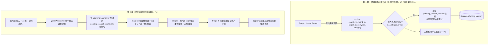

# 🍱 Multi-Turn Disambiguation Context Snapshot & Connoisseur Theme Alignment Plan

> **日期**：2026-11-17  
> **觸發個案**：
> 1. `c4aba176`（「靜岡 下午茶」➔ 反問分區 ➔ 使用者回「1」靜岡車站 ➔ 推薦海ぼうず關東煮居酒屋與魚市場直營店）
> 2. `78f550aa`（「靜岡 親子丼」➔ 反問分區 ➔ 使用者回「1」靜岡車站 ➔ 推薦戶隱蕎麥麵店，且必點推薦寫「戶隱蕎麥麵」，推薦理由通篇稱讚「蕎麥麵滑順有彈性」）
> **核心目標**：
> - 建立通用「多輪反問語境快照 (Context Snapshot)」機制，徹底解決多輪選區後丟失 `search_keyword_ja`、`target_place_types`、`category` 等檢索與護欄約束的系統漏洞。
> - 建立 Stage 4 通用「老饕主題錨定 (Connoisseur Theme Alignment)」提示詞與卡片規範：當複合名店（如蕎麥麵老店）賣目標料理（如親子丼）時，自然點出其招牌背景，並說明「除了蕎麥麵外，店裡的親子丼也極受常客喜愛，因為其高湯/滑蛋/肉質...」，必點菜色嚴格鎖定目標料理（或套餐），杜絕跑題。
> - Stage 3 通用「專門店 vs 附屬菜單店」柔性排序：依 Tabelog genre / 店名動態區分核心專門店與附餐店，不寫死特定菜色字典。

---

## 1. 根本原因深入剖析 (Root Cause Analysis)

### 1.1 多輪分區反問時的記憶漏鏈 (Context Memory Leak)
- **現狀**：在 `src/agent/stages/intent.py`（行 470~500）觸發廣域分區反問（`is_ambiguous and len(suggested_sub_areas) >= 2`）時，呼叫 `fsm.session_repo.update_working_memory` 只存入了：
  ```python
  suggested_locations = parsed["suggested_locations"]
  pending_cuisine = parsed.get("pending_cuisine")
  ```
  漏存了：
  - `search_keyword_ja`（如 `カフェ`）
  - `target_place_types`（如 `["cafe", "coffee_shop"]`）
  - `category`（如 `drink`）
  - `explore_category` / `dietary_restrictions` / `payment_preferences`
- **次輪選區還原時**：在 `intent.py`（行 250~255）使用者輸入 `1`、`2`、`3` 選擇地點時，只恢復了 `parsed["location"] = target_loc` 與 `parsed["cuisine"] = wm_sel.get("pending_cuisine")`。
  導致：
  - `search_keyword_ja` 為空 ➔ Stage 2 拿中文 `"下午茶"` 裸搜 Google Places，導致非目標店大舉湧入。
  - `target_place_types` 為空 ➔ Stage 2 與 Stage 3 的品類防禦護欄 `check_category_mismatch` 因目標類型為空而全部 Fail-Open 放行！
  - 關東煮居酒屋（海ぼうず，991 則評價，Tabelog 3.50 分）在無約束狀態下直接登頂！

### 1.2 Stage 4 卡片生成之主題偏離 (Topic Drift)
- **現狀**：在 `config/skills/scenarios/card-synthesis.md` 與 `src/agent/stages/synthesis.py` 中，LLM 被指示從評價中提取 `must_order` 與 `reason`，但未對使用者最初設定的目標料理（`{cuisine}`）施加約束。
- **後果**：面對蕎麥麵店（戶隱蕎麥麵），評價中 80% 都在講戶隱蕎麥麵，少數提及「親子丼セット」。LLM 挑選了高頻詞 `戸隠そば` 作為必點，推薦理由稱讚「蕎麥麵滑順有彈性」，完全背離用戶想吃親子丼的意圖。

### 1.3 Stage 3 專門店 vs 附餐店缺乏分級
- **現狀**：Google Places 搜尋 `親子丼` 時，由於日本蕎麥麵店、烏龍麵店普遍提供丼飯套餐，候選池會同時出現專門店（如鳥料理、丼飯店）與蕎麥麵店。若未在 Stage 3 依 `tabelog_genre` 進行專門店 vs 附餐店的柔性排序，評分較高或評價數較多的老牌麵店會把純親子丼專門店完全擠出前三名。

---

## 2. 系統架構變更設計 (Architectural Blueprint)



---

## 3. 具體模組實作規格 (Implementation Specifications)

### 3.1 Session Repository & Intent Context Snapshot
- **檔案**：`src/db/repositories/session.py`
  - 在 `update_working_memory` 新增 `pending_search_context: Optional[dict[str, Any]] = None`，支援保存完整檢索語境快照。
  - 當設定 `clear_disambiguation: bool = False` 時，主動清除 `suggested_locations` 與 `pending_search_context`，防止第三輪追問「1」時誤觸發再次分區（L2 防禦）。
- **檔案**：`src/agent/stages/intent.py`
  - 在反問分區時（`needs_concrete_area` / 行 470~500）：
    ```python
    pending_context = {
        "cuisine": parsed.get("cuisine"),
        "category": parsed.get("category"),
        "search_keyword_ja": parsed.get("search_keyword_ja"),
        "target_place_types": parsed.get("target_place_types"),
        "explore_category": parsed.get("explore_category"),
        "dietary_restrictions": parsed.get("dietary_restrictions"),
        "payment_preferences": parsed.get("payment_preferences"),
        "budget_max_jpy": parsed.get("budget_max_jpy"),
    }
    ```
    存入 `working_memory["pending_search_context"]`。
  - **建立共用還原輔助函式 `_restore_pending_search_context(parsed, wm_sel, target_loc=None)`**：
    確保：
    1. **數字索引分支**（使用者輸入 `1`/`2`/`3`，行 250~255）
    2. **文字地名分支**（使用者直接輸入「靜岡車站」、「濱松」，行 296~307，L1 防禦）
    兩者 100% 共用相同的還原邏輯，完整還原 `cuisine`、`search_keyword_ja`、`target_place_types`、`category`、`dietary_restrictions`、`payment_preferences` 等所有關鍵約束！
  - **選區消費後清理 (Tombstone)**：
    成功解析分區並還原語境後，將 session 的 `suggested_locations` 與 `pending_search_context` 清理標記為已消費，避免第三輪追問店家細節時再次命中。

### 3.2 Stage 4 老饕主題錨定與複合店推薦風格
- **檔案**：`config/skills/scenarios/card-synthesis.md` & `src/agent/stages/synthesis.py`
  - 更新合成規範：
    ```markdown
    【老饕主題一致性與複合名店推薦規範 (Cuisine-Anchored Synthesis)】
    若使用者有指定特定料理/餐點主題（如「親子丼」、「蛋包飯」、「下午茶」）：
    1. `must_order`（必點推薦）：
       - 必須優先鎖定包含該主題料理的品項或其延伸套餐（例如：`地雞親子丼`、`親子丼セット`）。
       - 嚴禁推薦與目標料理完全無關的單品（例如在親子丼推薦中推薦純蕎麥麵）。
    2. `reason`（老饕推薦理由）：
       - 核心必須圍繞該主題料理的特色（風味、醬汁、食材、口感）做介紹。
       - 【複合名店處理方式】：若該店是以另一項料理聞名的傳統名店（例如知名蕎麥麵老店、老字號居酒屋）：
         請以老饕筆吻自然點出其招牌背景，並精準說明常客為何推薦其主題餐點（例如：「雖然以手打蕎麥麵聞名，但店裡的親子丼也極受常客喜愛，因為採用濃郁出汁（柴魚高湯）調味，搭配滑嫩半熟蛋與彈牙雞肉，份量扎實且香氣十足」）。
    ```

### 3.3 Stage 3 專門店 vs 附餐店 柔性加權
- **檔案**：`src/agent/stages/enrichment/scoring.py`
  - 在 `calculate_foodie_score` 中（L3 防禦：總差額控制在 0.20 內，防止評分倒掛）：
    針對特定餐點查詢（`cuisine` 如「親子丼」、「鰻魚飯」、「下午茶」）：
    - 檢查店名 `name_ja` 與 `tabelog_genre`：
      - 若 `tabelog_genre` 包含主題核心字（如「丼」、「鳥」、「鶏」對應親子丼，或「カフェ」、「喫茶」對應下午茶），給予 `+0.10` 專門店加權。
      - 若店名或分類屬於顯著不同的大類（如純 `そば`、`うどん`），給予 `-0.10` 柔性降權。
      - **老饕品質保底**：3.50+ 分的頂級複合老店仍有能力在綜合評估下入圍，但與專門店同分時專門店享有優先順位。

---

## 4. 驗證與回歸測試清單 (Regression Test Mandate)

1. **真實案例回歸測試 (`tests/test_real_world_regressions.py`)**：
   - **Case 55**: 驗證多輪廣域分區反問（如「靜岡 下午茶」➔ 回覆 `1`），確保第二輪 100% 繼承 `search_keyword_ja`（カフェ）與 `target_place_types`（cafe, coffee_shop），且居酒屋被 category guardrail 攔截。
   - **Case 56**: 驗證「親子丼」查詢下推薦複合蕎麥麵店時，Stage 4 提煉的 `must_order` 包含「親子丼」（或其套餐），且推薦理由兼具蕎麥麵名店背景與推薦親子丼的原因。
2. **Pre-push QA 驗證**：
   - 確保 7/7 檢查全過（ruff format, ruff check, mypy, pytest, pages sync, changelog/arch sync, AGENTS.md <= 106 lines）。
