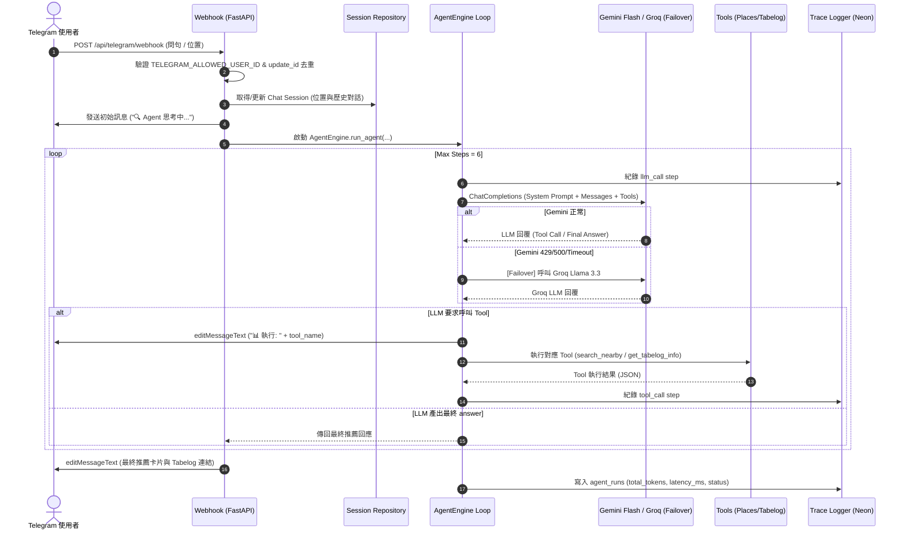

# 🍱 PickForMe - Phase A3 實作計畫 [Status: Completed / 已完工]

> **結案狀態 [2026-10-10]**：Phase A 核心功能與工程護欄已 100% 實裝完畢並通過 54 項單元/合約測試。核心成果包括：
> 1. **確定性 4 階段 FSM 狀態機 (`FoodRecommendationFSM`)**：結構化意圖抽取、Google Places 階梯搜尋、平行實體對齊與單輪卡片合成。
> 2. **多模型降級容錯鏈**：Groq 0.7s 極速主力 ➡️ Gemini 3.8 Flash 備援 ➡️ 本機 Ollama 離線保底。
> 3. **Tabelog 403 WAF 降級與快取**：自動 Web Grounding 備援提取真實評分、評價數與百名店，持久化寫入 Neon Postgres `tabelog_cache`。
> 4. **極致行動端卡片**：一秒複製日文店名、步行距離與分鐘數置頂、特派員極簡提醒。
> 5. **確定性數值防偽護欄與 CI 合約測試**：Scoped Anchor 毫秒級校正護欄 + CI 自動防範提示詞規則漂移。
> 完整架構白皮書請參閱 [docs/ARCHITECTURE.md](file:///c:/Users/User/OneDrive/文件/2026/PickForMe/docs/ARCHITECTURE.md)。

---

## 👨‍💻 User Review Required

> [!IMPORTANT]
> 1. **雙模型自動降級 (Failover Strategy)**：
>    - 主力模型：`gemini-2.0-flash` (經由 OpenAI 兼容 Endpoint 或 Google GenAI SDK)。
>    - 備援模型：`groq: llama-3.3-70b-versatile`。
>    - 當主力模型遇到 HTTP 429 (Rate Limit)、500 (Server Error) 或 15 秒 逾時，自動轉切至 Groq 備援繼續執行當前 Agent Loop，確保 Telegram 使用者感受零中斷。
>
> 2. **Telegram Webhook 同步動態進度串流 (Status Streaming)**：
>    - 由於 Agent 執行 Tool (Google Places + Tabelog Scraper + Entity Resolver) 需要約 2~5 秒，透過 `editMessageText` 在 Telegram 動態更新執行狀態：
>      - `🔍 正在為您搜尋地點與週邊美食...`
>      - `📊 正在比對並計算 Tabelog 美食分數...`
>      - 最終輸出格式化美食推薦卡片（附 Tabelog 分數 ⭐️、價格區間、地圖連結）。
>
> 3. **對話記憶與位置快取 (Session Memory)**：
>    - 存取 Neon `chat_sessions` 資料表。使用者傳送 Telegram Location 時自動更新 `last_location`，30 分鐘內發送文字問句（如「附近拉麵」）時自動帶入該位置。

---

## 📐 架構與資料流 (Data Flow & Agent Loop)



---

## 🛠️ Proposed Changes

### 1. Agent 核心與工具層 (`src/agent/`)

#### [NEW] `config/prompts/agent_system.md`
Agent 系統指令 (System Prompt)：
- **角色**：日本美食特派員 PickForMe (專業、熱情、依據評分推薦)。
- **工具選用原則**：
  1. 若使用者未提供座標但提及地名（如「博多站附近」），優先呼叫 `geocode_location` 取得 lat/lng。
  2. 取得座標後呼叫 `search_nearby` 檢索 800m 內精選餐廳。
  3. 對候選餐廳呼叫 `get_tabelog_info` 取得 Tabelog 評分、價格與內頁網址。
  4. 輸出精簡推薦（每家店標示 Tabelog 分數、Google 評分、價格帶、簡短特色、Google Map / Tabelog 連結）。

#### [NEW] `src/agent/tools.py`
定義 OpenAI 格式 Tool Schema 與執行器：
```python
TOOL_SCHEMAS = [
    {
        "type": "function",
        "function": {
            "name": "geocode_location",
            "description": "將日本地名、車站名或地標轉換為經緯度座標",
            "parameters": {
                "type": "object",
                "properties": {
                    "query": {"type": "string", "description": "地名或車站名稱，例如 '博多駅' 或 '心齋橋'"}
                },
                "required": ["query"]
            }
        }
    },
    {
        "type": "function",
        "function": {
            "name": "search_nearby",
            "description": "搜尋指定經緯度週邊的美食餐廳",
            "parameters": {
                "type": "object",
                "properties": {
                    "lat": {"type": "number", "description": "緯度"},
                    "lng": {"type": "number", "description": "經度"},
                    "radius": {"type": "integer", "description": "搜尋半徑 (公尺)，預設 800"},
                    "keyword": {"type": "string", "description": "美食類別關鍵字，例如 '拉麵', '燒肉', '居酒屋'"}
                },
                "required": ["lat", "lng"]
            }
        }
    },
    {
        "type": "function",
        "function": {
            "name": "get_tabelog_info",
            "description": "傳入 Google Place ID，比對並取得對應的 Tabelog 評分、評分人數、價格區間與連結",
            "parameters": {
                "type": "object",
                "properties": {
                    "google_place_id": {"type": "string", "description": "Google Place ID"}
                },
                "required": ["google_place_id"]
            }
        }
    }
]
```

#### [NEW] `src/db/repositories/trace.py` & `src/agent/trace.py`
- 非同步寫入 Neon `agent_runs` 與 `agent_steps` 資料表。
- 自動計算 Run 總耗時與 Token 消耗量。

#### [NEW] `src/agent/core.py`
- **`AgentEngine` 核心類別**：
  - 支援 `run_agent(chat_id, user_message, user_location, on_progress)`。
  - **Failover 機制**：先用 Gemini API（`httpx` OpenAI endpoint 或 `google-genai`），若丟出 429/500/timeout 則切換至 `groq` SDK 執行。
  - **Tool 錯誤自癒 (Self-Correction)**：Tool 執行失敗時回傳 `{"error": "..."}` 給 LLM 嘗試其他方法。
  - **Context Budgeting**：過長 Tool 輸出截斷（前 2000 字），防止上下文溢出。

---

### 2. Telegram Bot 與 Session 管理 (`src/bot/` & `src/db/repositories/`)

#### [NEW] `src/db/repositories/session.py`
- 存取 Neon `chat_sessions` 資料表：
  - `get_session(chat_id)`: 取得上次位置與歷史推薦列表。
  - `update_location(chat_id, lat, lng)`: 更新最新位置。
  - `save_session(...)`: 儲存 Session 狀態。

#### [NEW] `src/bot/handlers.py`
- `handle_telegram_update(update_data: dict)`：
  - **白名單校驗**：檢查 `message.from.id == TELEGRAM_ALLOWED_USER_ID`。
  - **去重機制**：記憶體/快取 `seen_update_ids` 防止重複發送。
  - **進度發送器**：`update_status(message_id, text)` 封裝 Telegram `editMessageText` API。
  - **發送最終卡片**：格式化輸出 HTML / Markdown 推薦列表。

#### [NEW] `src/bot/webhook.py`
- FastAPI Route `POST /api/telegram/webhook`。
- 驗證可選的 `X-Telegram-Bot-Api-Secret-Token` 標頭。
- 非同步觸發背景作業執行 Agent 迴圈。

#### [MODIFY] `src/main.py`
- 註冊 Telegram Webhook 路由端點。

---

### 3. 單元測試 (`tests/`)

#### [NEW] `tests/test_agent.py`
- 測試 `tools.py` Schema 格式正確性與 Tool 執行結果。
- Mock LLM Tool Call 測試 Agent Engine 的 Failover 與多步 (Multi-step) 迴圈。

#### [NEW] `tests/test_bot.py`
- 測試 Telegram Webhook 白名單過濾與 Location 訊息解析。

---

## 🧪 Verification Plan

### Automated Tests
```bash
python -m ruff check src/ tests/
python -m mypy src/
python -m pytest tests/ -v --cov=src
```

### Manual Verification
1. **地名與美食問句測試**：發送「博多車站附近的知名鰻魚飯」，驗證 Agent 先叫 `geocode_location` 再叫 `search_nearby` 帶入經緯度。
2. **Telegram 串流測試**：發送位置點，觀察 Telegram 訊息內容是否即時由 `🔍 搜尋中...` 轉為 `📊 計算 Tabelog 中...` 並印出最終評分卡片。
3. **Failover 模擬**：刻意傳入無效 Gemini Key 測試系統是否無縫轉切至 Groq 並成功返回結果。
