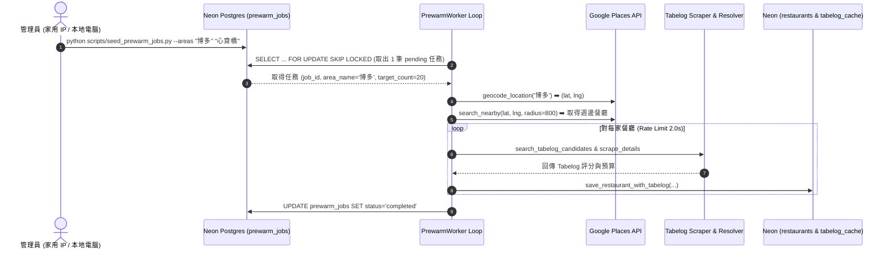

# 🍱 PickForMe - Phase A4 實作計畫：預熱 Worker、Docker 化與 Cloud Run 部署準備

> **目標**：開發依據 Neon Postgres 佇列執行的預熱 Worker (`prewarm.py`)、建置 Cloud Run 容器化設定 (`Dockerfile`, `docker-compose.yml`)，並提供 Telegram Webhook 自動設定 (`setup_webhook.py`) 與自訂預熱區域種子資料指令腳本 (`seed_prewarm_jobs.py`)。

---

## 👨‍💻 User Review Required & Confirmed Decisions

> [!IMPORTANT]
> 1. **預熱 Worker 執行環境 (本地/家用 IP)**：
>    - 由於 GCP / Cloud Run 等機房 IP 較易遭 Tabelog 觸發 HTTP 429 封鎖，Worker 預設於**本地/家用電腦環境**執行 (`python -m src.worker.prewarm`)。出發旅遊前於家用 IP 事先預熱，使線上呼叫直接命中 Neon DB 熱快取。
> 2. **自訂預熱區域種子腳本**：
>    - `seed_prewarm_jobs.py` 提供靈活的 CLI 參數 (如 `python scripts/seed_prewarm_jobs.py --areas "博多" "天神" "新宿"` 或 `--file areas.txt`)，完全由使用者自訂想要的區域。
> 3. **預熱防封鎖爬蟲速率限制 (Scraping Rate Limit)**：
>    - Worker 在處理預熱區域的餐廳清單時，抓取 Tabelog 頁面間隔設為 2.0 秒，並使用 `FOR UPDATE SKIP LOCKED` 併發安全鎖。

---

## 📐 預熱 Worker 架構與資料流 (Pre-warm Data Flow)



---

## 🛠️ Proposed Changes

### 1. 預熱 Repository 與 Worker 模組 (`src/db/repositories/` & `src/worker/`)

#### [NEW] `src/db/repositories/prewarm.py`
- `PrewarmRepository` 類別：
  - `create_job(area_name: str, target_count: int = 20) -> UUID`: 新增預熱任務。
  - `get_next_pending_job() -> Optional[dict]`: 以 `FOR UPDATE SKIP LOCKED` 鎖定並取得下一筆 pending 任務。
  - `update_job_status(job_id: UUID, status: str) -> None`: 更新任務狀態為 `processing`, `completed`, 或 `failed`。

#### [NEW] `src/worker/prewarm.py`
- `PrewarmWorker` 類別：
  - `process_next_job() -> bool`: 執行下一筆預熱任務，包含 Geocoding、Places Nearby 檢索、Tabelog 匹配抓取與 DB 寫入。
  - `run_loop(interval_sec: float = 5.0)`: 持續輪詢執行的背景服務迴圈。

---

### 2. 容器化與本地整合作業 (`/`)

#### [NEW] `Dockerfile`
- 採用 `python:3.11-slim` 基礎鏡像。
- 安裝項目依賴、設定 `PYTHONPATH=.` 與複製模組程式碼。
- 預設啟動命令：`uvicorn src.main:app --host 0.0.0.0 --port 8080`。

#### [NEW] `.dockerignore`
- 排除 `.git`, `.venv`, `__pycache__`, `.env`, `.pytest_cache`, `.coverage` 等暫存檔。

#### [NEW] `docker-compose.yml`
- 定義二個服務：
  - `app`: FastAPI Webhook 伺服器 (Port 8080)。
  - `worker`: 本地預熱 Worker (執行 `python -m src.worker.prewarm`)。

---

### 3. 工具腳本 (`scripts/`)

#### [NEW] `scripts/seed_prewarm_jobs.py`
- CLI 種子腳本：接受 `--areas` / `-a` 參數，將使用者自訂的區域塞入 Neon `prewarm_jobs` 佇列。

#### [NEW] `scripts/setup_webhook.py`
- CLI Webhook 註冊工具：提供 `python scripts/setup_webhook.py --url <URL>`，自動向 Telegram API 註冊並設定 `TELEGRAM_WEBHOOK_SECRET`。

---

### 4. 單元測試 (`tests/`)

#### [NEW] `tests/test_prewarm.py`
- 測試 `PrewarmRepository` SQL 鎖定與狀態切換邏輯。
- 測試 `PrewarmWorker` 在 Mock API / Scraper 條件下的完整預熱流程。

---

## 🧪 Verification Plan

### Automated Tests
```bash
python -m ruff check src/ tests/ scripts/
python -m mypy src/
python -m pytest tests/ -v --cov=src
```

### Manual Verification
1. **Docker 鏡像打包驗證**：
   ```bash
   docker build -t pickforme-app .
   docker run -p 8080:8080 --env-file .env pickforme-app
   ```
   瀏覽 `http://localhost:8080/health` 驗證回傳 `{"status": "ok"}`。
2. **預熱 Worker 測試**：
   執行 `python scripts/seed_prewarm_jobs.py --areas "博多" "心齋橋"` 後啟動 Worker `python -m src.worker.prewarm`，觀察控制台輸出與 Neon DB `tabelog_cache` 資料增長。
