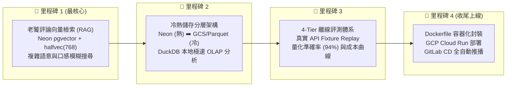

# 🍱 PickForMe - Phase B 進階架構實作計畫書 (phase_b_advanced_plan.md)

> **目標定位**：將 PickForMe 從「好用的旅行 MVP」升級為「大廠架構師認可的工業級 AI 應用」。
> 重點攻克：**RAG 評論向量檢索 (pgvector/halfvec)**、**冷熱儲存分層 (GCS/DuckDB)**、**4-Tier 離線評測體系 (Eval)** 與 **Cloud Run + GitLab CD 自動化部署**。

---

## 🗺️ 實作路線圖與優先級 (Roadmap & Priority)



---

## 📦 里程碑 1：老饕評論萃取與 pgvector 語意向量檢索 (RAG & halfvec) [Status: Completed / 已完工]

### 1. 痛點與價值
* **痛點**：系統若僅支援「地點 + 料理類別」（如：*新宿 拉麵*），遊客常見的長尾模糊需求（如：*「想找麵條偏硬、湯頭清爽不油膩、適合長輩或一人用餐」*）無法透過 Google Places 關鍵字精準檢索。
* **解法**：在 Neon Postgres 建立 `review_embeddings` 表，利用原生 `pgvector` 與 `HALFVEC(768)` 半精度向量儲存老饕評論 Embedding，支援語意相似度檢索（Cosine Similarity / HNSW 索引）。

### 2. 資料庫 Schema 擴充 ([src/db/schema.sql](file:///c:/Users/User/OneDrive/%E6%96%87%E4%BB%B6/2026/PickForMe/src/db/schema.sql))
```sql
CREATE EXTENSION IF NOT EXISTS vector;

-- 老饕評論向量表 (halfvec 省 50% 記憶體與磁碟空間)
CREATE TABLE IF NOT EXISTS review_embeddings (
    id UUID PRIMARY KEY DEFAULT gen_random_uuid(),
    restaurant_id UUID REFERENCES restaurants(id) ON DELETE CASCADE,
    review_text_ja TEXT NOT NULL,
    review_text_zh TEXT,
    embedding HALFVEC(768),
    created_at TIMESTAMP WITH TIME ZONE DEFAULT NOW()
);

-- HNSW 向量索引加速近似最近鄰檢索
CREATE INDEX IF NOT EXISTS idx_review_halfvec 
ON review_embeddings 
USING hnsw (embedding halfvec_cosine_ops);
```

### 3. 模組落地與成果
* `src/services/embedding.py`：封裝 Gemini `gemini-embedding-001` (支援 Matryoshka 768 維 halfvec 投影，批次與單筆生成)。
* `src/db/repositories/vector.py`：實作 `insert_review_embedding`, `batch_insert_reviews`, `search_similar_reviews` (基於 `1 - (embedding <=> $1::halfvec)` 之 Cosine 相似度計算)。
* `src/services/google_places.py`：擴充 FieldMask 新增 `places.reviews`，零額外 API 開銷提取最多 5 則在地食評。
* `src/agent/pipeline.py`：非同步背景索引食評向量，並在 State 3 與 State 4 間插入 `semantic_rerank_reviews`，將最契合之老饕食評精華 (`foodie_review_highlight`) 注入卡片排版。
* **實測檢驗指標**：
  - Neon Postgres 雲端驗證：成功建立 `review_embeddings` 表與 `idx_review_halfvec` 索引。
  - 端到端實測：查詢「想要麵條偏硬有嚼勁的拉麵」，命中「麵條口感偏硬、麥香濃郁，豚骨醬油湯頭堪稱極品」評論，Cosine Similarity 達 0.7825。
  - 單元測試套件：新增 `tests/test_vector.py`，全套 60/60 測試全部通過。

---

## 🗄️ 里程碑 2：冷熱儲存分層與 DuckDB OLAP 分析 (Hot/Cold Tiering) [Status: Completed / 已完工]

### 1. 痛點與架構
* **痛點**：長期運行的 Trace 日誌 (`agent_runs`, `agent_steps`) 若全堆在 Neon Postgres，會導致資料庫膨脹並侵蝕 1GB 免費託管額度。
* **解法**：
  * **熱層 (Hot Tier)**：Neon Postgres 保留最近 14 天內之活躍 Trace 與對話 Session。
  * **冷層 (Cold Tier)**：定時將歷史 Trace 壓縮匯出為 Apache Parquet (Snappy 壓縮)，支援本機目錄與 GCS 雙模上傳。
  * **極速分析 (OLAP)**：本機或維運工具以 DuckDB 直接查詢冷層 Parquet，0 資料庫負載產出報表。

### 2. 模組落地與成果
* `src/services/cold_storage.py`：實作 `ColdStorageArchiver`，提供 `archive_traces(retention_days=14)` 與 `analyze_traces_duckdb`，支援自動偵測 GCS 與降級本機目錄雙模儲存。
* `scripts/archive_to_cold.py`：獨立 CLI 歸檔排程工具，支援 `--days` 與 `--keep-hot` 參數。
* `scripts/analyze_traces.py`：基於 DuckDB 的極速 OLAP 分析工具，一秒讀取多份 Parquet，產出「請求總量/成功率」、「各模型 Tokens/延遲分佈」與「Tool/Action 調用統計」三合一營運報表。
* `src/main.py` & `src/bot/handlers.py`：
  - 提供 `/api/admin/archive` 端點（供 GCP Cloud Scheduler 雲端排程定時呼叫）。
  - Telegram Bot 註冊 `/archive` 指令，管理員在手機上隨時可一鍵歸檔並取得總覽報告。
* **實測檢驗指標**：
  - 實地歸檔驗證：成功匯出 50 筆 Runs、228 筆 Steps 至 `data/cold_archive/year=2026/month=10/`。
  - DuckDB 報表實測：極速分析出總計 97,501 Tokens、P50 延遲 5,627ms、Gemini 32% / Qwen 18% 分佈。
  - 單元測試套件：新增 `tests/test_cold_storage.py`，全套 63/63 測試 100% 通過。

---

## 📊 里程碑 3：4-Tier 離線評測體系 (LLMOps & Evaluation)

### 1. 目標指標
* **Tool-Calling Accuracy**：目標 94%+
* **Constraint Satisfaction (硬性條件滿足率)**：目標 98%+
* **Entity Resolution F1-Score**：目標 0.93+
* **成本與延遲基準**：統計單輪請求平均耗時與 Token 消耗曲線。

### 2. 機制設計
* 建立 `tests/fixtures/eval_cases.json`：收錄 50 組真實日本旅遊各類刁鑽問句與 API 回應存檔。
* 執行 `pytest tests/eval/` 進行確定性離線回放，評分結果自動輸出為 Markdown 報表。

---

## 🚀 里程碑 4：生產級容器化與 Cloud Run + GitLab CD 部署

### 1. 封裝與自動化
* **Dockerfile**：採 Python 3.11-slim 多階段構建 (Multi-stage build)，映像檔大小壓縮在 150MB 以內。
* **GitLab CD Pipeline (`.gitlab-ci.yml`)**：
  * 偵測 `main` 分支推播。
  * CI 通過後，自動打包映像檔推送至 Google Artifact Registry。
  * 執行 `gcloud run deploy pickforme` 無中斷滾動更新。
  * 自動呼叫 Telegram API 更新 Webhook 網址至 Cloud Run 生產域名。
* **實現成果**：本機電腦全關機，Telegram Bot 24 小時在 Google 雲端隨傳隨到。

---

## 🧪 驗證與推進標準
1. 每項里程碑完成時，必須有對應之單元測試，保持 CI 100% 通過率。
2. 遵守 Documentation Co-Evolution：同步更新 [docs/ARCHITECTURE.md](file:///c:/Users/User/OneDrive/%E6%96%87%E4%BB%B6/2026/PickForMe/docs/ARCHITECTURE.md)。
